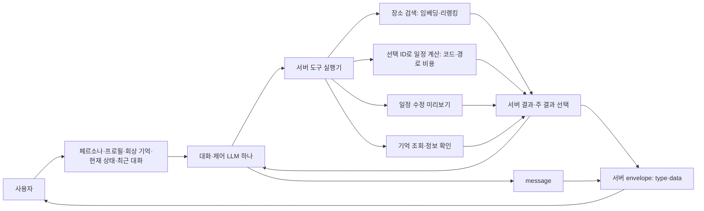

# TravelMate 단일 Agent 평가 V1.4.0

대화·제어 LLM 하나가 가이드 캐릭터와 관계를 유지하고 도구를 호출한다.
LLM은 message·도구 선택·인자·방문할 장소를, 서버는 type·data·순서·시간·동선·저장을 맡는다.
plannerLLM과 managerLLM은 모델 두 개가 아니라 **같은 Agent의 기능별 평가 트랙**이다.
사용자가 지정한 구성은 각 100문항, 코드 검사 + gpt-4.1-mini의 MD Judge다.
기존 V1.3.0 파일과 실행 결과는 변경하지 않는다.



이 그림은 목표 구조다. 실제 저장은 미리보기 후 사용자 확정과 서버 반영 성공 흐름에 속한다.

```text
Evaluation/V1.4.0/
├── common/
│   ├── cases.source.json              # 200문항의 유일한 작성 원본
│   ├── corpus.json · snapshot.json     # 동결한 공통 관광지 근거
│   ├── source_goldenset_v1.3.0.jsonl   # 질문별 사람 판정 원본
│   ├── source_review_notes.csv         # 기존 검수자·판정·메모 보존
│   ├── golden.jsonl · development.jsonl · test.jsonl
│   ├── by_type/{PLACES,PLAN,PLAN_DIFF,CLARIFICATION,TEXT}.jsonl
│   ├── by_track/{search,tool_call,plan,state,memory,behavior,message}.jsonl
│   ├── envelope.schema.json · tool_contracts.json
│   ├── persona/guide_v1.json            # 버전이 있는 성격·관계·말투·경계 예시
│   └── build_dataset.py · metrics.py · runner.py · judge.py · tests/
├── plannerLLM/
│   ├── golden.jsonl                    # 공통 원본에서 생성한 100문항 뷰
│   ├── by_type/ · development.jsonl · test.jsonl
│   └── rubric.md · run.py · results/
└── managerLLM/
    ├── golden.jsonl                    # 공통 원본에서 생성한 100문항 뷰
    ├── by_type/ · development.jsonl · test.jsonl
    └── rubric.md · run.py · results/
```

타입별·기능별 파일은 별도로 편집하는 정답지가 아니라 **자동 생성 뷰**다.
수정은 common/cases.source.json에서만 한다. 한 문항은
`evaluation_tracks: ["tool_call", "search", "message"]`처럼 여러 트랙에 속한다.
장소 관련도는 전역 장소 점수가 아니라 **원래 질문 ID + 장소 ID**에 붙는다.
새 질문에 기존 점수를 조용히 재사용하지 않으며, search 트랙은 원래 질문·조건과 같을 때만 연결한다.

## 응답 타입과 평가

| type | 서버 data | 주요 채점 |
|---|---|---|
| PLACES | 기존 검색과 같은 장소 배열 | Top-1·Top-5·Top-10, Recall@5·@10, 기존 여섯 순위 지표, 도구 인자 |
| PLAN | stops와 미리보기/반영 정보 | LLM 선택 ID·필수/제외, 서버 순서·시간·제공된 비용 행렬의 동선, 설명 |
| PLAN_DIFF | 변경 내역·기준 버전·미리보기/반영 정보 | 수정 도구 인자, 버전·확정·실제 관측 상태, 설명 |
| CLARIFICATION | missing 목록 | ask_clarification과 빠진 항목, 확인 질문의 의미 |
| TEXT | null | 일상 대화·페르소나·기억 활용·답변 보류, 불필요한 도구 호출 |

골든셋의 expected_response_type은 기대 타입, reference는 기대 발화 예시,
reference_envelope은 서버 응답 예시다. 실제 수집 결과의 response.type과 비교한다.
expectations에는 도구·검색·계획·상태·기억·행동의 정답을 나눠 기록한다.
타입 정답과 message의 표현 일치, 서버 data의 보존 여부를 하나의 점수로 섞지 않는다.
ask_clarification.missing은 origin·reference_place 같은 안정적인 필드 ID를 사용한다.
사람에게 보여 주는 한국어 이름은 공통 tool_contracts.json의 clarification_field_labels로 연결한다.
질문 문장의 동의어 때문에 도구 인자 정답이 어긋나지 않게 데이터 ID와 말의 표현을 분리한 것이다.

PLAN/PLAN_DIFF의 data.applied=false이면 proposalId가 있는 변경안이다.
applied=true는 실제 서버 반영 성공 결과가 있어야 하며 planId/version을 포함한다.
최상위 다섯 타입을 유지하면서 미리보기와 실제 반영을 구분하기 위한 **평가용 계약안**이다.
애플리케이션 DTO·API를 구현했다고 표시하지 않는다.

최종 type은 마지막 성공 도구를 무조건 따르지 않는다.
일정 생성 뒤 부가 장소 조회가 있었다면 여전히 PLAN이 주 결과일 수 있다.
관측 레코드의 primary_result_id로 서버가 선택한 주 결과를 지정하고,
해당 결과의 public_data와 응답 data가 같은지 검사한다.
LLM에는 필요한 llm_summary만 보내고 전체 public_data는 서버가 보관한다.

## 기억과 프롬프트

프롬프트는 버전이 있는 페르소나 → 관련된 유효 프로필 → 검색한 기억 →
현재 일정·세션 → 이전 대화 요약 → 최근 대화 → 이번 발화로 조립한다.
토큰 예산·최근 대화 개수·기억 검색 개수는 여기서 임의로 운영 기본값을 확정하지 않는다.
명시 취향 자동 반영, 추론 확인, 리뷰·일기 출처/버전, 계획만 롤백하는 조건을 유지한다.
recall_memory는 내부 근거 조회이며 그 자체가 공개 응답 타입을 덮어쓰지 않는다.

DB 쓰기·기억 검색·마지막 응답을 구분한다. 입력의 memory_sources는 자동 회상한 기억,
fixtures.memory_store는 테스트 도구 실행기만 읽는 가상 저장소다.
도구 회상 문항에서는 이 저장소 전체를 LLM에 먼저 넣지 않는다.
기억 검색은 실제 memory_retrieval_ids가 기록된 경우에만 별도 정답 기억 ID로 채점한다.
관광지 판정표를 기억 정답으로 그대로 쓰지 않는다.

## 실행

저장소 루트 PowerShell 기준. 기존 평가 가상환경을 재사용할 수 있다.

```powershell
.\.venv-ragas\Scripts\python.exe -m pip install -r Evaluation/V1.4.0/common/requirements.txt
.\.venv-ragas\Scripts\python.exe Evaluation/V1.4.0/common/build_dataset.py
.\.venv-ragas\Scripts\python.exe Evaluation/V1.4.0/plannerLLM/run.py check
.\.venv-ragas\Scripts\python.exe Evaluation/V1.4.0/managerLLM/run.py check
```

원본을 수정했을 때만 build_dataset.py --build로 뷰를 재생성한다.
새 빌더는 입력/정답 뷰만 쓰며 수집 응답과 results는 초기화하지 않는다.
seed_cases.py는 최초 작성용이며 원본이 있으면 덮어쓰기를 거부한다.

수집용 입력을 내보낼 때 평가 범위를 명시한다. 아래는 개발 분할 예시다.

```powershell
.\.venv-ragas\Scripts\python.exe Evaluation/V1.4.0/plannerLLM/run.py export-inputs --split development --output planner_inputs.jsonl
.\.venv-ragas\Scripts\python.exe Evaluation/V1.4.0/managerLLM/run.py export-inputs --split development --output manager_inputs.jsonl
```

tested Agent에는 model_input만 전달하고 harness_fixtures는 도구 테스트 실행기가 사용한다.
reference·expectations·사람 점수는 내보낸 모델 입력에 포함하지 않는다.
model_input.tools는 실제 호출에 제공할 도구 스키마이며 페르소나·후보와 함께 입력 해시에 포함한다.
수집기는 입력 파일의 input_sha256을 실제 응답 레코드에 그대로 기록해야 한다.
다른 후보·페르소나·대화·도구 픽스처로 실행된 응답을 섞지 않도록 이 값을 검사한다.

수집한 응답을 평가한다. 아래 코드가 애플리케이션 도구를 실제 실행하거나 DB를 수정하지는 않는다.

```powershell
.\.venv-ragas\Scripts\python.exe Evaluation/V1.4.0/plannerLLM/run.py evaluate --split development --responses planner_responses.jsonl --judge --env-file .env
.\.venv-ragas\Scripts\python.exe Evaluation/V1.4.0/managerLLM/run.py evaluate --split development --responses manager_responses.jsonl --judge --env-file .env
```

--judge를 빼면 코드 검사만 한다. --precheck-only는 유료 모델을 호출하지 않는다.
.env의 OPENAI_API_KEY를 읽으며 기본 평가 모델은 선택한 gpt-4.1-mini다.
RAGAS_JUDGE_MODEL로 명시한 모델을 덮어쓸 수 있다. 키 값이나 제공자 오류 원문은 기록하지 않는다.
GPT 기준별 0~3점은 사용자 정의 MD Judge이며 Ragas 내장 점수로 표시하지 않는다.
평가 결과는 실행마다 새로운 results/실행ID/에 저장한다.

## 수집 레코드

```json
{
  "case_id": "PLR-TM-palaces-01",
  "input_sha256": "내보낸 입력의 실제 해시",
  "response": {
    "type": "PLACES",
    "message": "창경궁을 찾았어.",
    "data": [{"placeId": 378, "name": "창경궁"}],
    "conversationId": "fixture-PLR-TM-palaces-01"
  },
  "tool_calls": [{"name": "search_places", "arguments": {"query": "창경궁", "region": "서울"}}],
  "primary_result_id": "실제 서버 도구 결과 ID",
  "tool_results": [{
    "result_id": "실제 서버 도구 결과 ID",
    "status": "completed",
    "response_type": "PLACES",
    "llm_summary": {"placeId": 378, "name": "창경궁"},
    "public_data": [{"placeId": 378, "name": "창경궁"}]
  }]
}
```

예시는 레코드 형식이며 실제 실행 점수가 아니다.
observations.source=backend_observation인 DB 전후 상태가 있어야 실제 상태 보존을 채점한다.
그 값이 없으면 해당 지표는 null과 별도 평가 건수로 보고하고 통과로 처리하지 않는다.
원본 모델의 잘못된 ID를 측정하려면 validIds 필터 전 tool_calls를 수집해야 한다.
후보 밖 ID 비율을 모든 종류의 환각률이라고 부르지 않는다.

## 해석과 현재 한계

- 기존 사람 검수와 판정은 원본 그대로 보존했다. 새 기능별 기대값·가상 일기·페르소나·도구·일정 픽스처는 Codex가 작성한 평가 초안이다. 새 문항 전체를 사람이 검수했다고 표시하지 않는다. 이 상태가 GPT 평가를 막는 조건은 아니다.
- 개발/시험은 모든 타입·기능에서 source group의 분할을 공유한다. 같은 장소의 분할 간 재사용은 기존 정책대로 허용한다.
- 미판정 장소는 확인된 오답이 아니다. 검색 Recall은 현재 알려진 정답에 대한 값이며 judged@K를 함께 기록한다.
- 계획 순서·시간은 모델 단독 성능이 아니라 서버 도구의 계산 결과 검사다. 합성 비용 행렬은 가상 시간이며 실제 도보 경로·운영시간의 증거가 아니다.
- 비용 행렬의 경로는 출발점에서 선택 장소들을 방문하는 편도다. 귀환을 임의로 추가하지 않는다. route_cost_ratio는 반환 경로 비용 ÷ 같은 선택 집합의 최소 비용이며 1이 최선이다.
- PostGIS만으로 도로 최적 경로나 실시간 이동시간이 자동으로 구해지지는 않는다. 실제 경로 비용 제공자와 코드 최적화기를 연결해야 한다.
- 규칙별·GPT 기준별 점수와 적용 건수를 따로 보고하며 임의의 가중 종합 점수를 만들지 않는다.
- 문항 누락·입력 해시 불일치는 실제 오답으로 숨기지 않고 별도 집계한다.
- 현재 버전은 골든셋·검증기·기록 응답 평가기다. 아직 없는 Agent/도구 API나 두 번째 모델을 구현했다고 주장하지 않으며 실제 모델 성능 점수는 응답을 수집한 뒤 산출한다.
