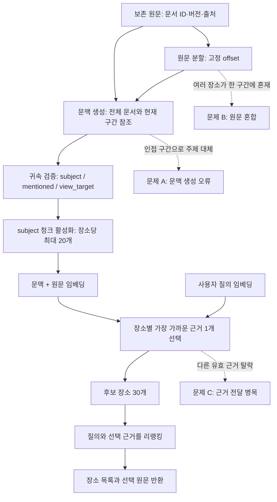

# 문맥 청크 검색의 문제 정의와 해결 실험안

작성일·갱신: 2026-10-31 · 진단 기준: `f90ebfc2` · 상태: **실험 A·B 구현·격리 실측 완료, C·D는 제안**

[실험 A 결과와 실행 기록](../../runs/contextual/multi-evidence-v1/20261031-01/REPORT.md)에
근거 1·2·3개 비교, 회귀 검증, 지연·부하와 남은 생성 오류를 기록했다. 서비스 기본값은 1개로 유지한다.
[실험 B 결과](../../runs/contextual/prompt-grounding-v1/20261031-01/REPORT.md)는 근거 2개를 고정한 v2·v4 비교다.
일부 문맥 오류는 줄었으나 검색 대표 근거 선택은 21/22개로 같았고 v4에도 인접 구간 요약이 남았다. 기본 프롬프트는 v2다.

## 1. 목적과 현재 결론

사용자가 풍부한 자연어로 장소의 특성을 요청하면, 검색기가 맞는 장소와 그 요청을 뒷받침하는 원문을 함께 찾아야 한다.
장소 이름만 상위에 올리는 것과 적절한 추천 근거를 고르는 것을 별도 목표로 둔다.

[실측 보고서](../../runs/contextual/stored-nine-pairs/20261031-01/REPORT.md)는 청담도로공원 원문 22구간·응답 9쌍·질문 26개를 비교했다.
답할 수 있는 22문항에서 목표 장소 1위는 19→21개, 상위 5위이면서 올바른 원문을 선택한 질문은 19→19개였다.
따라서 이 표본에서 장소 순위 개선은 관측됐지만, 근거 선택의 전반적인 개선은 확인되지 않았다.
다른 장소의 관련도를 전수 판정하지 않았으므로 이 수치를 전체 검색 Precision·Recall로 부르지 않는다.

이번 진단은 각 입력 묶음을 따로 활성화한 검색 코어 실험이다. 9개 묶음 전체를 함께 색인한 운영 실험이 아니다.
검수는 에이전트 검수이며 독립적인 사람의 블라인드 검수가 아니다. Spring→Kafka 전달·최종 답변·전체 서비스 지연도 평가하지 않았다.

## 2. 문제가 발생하는 위치



주요 코드: [분할·활성 청크 선택](../../../embedding-server/app/contextual/pipeline.py),
[문맥·원문 결합 계약](../../../embedding-server/app/contextual/contracts.py),
[v2 프롬프트](../../../embedding-server/app/contextual/prompts/v2_contextual_prompt.py),
[검색·리랭킹 런타임](../../../embedding-server/app/kafka_runtime.py).
활성 청크 최대 20개는 저장·색인 단계의 장소별 제한이다. 질의마다 리랭커에 전달할 근거 개수와는 별개다.

## 3. 문제 A — 생성기가 현재 구간의 주제나 장소 귀속을 바꾼다

**관측:** v2의 P09-S02는 다른 공원의 조경·조망을 청담도로공원의 `subject`로 붙였다.
P01-S03·P05-S02·P05-S03·P09-S02는 현재 구간 대신 앞 구간을 요약했다. 귀속 오류와 주제 대체 집계는 중복된다.
문맥이 같은 문서에 실제 존재하는 내용이어도, 그 내용이 현재 청크의 관찰을 대신하면 잘못된 검색 입력이 된다.

**영향:** 생성 문맥이 실제 임베딩·리랭킹 입력에 들어가므로 잘못 붙은 경관이나 시설이 해당 장소의 추천 근거처럼 검색될 수 있다.
스키마·offset 검증 통과는 이러한 의미 오류의 부재를 보장하지 않는다.

**책임과 해석:** 이 오류는 Perplexity를 통해 호출한 Sonar가 문맥을 잘못 생성한 결과이며, 프롬프트 개선의 직접 대상이다.
v2에도 주제 대체와 다른 장소 귀속을 금지하는 규칙이 있었지만 실제 응답에서 지켜지지 않았다.
이는 v2 지시문이 충분히 효과적이지 않았다는 관측이다. 프롬프트로 해결할 수 없다는 결론은 아니다.
한 번의 비교만으로 프롬프트 표현·모델의 지시 준수·입력 혼합 중 어느 요인이 얼마나 기여했는지 확정할 수도 없다.

**해결 제안:** 후속 프롬프트를 별도 버전으로 추가하고, 다음 규칙을 명시적인 사례와 함께 검증한다.

- 생성기는 현재 구간에서 설명하는 장소·시설·행동·관찰을 먼저 식별한다.
- 같은 문서의 다른 구간은 대명사의 대상, 장소 이름, 필요한 배경을 식별하는 데 사용한다. 다른 구간의 경험·평가로 현재 구간을 대체하지 않는다.
- 문맥은 원문을 보충하는 짧은 설명으로 작성한다. 풍부한 감각·감정 표현은 원문에 보존한다. 1~2문장을 선호하되 귀속·부정·조건을 잃는 절대 제한으로 사용하지 않는다.
- 생성기는 화장실의 청결, 주차장의 어두움, 이웃 공원의 경관을 구분한다. 낡음→더러움, 한산함→조용함처럼 원문에 없는 해석을 추가하지 않는다.
- `subject`는 직접 설명하는 장소에만 부여한다. `mentioned`·`view_target`만 있는 청크는 정상적으로 보존하고 해당 장소의 검색 색인에서는 제외한다.
- 귀속을 판단할 수 없으면 `place_refs=[]`, `entities=[]`를 반환한다. 통과시키기 위해 `subject`를 강제하지 않는다.
- 방문 시점·날씨·시간대·전언·의견·개선 제안을 유지한다. 과거 후기를 현재 운영 상태로 확정하지 않는다.

실패 예시는 현재 구간·잘못 생성된 문맥·올바른 문맥을 함께 제시한다. 예를 들어 주소 구간의 문맥은 청담도로공원 주차장 주소를 설명해야 하며,
앞 구간의 삼성해맞이공원 경관을 설명하지 않도록 한다. 프롬프트에 사용한 예시와 별도의 미사용 사례를 구분해 평가한다.
후속 검수는 각 추가 문맥이 원문의 어느 구간에서 뒷받침되는지 확인한다.
같은 문서 밖의 지식이나 출처 없는 주장은 반영하지 않는다. 자동 검사는 형식·추적 가능성을 확인하고, 의미 판정은 원문 대조 검수로 보완한다.
기존 v1/v2/v3 기록과 설정을 덮어쓰지 않는다. 새 버전 이름은 구현 시 등록하고 이번 문서에서는 예약하지 않는다.

## 4. 문제 B — 청크 원문에 여러 장소의 경험이 섞인다

**관측:** P09-S01은 청담도로공원 주차장과 삼성해맞이공원 경관을 함께 포함한다.
현재 분할기는 기본 800글자 안에서 줄바꿈·문장 경계를 찾는다. 장소별 의미 경계를 보장하는 분할기는 아니다.

**영향:** 생성기가 문맥을 정확하게 붙여도, 함께 임베딩한 원문에 다른 장소의 경관이 남는다.
한 청크에 여러 `place_refs`를 넣는 것만으로는 문장별 경험의 주인이 구분되지 않는다.

**해결 제안:** 다른 장소로 경험의 주체가 바뀌는 문장·문단 경계에서 원문을 나누는 분할 전략을 별도 실험한다.

- 새 청크는 보존 원문에서 연속된 구간을 정확히 가리킨다. LLM이 다시 쓴 문장을 원문으로 저장하지 않는다.
- 분할 버전을 올리고 새 offset에서 청크 ID를 생성한다. 기존 청크 ID·검수·벡터는 보존하고 부모 구간과의 연결을 기록한다.
- 별개의 장소를 설명하는 하위 구간에는 각각 확인된 장소 ID를 연결한다. ID가 없는 다른 장소에 대상 장소의 ID를 재사용하지 않는다.
- 여러 장소가 한 문장에 얽혀 분리할 수 없으면 귀속 검수 대상으로 남긴다. 불명확한 구간은 대상 장소의 특징으로 색인하지 않는다.
- 여러 출처의 깨끗함·더러움은 장소뿐 아니라 시설·방문 조건·출처별로 유지한다. 최신 게시글 하나로 과거 관찰을 지우거나 현재 사실을 확정하지 않는다.
- 기존 장소별 활성 청크 상한 20개를 유지한다. 분할로 후보가 늘면 활성화·제외 목록을 기록해 누락을 측정한다.

이 실험은 입력 분할 자체를 바꾼다. 프롬프트만 바꾼 비교와 섞지 않고, 기대 원문은 문서 버전·offset으로 다시 연결한다.
청크 ID가 달라졌다는 이유로 올바른 근거를 오답 처리하지 않는다.

## 5. 문제 C — 리랭커가 필요한 근거를 받지 못한다

**관측:** Q21에서 임베딩 단계의 목표 장소는 4위였지만, 검색기는 실제 혼잡 안내 P08-S02 대신 TourAPI의 ‘관광지. 근린공원’을 선택했다.
현재 SQL의 장소별 `LATERAL ... LIMIT 1`이 한 근거만 선택한다. 리랭커는 전달받지 못한 후기를 복구할 수 없다.

**해결 제안:** 장소 후보와 장소별 복수 근거를 구분해서 수집하고, 질의와 각 근거를 리랭킹한 뒤 장소별로 묶는다.

```text
질의 → 장소 후보 확보 → 후보별 관련 근거 여러 개 확보
     → chunk_id·context_version 기준 중복 제거
     → 질의 × (문맥 + 원문) 쌍을 리랭킹
     → 장소별 점수 집계·근거 묶기 → 장소 목록 반환
```

- 비교의 첫 단계에서는 장소 후보 30개와 출력 20개를 고정한다. 장소별 근거 개수만 바꿔 기존과 비교한다.
- 근거 수 1·2·3개를 실험 후보로 제안한다. 이는 확정 운영값이 아니다. 별도의 전체 pair 수·토큰 예산도 필요하다.
- 장소 점수는 우선 최고 근거 점수로 집계하는 방식을 비교한다. 단순 합산은 청크가 많은 장소를 부당하게 유리하게 만들 수 있다.
- 같은 장소는 결과에 한 번만 반환하고, 근거는 출처·시설·조건과 함께 여러 개 연결할 수 있게 한다.
- ‘야경과 무료 주차’ 같은 복합 조건은 각 조건의 근거가 모두 도달했는지 별도 검사한다. 최고 점수 하나가 모든 조건 충족을 보장하지 않는다.
- 복수 근거를 합쳐 하나의 큰 입력으로 만들기보다 각 쌍을 배치 처리하는 방식을 우선 비교한다. 리랭커 모델을 두 개 띄울 필요는 없다.
- GPU 6GB 환경에서 pair 수·토큰 길이·배치 수·피크 메모리·대기 시간을 측정한다. 품질과 지연의 교환 관계를 보고 근거 수를 결정한다.

반환 형식은 장소 ID와 근거 목록을 서버가 생성하는 방식으로 제안한다.
각 근거에는 `chunk_id`, `context_version`, `source_id`, `source_version`, 원문 offset, 원문, 문맥, 출처를 연결한다.
청크별 점수와 장소별 집계 점수는 구분하고, 점수를 사실 확률이나 정답 확률로 표시하지 않는다.
기존 API의 단일 `evidence` 소비자와 호환할 방법은 구현 전에 확인해야 한다.

## 6. 실험 순서와 판정 기준

다음 순서는 제안이다. 새 평가의 지역·문항 수·개발/시험 분할·최종 지연 목표는 사용자와 확정한 뒤 실행 기록에 명시한다.
이번 26문항은 오류 재현용으로 유지하며 독립 시험셋으로 승격하지 않는다.

| 실험 | 고정할 항목 | 바꿀 항목 | 확인할 결과 |
|---|---|---|---|
| A: 근거 전달 | 저장된 v2 청크·질문·모델·장소 후보·출력 수 | 장소당 리랭킹 근거 수 | Q21 근거 도달·선택, 다른 문항 회귀, pair 증가와 지연 |
| B: 문맥 생성 | 원문·분할·모델·effort·출력 한도·스키마·검색 설정 | 지시문 버전만 | 주제 대체·귀속 오류·조건 누락·유효 근거 제외 |
| C: 장소 경계 분할 | 원문·모델·선정한 지시문·검색 설정 | 분할 전략·버전 | 혼합 귀속 감소, 원문 근거 보존, 상한 20개에 따른 누락 |
| D: 통합 확인 | 선택한 전략과 설정을 기록 | 전체 원문 묶음 활성화 | 장소별 여러 출처 동시 검색, 조건별 근거, 전체 경로 지연 |

각 실험은 기준군을 함께 실행하며 한 단계의 개선이 다음 단계에서도 유지되는지 확인한다.
복수 근거가 문맥 오류를 해결한다고 보거나, 프롬프트 개선이 근거 전달 병목을 해결한다고 간주하지 않는다.

측정값은 다음과 같이 구분한다.

| 대상 | 측정 방법 | LLM 필요 여부 |
|---|---|---|
| 생성 문맥 | 원문 대비 주제 대체·잘못된 귀속·조건 누락·색인 제외 건수. 제외한 유효 구간도 검수 | 사람 검수 또는 보조 judge 가능. 독립 검수 여부 표시 |
| 근거 전달 | 기대 원문이 리랭커 입력에 포함됐는지, 선택 근거가 맞는지 | 고정된 원문 라벨과 코드로 계산 |
| 장소 검색 | Top-1·Hit@K, 판정 풀이 갖춰진 경우 Precision/Recall/F1·NDCG/MAP/MRR | 장소별 관련도 라벨과 코드로 계산. 문장형 reference 불필요 |
| 복합 조건 | 필수 조건별 원문 도달·선택과 전체 조건 충족률 | 조건별 근거 라벨과 코드 검사, 의미 판단은 검수 보완 |
| 지연·자원 | 임베딩·DB·리랭킹·대기·전체 시간, 예열/첫 실행, p50/p95와 표본 수 | 계측 코드로 측정 |
| 최종 안내 | 문장의 원문 근거, 사실 과장, 거절·되묻기, 도구 결과 일치 | 별도 응답 평가. 이번 검색 진단에는 포함되지 않음 |

미판정 장소를 확인된 오답처럼 보고하지 않는다. 전체 Precision·Recall을 보고하려면 평가 풀과 미판정 비율을 함께 공개한다.
리랭커가 부정·다른 장소 귀속을 항상 걸러낸다고 가정하지 않는다. 어려운 오답을 평가에 포함한다.
예상 질문 확장은 현재 비활성 상태를 유지하고, 기본 근거 품질과 전달 문제를 검증한 뒤 별도 실험으로 다룬다.

## 7. 재현 자료와 변경 범위

각 실행에는 원문·분할·요청 설정·모델 응답·활성 청크·질의·기대 원문·리랭커 입력/출력·집계·코드 SHA·해시를 연결한다.
`source_id + source_version + start/end`로 원문을 찾고, `chunk_id + context_version`으로 실제 색인 입력을 찾는다.
오프셋·역할 검증과 의미 검수를 별개로 기록한다. 저장 원본과 과거 보고서를 수정해 새 결과처럼 만들지 않는다.

현재 게시 커밋에는 집계·검수·질문·실행/정리 메타데이터가 있지만, 보고서가 참조하는 `prepared.json`과 개별 검색 응답은 포함되지 않았다.
게시된 `scores.json` 재집계는 가능하지만, 그것만으로 원문 대조와 검색 재실행을 독립적으로 완료할 수는 없다.
후속 실행은 로컬 전용 자료와 공개 자료를 구분한 목록·해시를 제공하고, 허용된 자료의 보관 위치와 접근 방법을 기록해야 한다.
API 키·인증 정보는 재현 자료에 포함하지 않는다.

초기 문서 커밋 `4ed97294`는 문제 정의와 해결 실험안만 추가했다.
후속 실험 A는 복수 근거 조회·점수 집계·예산 검사와 격리 실행기를 구현하고 보존된 v2로 실측했다.
실험 A에서는 프롬프트·분할·고정 질문을 유지했고 유료 호출이 없었다.
그다음 실험 B에서 v4를 선택 버전으로 추가하고 같은 조건의 새 응답 9개를 생성했다. API 보고 비용은 US$0.01505다.
분할·고정 질문·검증 규칙은 유지했다. 운영 DB 적용·서비스 재배포·develop 병합은 두 실험 모두 하지 않았다.
