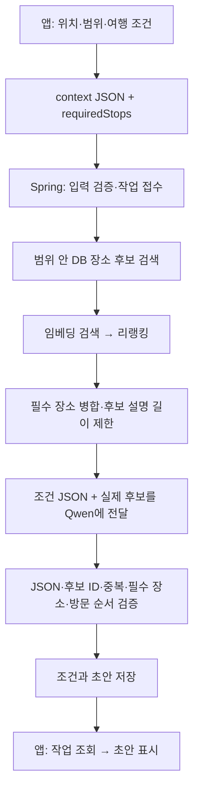

# 여행 조건 Context 전송 및 Qwen 파이프라인 구현·검증

작성일: 2026-10-13

## 기준 명세와 구현 범위

- `TravelMate_server_specification.pdf`의 **08 일괄 생성 요청 예시**를 요청 JSON의 기준으로 사용했다.
- DOCX에 포함된 위치 선택·여행 조건·장소 담기·일정 편집 화면 이미지를 확인했다.
- 사용자 확인 흐름: **현재 위치 또는 원하는 위치 선택 → 여행 범위 설정 → AI로 한 번에 / 장소를 하나씩 선택 → 공통 여행 조건 입력 → 선택한 방식으로 진행**.
- 이번에 확인한 범위는 조건 입력, 서버 전송, 범위 내 의미 검색, Qwen을 이용한 후보 선택, 결과 검증 및 초안 저장이다. 문서 전체의 경로 계산·일정 편집·도구 호출 기능이 완성된 것은 아니다.

## 화면과 상태

- `TravelPlanningScreen`: 위치 선택, 공통 조건, 직접 장소 선택, 초안 결과 화면.
- `TravelPlanningViewModel`: 화면 단계, 선택 방식, 위치·범위, 여행 조건, 필수 장소, 제출 상태 관리.
- `SearchViewModel`: 검색 요청·결과 및 지도 선택 상태 관리.
- `TravelPlanningState`, `TravelConditions`: 두 방식에서 유지하는 입력 상태.
- `PlanningStep`, `PlanningMode`, 위치 선택·이동수단 등의 값은 Enum으로 관리한다.
- 공통 UI는 `Android/app/src/main/java/com/ssafy/travelmate/common/components/`에서 관리한다.
- 전체 화면을 덮던 지도를 위치 선택 화면의 제한된 높이 영역으로 변경했다. 검색창, 조건 카드, 버튼은 파란색 테마에 맞췄다.
- 지도에서 중심을 선택하고 반경을 조절하면 범위가 표시된다. 출발지는 검색 중심과 별도 값으로 유지한다.
- 현재 위치는 Android 위치 권한을 요청해 가져오며, 실패하면 지도에서 위치를 선택할 수 있다.

## 요청 구조

최상위 필드는 `context`, `inputMethod`, `requiredStops`이다.

```json
{
  "context": {
    "area": {
      "type": "CIRCLE",
      "center": { "lat": 37.5820858828, "lon": 126.9846616856 },
      "radiusMeters": 3000
    },
    "origin": {
      "coordinate": { "lat": 37.5820858828, "lon": 126.9846616856 },
      "label": "검증 출발지",
      "source": "SELECTED_POINT"
    },
    "destination": null,
    "startAt": "2026-10-13T10:00:00+09:00",
    "endAt": "2026-10-13T17:00:00+09:00",
    "transportMode": "WALK",
    "objective": "DISTANCE",
    "preferences": {
      "themes": [],
      "avoid": [],
      "pace": "RELAXED",
      "partySize": 1,
      "budgetKrw": null
    },
    "categoryRequirements": [],
    "additionalRequest": "조용한 산책 장소",
    "unknownHoursPolicy": "ALLOW_WITH_WARNING"
  },
  "inputMethod": "TEXT",
  "requiredStops": [{ "placeId": 249, "stayMinutes": 40 }]
}
```

위 값은 실기기 테스트가 서버에 보낸 요청을 바탕으로 생략 가능한 null 필드를 정리한 예시다. 좌표는 테스트에 사용한 DB 장소 좌표이며 사용자의 GPS 위치가 아니다. 날짜와 장소 ID를 고정 기본값으로 사용하지 않는다. 테스트 계정과 생성 초안은 검증 후 삭제했다.

- 날짜와 시간은 `+09:00`을 포함한 문자열로 전송하고 서버에서도 오프셋을 보존한다.
- 추가 요청·취향은 `context`에 유지한다. 필수 장소는 별도의 `requiredStops`에 담는다.
- 현재 입력 UI는 텍스트 방식이므로 `inputMethod=TEXT`다. 음성 인식은 연결하지 않았다.
- 사용자 UID는 요청 본문에 넣지 않고 인증된 JWT 사용자로 식별한다.

## 실제 연결한 API

| 메서드 | 경로 | 역할 |
|---|---|---|
| GET | `/api/places/search` | 기존 검색 유지, 위치 선택 단계에서 사용 |
| POST | `/api/v1/places/search` | `context`, `query`, `limit`을 받아 범위 내 의미 검색 |
| POST | `/api/v1/plans/generations` | AI 생성 작업 접수, HTTP 202 및 작업 ID 반환 |
| GET | `/api/v1/planning-jobs/{jobId}` | 생성 작업 상태·결과 ID·실패 이유 조회 |
| POST | `/api/v1/plans` | 직접 고른 장소와 조건으로 초안 저장 |
| GET | `/api/v1/plans/{planId}` | 저장한 조건·장소·체류시간·주의사항 조회 |

생성·직접 저장 요청에는 `Idempotency-Key` UUID를 사용한다. 같은 사용자·작업 종류·키·본문은 기존 작업 또는 결과를 반환하고, 같은 키에 다른 본문을 보내면 HTTP 409를 반환한다. 작업과 초안 조회는 소유자 조건으로 제한한다.

## AI 생성 파이프라인



1. `ContextPlanningController`가 인증 사용자와 요청 DTO를 서비스로 전달한다.
2. `ContextPlanningService`가 검증, 중복 요청 처리 및 비동기 작업을 관리한다.
3. `PlaceSemanticSearchRepository`가 중심·반경 조건을 **후보 top-K 선택 전에** 적용한다. 공간 필터는 Haversine 거리 계산을 사용하며 PostGIS 기반 경로 계산은 아니다.
4. 기존 임베딩·리랭킹 서비스를 사용한다. 생성용 후보는 필수 장소와 합쳐 최대 10곳을 구성한다.
5. `ContextPlanPromptFactory`가 전체 요청과 실제 후보를 프롬프트에 넣는다. 후보 설명은 장소당 최대 400자로 제한한다.
6. `OllamaLlmClient`가 실제 `qwen3:8b`를 호출한다. JSON 출력, thinking 비활성화, 출력 토큰 제한 및 통신 제한 시간을 적용했다.
7. `ContextPlanResultValidator`가 빈 결과, 후보 밖 장소, 중복, 잘못된 순서, 필수 장소 누락, 여행 가능 시간을 넘는 체류시간을 거절한다.
8. `ContextPlanRepository`가 기존 `plans`, `pins`에 초안을 저장하고 `context`, 원래 요청, 체류시간을 함께 유지한다.

직접 선택 방식은 Qwen을 거치지 않는다. 동일한 조건과 선택한 `requiredStops`를 서버에 보내 초안으로 저장한다.

## 검증 결과

| 검증 | 결과 |
|---|---|
| Android 빌드 및 단위 테스트 | 성공: 검색 4개, 조건·전송 계약 4개, 기존 기본 테스트 1개 |
| 서버 계약·파이프라인 단위 테스트 | 4개 통과 |
| 실기기 조건 입력 → 검색 → 장소 담기 → 저장 | 1개 E2E 통과, 최종 실행 약 43.7초 |
| 실기기 입력과 서버 반환 Context 비교 | 일치 |
| 수동 초안 저장 및 조회 | HTTP 201, 조건·체류시간 유지 |
| 동일 요청 재전송 | 같은 결과 반환 |
| 같은 키에 다른 본문 | HTTP 409 |
| 잘못된 중첩 범위 값 | HTTP 400 |
| Context 기반 의미 검색 | HTTP 200, 검증 요청 결과 3곳 |
| 실제 Qwen 생성 | HTTP 202 접수 후 `SUCCEEDED`, 6개 장소 초안 저장 |
| 생성 후 조건·필수 장소 확인 | 유지 확인 |

최종 서버 실행 기록에서 `SEARCHING → GENERATING → VALIDATING_RESULT → SUCCEEDED`를 확인했다. 해당 실행의 검색·리랭킹 구간은 약 42초, Qwen 호출은 약 56초였다. 단일 로컬 실행의 관측값이며 성능 보장 수치는 아니다.

초기 전체 설명 전달 방식의 생성은 실패했다. 이후 후보 설명 길이 제한, JSON 출력 지정, 실패 기록을 적용했고 수정본의 실제 생성 성공을 확인했다.

### 검증 증거 파일

- `Android/app/build/e2e/context-server-verification.json`
- `Android/app/build/e2e/device-received-context.json`
- `Android/app/build/e2e/planning-device-result.txt`
- `Android/app/build/e2e/planning-location.png`
- `Server/TravelMate/build/local-server.stdout.log`의 `planning job=` 기록

`build/` 아래 파일은 로컬 검증 산출물로, 정리 또는 clean 빌드 시 사라질 수 있다. 서버 전체 로그에는 기존 인증 코드가 출력하는 민감 정보가 섞일 수 있으므로 원문을 공유하지 않는다. 테스트 계정·초안·Redis 토큰·기기 인증 fixture는 검증 후 정리했다.

## 실행 환경과 DB 변경

- 검증 기기: Samsung SM-A155N, Android 15.
- Wi-Fi로 앱에서 서버에 연결했으며 USB 포트 전달에 의존하지 않았다.
- 검증 당시 서버 주소: `http://172.30.1.81:8080/`. PC IP가 바뀌면 Android 로컬 `.env`의 `SERVER_URL`을 수정하고 다시 빌드해야 한다.
- Redis: 로컬 Docker `travel-redis`, `127.0.0.1:6379`, 영속 볼륨 사용.
- 기존 `provider_id` 보완: `Docker/migrations/20261013_add_user_provider_id.sql`.
- 여행 조건 저장 추가: `Docker/migrations/20261013_add_planning_context.sql`.
- 추가 컬럼: `plans.context`, `plans.request_payload`, `pins.stay_minutes`.
- 추가 테이블: 사용자·멱등 키·요청 본문·상태·결과를 저장하는 `planning_jobs`.
- 기존 데이터를 삭제하는 reset 스크립트는 실행하지 않았다. 새 DB 초기화에도 계획 Context 마이그레이션이 적용되도록 Compose에 연결했다.

## 남은 작업과 제한

- **실제 도보 경로 조회, 이동시간 계산, 방문 시간표 확정, 거리·시간 최적화는 아직 미구현이다.** 목표와 조건을 저장·전달하는 것과 조건 충족을 계산으로 보장하는 것은 다르다.
- **운영시간 정규화·검증은 아직 미구현이다.** 현재 `EXCLUDE` 요청은 명시적 오류 또는 실패로 처리한다. `ALLOW_WITH_WARNING`을 선택하면 확인이 필요한 초안으로 저장한다.
- 문서의 Qwen **도구 호출 반복 실행과 `PlannerDecision` 스키마**는 아직 연결하지 않았다. 현재는 서버가 후보를 준비하고 Qwen이 후보 선택 JSON을 반환하는 방식이다.
- 자동차, REGION 사전 검색, 고정 방문시간, 예산 검증은 현재 지원하지 않으며 관련 요청을 명시적으로 거절한다.
- 직접 담기의 카페 필수 조건 등은 Context에 보존되지만, 문서에 있는 확정 전 종합 검증·조건 충족 배지는 아직 완성하지 않았다.
- `avoid`, 여행 속도, 인원, 예산 등 DTO 필드 전체를 편집하는 UI는 아직 제공하지 않는다. 현재 화면에서 제공하는 조건과 DTO 기본값을 구분해야 한다.
- 일정 수정 API, 실제 경로선, 방문·순서 고정, 버전 충돌 처리, 일정 확정, 채팅 동기화, 음성 입력은 후속 작업이다.
- 지도 이미지와 운영시간·이동시간을 임의 값으로 만들어 검증 완료처럼 표시하지 않는다. 현재 결과는 확인이 필요한 **초안**이다.

## 다음 구현 순서

1. 장소 운영정보를 정규화하고 방문 날짜 기준의 확인 가능 여부·오류를 반환한다.
2. 실제 경로 어댑터와 일정 배치·검증기를 연결한다.
3. 공통 초안 편집기에 순서·체류·고정 수정, 버전 관리, 확정을 연결한다.
4. 문서의 도구 정의와 최종 출력 스키마로 Qwen 도구 호출 흐름을 확장한다.

이 문서는 구현 및 검증 이력이다. 원본 PDF/DOCX의 전체 목표 명세를 대체하지 않는다.
