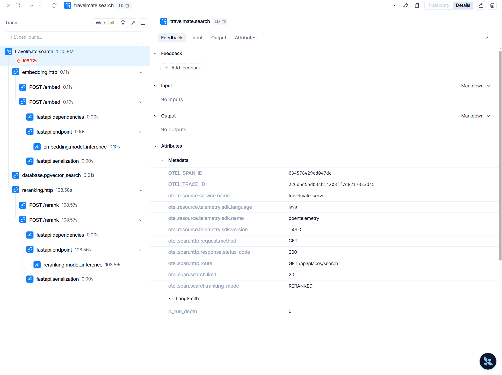
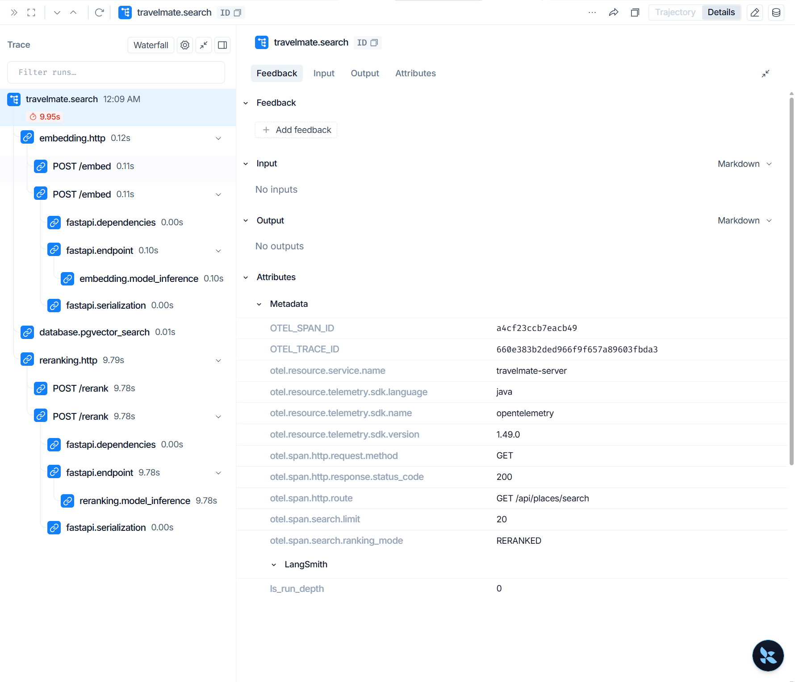

# 검색 API 단계별 LangSmith 계측 기록

- 기록일: 2026-10-24 (KST)
- 평가 데이터셋: `Evaluation/v1.3.0/development.jsonl`
- 실행 범위: `TM-palaces-01` 1문항, `창경궁을 찾아줘`
- API: `GET /api/places/search`, 결과 제한 20개
- 비교 전략: `v1_semantic_only`와 `v2_reranked`
- LangSmith 프로젝트: [`travelmate-search-observability`](https://smith.langchain.com/o/eb9e01f0-f51b-44d0-a2d2-bc6f3f239c15/projects/p/be665de5-ef04-44e3-92f1-362740f035a9)

## 측정 결과

| 단계 | v1 의미 검색 | v2 리랭킹 | 의미 |
|---|---:|---:|---|
| Spring `travelmate.search` | 0.322초 | 108.723초 | Spring 검색 API 요청 전체 |
| Spring→FastAPI `embedding.http` | 0.235초 | 0.111초 | 임베딩 서비스 HTTP 요청 왕복 |
| FastAPI `embedding.model_inference` | 0.131초 | 0.103초 | 임베딩 모델 추론 |
| PostgreSQL `database.pgvector_search` | 0.027초 | 0.005초 | 벡터 DB 검색 |
| Spring→FastAPI `reranking.http` | 없음 | 108.584초 | 리랭커 서비스 HTTP 요청 왕복 |
| FastAPI `reranking.model_inference` | 없음 | 108.564초 | 리랭커 모델 추론 |

해당 요청에서 리랭커 추론 span이 약 108.6초였고, 전체 API trace의 대부분을 차지했습니다. 검색 API의 `limit`은 20이지만, 리랭커는 의미 검색으로 가져온 후보 30개 각각에 대해 query-text 쌍을 점수화합니다. FastAPI 설정은 CPU 장치를 사용합니다. 모델은 모듈 초기화 때 생성되고 추론 span은 `model.predict()` 호출 주위에 있으므로, 이 108.6초는 앱 시작 시 모델 파일을 불러온 시간은 아닙니다. 단, span에는 후보 텍스트 토큰화와 배치 준비 등 `predict()` 내부 작업도 포함될 수 있어 순수 행렬 연산 시간이라고 단정하지 않습니다.

이번 평가 실행은 질문 1개에 대해 semantic-only와 reranked 두 전략을 각각 요청했습니다. 스크린샷은 그중 reranked 요청 하나입니다. v1은 약 0.32초, v2는 약 108.72초였습니다. 이는 지연 원인 탐색을 위한 단일 실행 관측값이지, 전체 데이터셋의 성능 통계가 아닙니다.

## LangSmith에서 확인

위 프로젝트 링크를 열고 다음 trace ID를 검색합니다.

- v1 의미 검색: `afca95ea2006bafdfaa243a7e513c17f`
- v2 리랭킹: `226d5d55d03cb14203ff7d8217323d45`

각 `travelmate.search` trace에서 하위 `embedding.http`, `database.pgvector_search`, `reranking.http` span을 열면 서버 간 요청과 모델/DB 작업 시간을 확인할 수 있습니다. API 전체 시간은 root span에서 확인합니다.

v2 trace 상세 화면을 실행 증거로 함께 보관했습니다. 화면에는 root `travelmate.search` 108.72초, `reranking.http` 108.58초, `reranking.model_inference` 108.56초, HTTP 상태 200, `RERANKED`, limit 20이 표시됩니다. LangSmith UI는 짧은 span 시간을 반올림해 보여주므로 표의 세 자리 수치와 화면의 0.11초/0.01초 표시는 정밀도 차이가 있습니다.

## 계측 구성과 근거

- [계측 구성 및 실행 방법](../Docker/OBSERVABILITY.md): trace 트리, 환경 변수, 데이터 수집 범위
- [검색 요청 root span 필터](../Server/TravelMate/src/main/java/com/yollo/TravelMate/config/observability/SearchRequestTraceFilter.java)
- [Spring tracing 설정과 전파 유틸리티](../Server/TravelMate/src/main/java/com/yollo/TravelMate/config/observability/)
- [FastAPI tracing 초기화](../embedding-server/app/observability.py)
- [FastAPI endpoint span](../embedding-server/app/main.py)
- [임베딩 추론 span](../embedding-server/routers/embed.py)
- [리랭킹 추론 span](../embedding-server/routers/rerank.py)
- [실행 선택과 완료 상태](../Evaluation/datasets/v1.3.0/development_run.json)
- [v1 API 실행 결과](../Evaluation/datasets/v1.3.0/api_embedding/v1.jsonl)
- [v2 API 실행 결과](../Evaluation/datasets/v1.3.0/api_reranking/v2.jsonl)

`embedding.http`와 `reranking.http`에는 네트워크 왕복뿐 아니라 서버 처리 대기와 요청/응답 직렬화가 포함됩니다. HTTP 시간과 FastAPI span의 차이는 순수 네트워크 시간이 아닙니다. DB span도 DB 서버 내부의 순수 실행만이 아니라 해당 계측 구간에서 수행한 클라이언트 작업을 포함할 수 있습니다.

이 HTTP 측정 당시에는 route, 상태, ranking mode, limit, 후보 개수 등 운영 메타데이터를 전달했습니다. 이후 CQRS 검색어·필터·리랭커 상세 계측은 [현재 진단 안내](../Docker/RERANKING_DIAGNOSTICS.md)를 참고하세요.

## 실행 및 검증 메모

- 실행 구간: `2026-10-24 14:10:17Z`–`14:12:06Z` (KST `23:10:17`–`23:12:06`)
- Docker에서 Spring, FastAPI, PostgreSQL, Redis를 기동한 뒤 실제 검색 API를 호출하고 LangSmith에 trace가 올라온 것을 확인했습니다.
- `compileJava`, Python 구문 검사, Docker 설정 검사, 자격 증명 전달 단위 테스트는 통과했습니다.
- 호스트에서 실행한 전체 Java 테스트는 18개 중 2개가 실패했습니다. 테스트 환경에서 Redis/Ollama 연결을 사용할 수 없었던 환경 의존 실패이며, 계측 경로 자체의 통과 여부로 해석하지 않습니다.
- 전체 80문항이나 반복 실행은 수행하지 않았습니다. 이번 기록으로 확인되는 것은 한 질문의 단계별 지연과 trace 연결입니다.

## GPU 후속 측정 (2026-10-25 KST)

확인한 로컬 GPU는 NVIDIA GeForce RTX 4050 Laptop GPU이며 전용 메모리는 6,141 MiB입니다. Docker의 `--gpus all` 테스트에서 장치가 보이는 것을 확인했습니다. 기존 컨테이너는 CPU 전용 PyTorch 패키지를 사용하고 있었습니다.

CUDA 12.9 지원 PyTorch 이미지와 GPU Compose 오버레이를 추가했습니다. 임베딩은 CPU, 리랭커는 CUDA에서 실행합니다. GPU 오버레이는 CUDA를 필수로 하며, 장치가 없으면 CPU로 조용히 대체하지 않고 시작을 실패시킵니다. LangSmith `reranking.model_inference` span에 실제 장치를 `reranking.device`로 기록합니다.

같은 `TM-palaces-01` 질문과 30개 후보를 비교한 단일 실행 결과입니다.

| 측정 | 기존 CPU 실행 | RTX 4050 GPU 실행 |
|---|---:|---:|
| Spring 검색 전체 trace | 108.723초 | 첫 호출 13.024초 / 반복 9.954초 |
| Spring→FastAPI `reranking.http` | 108.584초 | 첫 호출 12.879초 / 반복 9.785초 |
| FastAPI `reranking.model_inference` | 108.564초 | 첫 호출 12.867초 / 반복 9.775초 |
| 리랭커 장치 | CPU 폴백 | `cuda` |

반복 호출은 CPU 측정에 비해 약 10.9배 빨랐습니다. 첫 호출은 약 8.4배 빨랐습니다. 평가 JSONL의 요청 시간은 첫 호출 13.047초, 반복 호출 9.969초이며, v1 의미 검색은 각각 약 0.563초와 0.251초였습니다. 두 GPU 실행에서 전달받은 LangSmith 식별자는 `00000000-0000-0000-c1c6-36a059a1ec50`과 `00000000-0000-0000-a4cf-23ccb7eacb49`입니다. 아래 반복 실행 캡처에서 두 번째 식별자의 마지막 16자리 `a4cf23ccb7eacb49`가 `OTEL_SPAN_ID`와 일치합니다. 화면의 실제 `OTEL_TRACE_ID`는 `660e383b2ded966f9f657a89603fbda3`입니다. 두 실행 모두 한 문항만 측정했으므로 전체 성능 결론이 아니라 GPU 기준 관측값입니다.

두 번째 GPU 실행의 LangSmith 화면은 root `travelmate.search` 9.95초, `reranking.http` 9.79초, `reranking.model_inference` 9.78초, HTTP 상태 200 및 `RERANKED` 모드를 보여줍니다. 이 반복 실행의 전체 시간은 CPU 108.723초 대비 약 10.9배 짧습니다.

비교한 모델은 양쪽 모두 `BAAI/bge-reranker-v2-m3`, 후보도 30개로 같지만 PyTorch 빌드는 CPU `2.14.1+cpu`, GPU `2.13.0+cu129`로 다릅니다. 따라서 이번 수치는 GPU 전환의 실측 참고값이며, 완전히 통제된 벤치마크는 아닙니다. 이 측정 당시에는 FP16을 적용하지 않았고 GPU는 FP32였습니다. 이후 고정 입력 FP32·FP16 비교 결과는 [벤치마크 JSON](../embedding-server/reports/reranker-comparison-20261025.json)에 있습니다.

실행 후 `reranking.model_inference` span에 `reranking.device=cuda`, `reranking.candidate_count=30`가 실제 기록됐습니다. 모델 로딩 직후 유휴 시 GPU 메모리 사용량은 약 1,653 MiB였고, 요청 후 `nvidia-smi`가 표시한 사용량은 4,099/6,141 MiB였습니다. 이는 샘플 측정치이며 피크 VRAM은 별도 계측하지 않았습니다.

- GPU 이미지 검증: 컨테이너에서 `torch.cuda.is_available()`이 `True`, 장치가 RTX 4050으로 확인됐습니다.
- 런타임 검증: embedding 컨테이너 healthy, 로그에 `device=cpu`(임베딩) 및 `device=cuda`(리랭커)가 출력됐습니다.
- Compose GPU 설정 검증 통과, Docker GPU 오버레이로 컨테이너를 재기동했습니다.
- RAGAS LLM 점수는 reference 누락으로 이번 실행에서도 계산하지 않았습니다. 마지막 반복 실행 세부는 `Evaluation/v1.3.0/development_run.json`과 `api_reranking/v2.jsonl`에 있습니다.

GPU 설정은 [Docker 계측 및 GPU 실행 안내](../Docker/OBSERVABILITY.md)에 설명했습니다. PyTorch CUDA wheel은 공식 [PyTorch 설치 안내](https://pytorch.org/get-started/previous-versions/)의 CUDA wheel 방식에 맞춰 사용했습니다.
