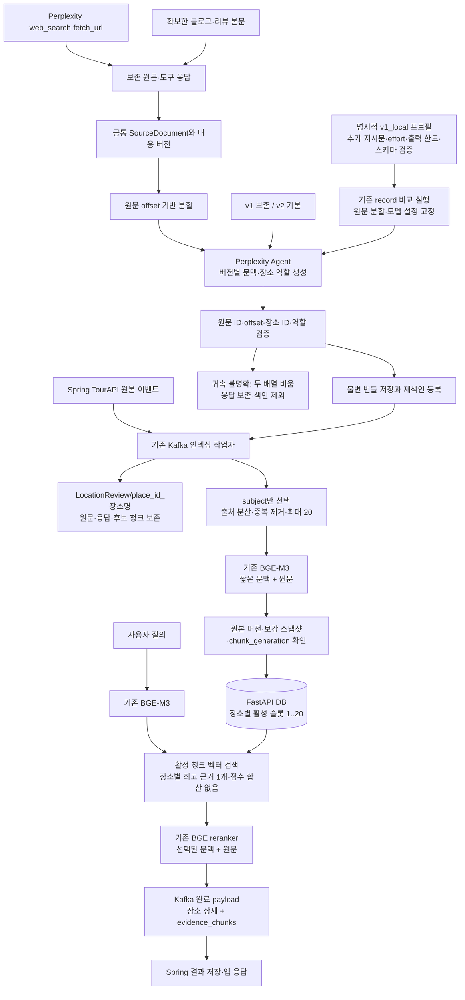
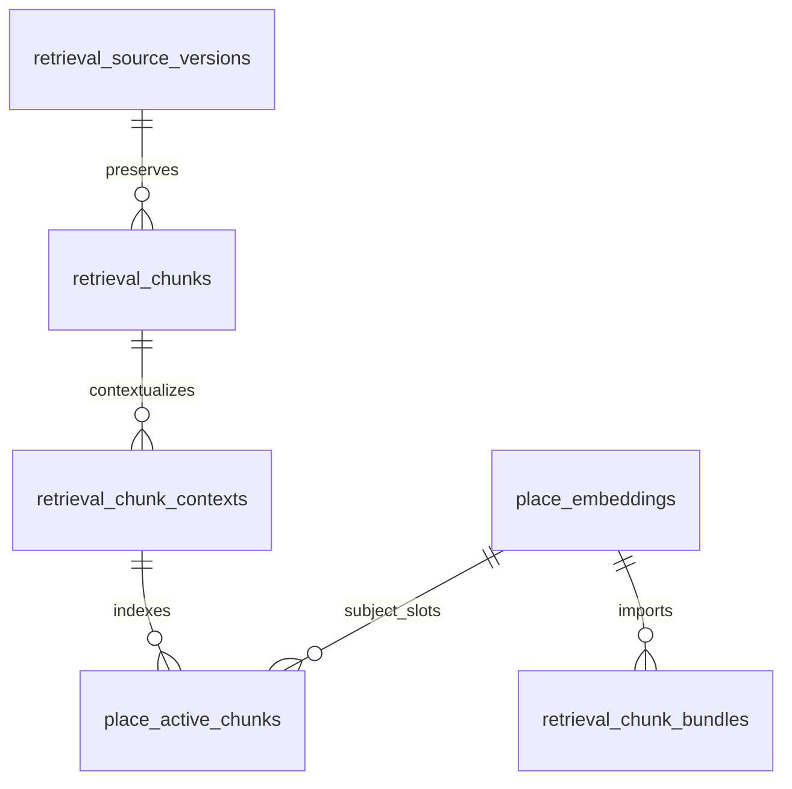
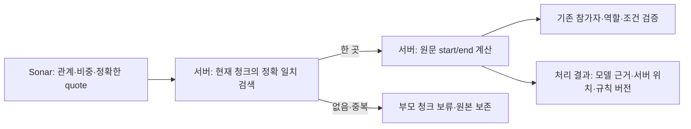
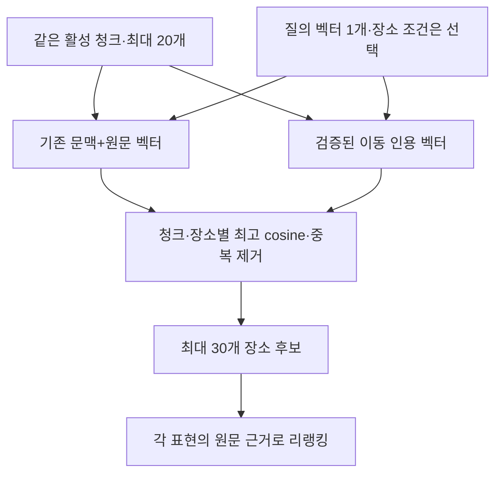
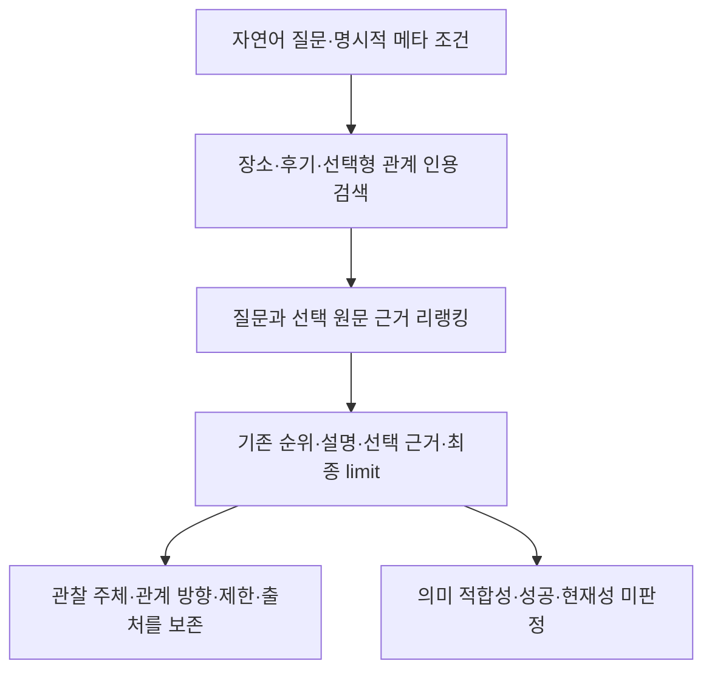

# 장소별 공통 청크 검색 구조

문서 버전: 2 · 갱신: 2026-11-01

[계획](../plans/contextual-retrieval.md) · [상세 명세·DB 이행](../specifications/contextual-retrieval.md)

청크는 전역 UUID이고 장소와 N:M 관계다. `place_refs`는 원문 청크의 subject/view_target/mentioned를 보존하며,
실제 검색 연결인 place_active_chunks에는 subject만 들어간다. 청담도로공원의 벤치에서 청담대교가 보이는
후기가 있을 때 공원의 시설을 대교의 시설로 색인하지 않는다. 여러 subject를 실제로 다루는 청크는
각 장소의 20개 제한에 각각 포함된다.

생성·수집은 오프라인 관리 작업이며 추천 요청은 Perplexity를 호출하지 않는다.
DB 트랜잭션은 네트워크 호출·모델 추론 동안 잡지 않는다. 활성 집합은 추론 뒤 최신 세대를 확인하고 원자 교체한다.
Spring DB와 FastAPI DB 사이 JOIN/FK는 없다. 새 FK는 FastAPI 검색 DB 내부에만 존재한다.
기존 무청크 장소는 호환 벡터로 조회할 수 있으므로 단계별 재색인이 가능하다.
v2에서도 같은 문서의 다른 구간은 장소 식별이나 필요한 배경에 활용한다. 청크 밖 정보 전체를 금지하지 않는다.
baseline 비교는 모델/프리셋 선택까지 고정하지만 공급자가 반환한 실제 모델도 별도로 비교해 기록한다.
로컬 프로필 비교는 보존 요청을 복사해 instructions만 교체한다. 표준 v1 검증은 유지하고, 기존 원본 파일은 수정하지 않는다.
새 기록의 프로필 ID는 요청 해시·청크 generation·비교 보고서에 연결되며, 기본 실행은 네트워크 호출 없는 미리보기다.
검증기의 형식/역할 일치 확인만으로 장소 귀속·문맥의 의미 정확성이나 실제 품질 향상을 보증하지 않는다.

## 선택형 v8 관계 인용 위치 계산

v8의 관계 evidence는 모델이 정확한 quote만 반환한다. 청크 자체의 좌표는 기존 서버 분할 값을 그대로 복사한다.
서버는 현재 청크에서 인용의 유일한 정확 일치를 찾아 원문 위치를 계산한 뒤 기존 관계·관찰 검증을 수행한다.
없음·중복 인용은 보류하며, 현재 정책은 부모 청크 전체 제외다. 모델 반환 원본과 서버 계산 이력은 별도로 보존한다.

기존 v7 기록은 명시적인 검증 v5로 무료 재처리하며, 원래 v7 검증 v4와 원본 4개 파일을 바꾸지 않는다.
v8은 출력 스키마 변경이므로 지시문 전용 비교와 구분한다. 기본값·DB·검색 후보 정책은 바뀌지 않는다.
[실행 예시·결과와 한계](../../Evaluation/runs/contextual/v8-server-evidence-v1/20261101-01/REPORT.md)

## 선택형 이동 근거 벡터 검색

`chunk-only`가 기본값이다. `chunk-and-relation-v1`을 선택하면 같은 활성 청크의 실제 이동 인용을 별도 벡터로 보존한다.
검색은 여전히 place_active_chunks를 통하며 장소별 20개를 유지한다. observation 필터가 없는 일반 의미 검색에서도 같은 질의 벡터로 관계 인용을 함께 검색한다.
출발지·도착지는 선택 조건이다. 명시적 이동 필터가 있으면 기존처럼 개별 관계의 방향·endpoint·비중을 먼저 검사한다.
검색 표현과 원문 범위는 `contextual/retrieval.py`의 전략 레지스트리에서 일반 관계·조건부 관계·청크 전용 중 정확히 하나를 선택한다.

새 관계 벡터는 기존 색인 세대 CAS 성공 트랜잭션에서만 저장하며, 구간·인용 불일치는 SQL trigger로 거부한다.
별도 벡터가 없는 자료는 기존 전체 벡터로 검색한다. 기본값·활성 상한 의미·장소 귀속·예상 질문 정책은 바꾸지 않았다.
일반 검색에서 전체 청크 벡터는 subject 슬롯에만 허용하고, relation_endpoint 슬롯은 해당 관계 인용만 사용한다.
같은 청크의 전체 설명과 이동 인용은 서로 다른 근거로 유지하되 기존 근거 수 예산 안에서 선택한다. 장소 점수는 합산하지 않는다.
명시적 경관·시설 필터는 subject 관찰 검색을 유지한다. 기본 설정 chunk-only도 기존 경로를 유지한다.
[고정 비교·결과·남은 한계](../../Evaluation/runs/contextual/relation-vector-retrieval-v1/20261101-01/REPORT.md)
[일반 의미 검색 통합의 고정 비교](../../Evaluation/runs/contextual/general-relation-retrieval-v1/20261101-01/REPORT.md)

## 일반 의미 검색과 실험 정책의 분리

서비스는 정규식으로 이동 의도를 확정하거나 결과를 강제 보류하지 않는다.
관계 벡터 검색을 유지하고 기존 리랭킹의 설명·복합 근거를 그대로 반환한다.

`evidence_chunks`의 content_kind/place_refs는 관찰 주체를, relations/evidence/conditions는 관계와 제한 원문을 보존한다.
별도 의미 판정 없이 차단·부정 인용을 성공으로 변환하지 않는다. `evidence_assessment.status=not_assessed`를 기록한다.
선택 근거 수 기본 1·선택 2/3, 후보 30·활성 20·거리 정책을 유지한다. 모든 조건의 근거가 항상 선택된다는 보장은 없다.

과거 이동 전용 정책은 `Evaluation/tracks/contextual/experiments/connection_quality`의 오프라인 실험으로만 존재한다.
과거 재생 명령에는 `--experimental-policy movement-regex-v1`이 필요하다. 서비스 앱·배포 이미지·운영 설정에서 참조하지 않는다.
원문 좌표 검증·귀속·관계 인용 검색과 범용 의미 평가의 책임을 분리한다.
[범위 교정·회귀·남은 의미 평가 과제](../../Evaluation/runs/contextual/general-search-policy-isolation-v1/20261101-01/REPORT.md)
