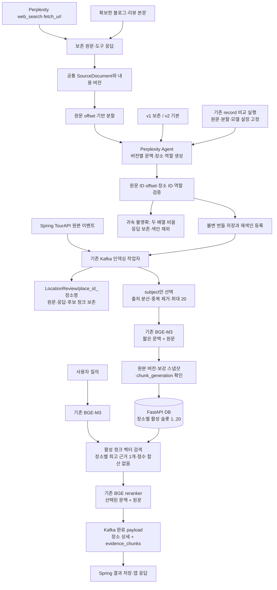
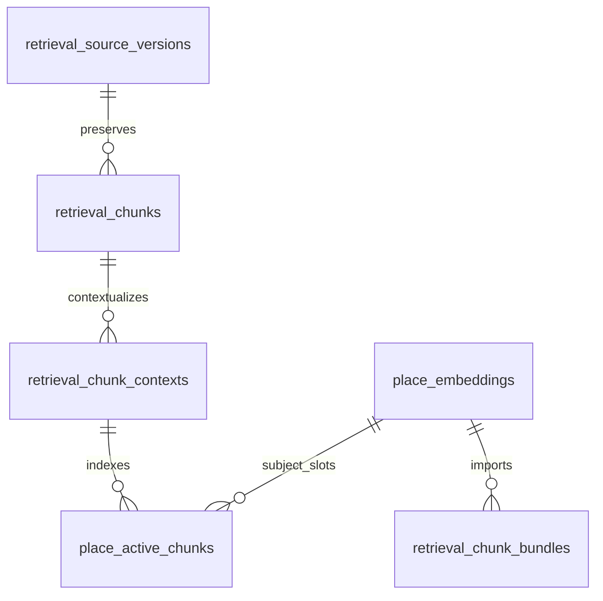

# 장소별 공통 청크 검색 구조

[계획](../plans/contextual-retrieval.md) · [상세 명세·DB 이행](../specifications/contextual-retrieval.md)

청크는 전역 UUID이고 장소와 N:M 관계다. `place_refs`는 원문 청크의 subject/view_target/mentioned를 보존하며,
실제 검색 연결인 place_active_chunks에는 subject만 들어간다. 청담도로공원의 벤치에서 청담대교가 보이는
후기가 있을 때 공원의 시설을 대교의 시설로 색인하지 않는다. 여러 subject를 실제로 다루는 청크는
각 장소의 20개 제한에 각각 포함된다.

생성·수집은 오프라인 관리 작업이며 추천 요청은 Perplexity를 호출하지 않는다.
DB 트랜잭션은 네트워크 호출·모델 추론 동안 잡지 않는다. 활성 집합은 추론 뒤 최신 세대를 확인하고 원자 교체한다.
Spring DB와 FastAPI DB 사이 JOIN/FK는 없다. 새 FK는 FastAPI 검색 DB 내부에만 존재한다.
기존 무청크 장소는 호환 벡터로 조회할 수 있으므로 단계별 재색인이 가능하다.
v2에서도 같은 문서의 다른 구간은 장소 식별이나 필요한 배경에 활용한다. 청크 밖 정보 전체를 금지하지 않는다.
baseline 비교는 모델/프리셋 선택까지 고정하지만 공급자가 반환한 실제 모델도 별도로 비교해 기록한다.
검증기의 형식/역할 일치 확인만으로 장소 귀속·문맥의 의미 정확성이나 실제 품질 향상을 보증하지 않는다.
