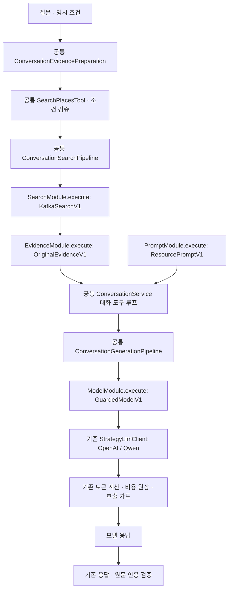

# 공통 대화 파이프라인과 교체 가능한 부품

대화·도구 루프는 `ConversationService` 하나가 실행한다. 검색·근거 구성·프롬프트·모델 호출을 별도 인터페이스와 구현 클래스로 분리했다. 운영과 평가는 이 소스를 공유하며, 버전별 서비스/JAR/작업 폴더를 만들지 않는다.



## 부품의 책임

| 인터페이스 | 현재 구현 / 버전 | 책임 |
|---|---|---|
| `SearchModule` | `KafkaSearchV1` / `KAFKA_V1` | 검증된 검색 조건을 기존 검색 서비스로 전달하고 실제 적용 조건과 결과 반환 |
| `EvidenceModule` | `OriginalEvidenceV1` / `ORIGINAL_V1` | 장소 데이터·전체 원문·출처·조건·보충 문맥을 기존 형식으로 구성하고 인용 ID 충돌 방지 |
| `PromptModule` | `ResourcePromptV1` / `RESOURCE_V1` | 로컬 프롬프트 리소스를 UTF-8로 한 번 읽고 원문과 SHA-256 제공 |
| `ModelModule` | `GuardedModelV1` / `GUARDED_V1` | 전체 메시지·도구 정의를 기존 가드가 있는 LLM 클라이언트에 한 번 전달 |

각 인터페이스는 `supports(version)`과 `execute(input, config)`를 제공한다. 공통 파이프라인은 주입된 목록에서 일치하는 구현 하나를 서버 초기화 시 선택한다. 0개·여러 개·알 수 없는 enum 버전·없는 프롬프트는 초기화 오류다. 다음 구현으로 자동 재시도하거나 다른 공급자로 전환하지 않는다.

현재는 실제 운영 중인 V1 구현을 추출했다. 같은 동작을 복사해 이름만 바꾼 V2 클래스는 만들지 않았다. 구현 버전은 알고리즘의 버전이며 프롬프트 내용·모델명·검색 순위 설정과 구분한다.

## 같은 부품에서 설정만 바꾸는 경우

### 임베딩 순위와 리랭킹 순위

`KafkaSearchV1`는 복제하지 않는다. `search-ranking` 설정으로 `REQUEST_DEFAULT`, `SEMANTIC_ONLY`, `RERANKED` 중 하나를 선택한다. 기본 `REQUEST_DEFAULT`는 요청에 담긴 순위 모드를 그대로 유지한다.

순위 설정만 달라지며 질의·지역·도시·카테고리·제외 ID·반경·결과 수를 바꾸거나 보정하지 않는다. 적용된 순위는 기존 `modelData.searchCriteria.rankingMode`에도 기록한다. 이 설정은 대화 검색 도구 경로에 적용되며 독립 `/api/places/search`의 명시적 순위 모드를 덮어쓰지 않는다.

### 프롬프트 비교

기존 `ConversationService.SYSTEM_PROMPT`를 다음 리소스로 옮겼다.

```text
Server/TravelMate/src/main/resources/conversation/prompts/v1-grounded-system.txt
```

이전 Java 텍스트 블록과 동일한 UTF-8 내용이며 SHA-256은 `981cd883794d751f63b0fca1c0bc29734d9ae19b4c844634c695368a1b9b81d2`다.

문구를 비교할 때는 새 구현 클래스를 만들지 않고 `prompt-resource`를 다른 버전 파일로 지정한다. `classpath:`와 `file:` 로컬 리소스만 지원한다. 프롬프트는 서버 초기화 시 한 번 읽고 캐시하므로 파일을 바꾼 뒤 같은 테스트 서버를 재기동한다. 실행 중에 파일을 몰래 다시 읽거나 프롬프트를 자르지 않는다.

### LLM 비교

모델명·공급자·출력 예약량은 기존 `llm.provider`, `openai.*`, `ollama.*` 설정으로 선택한다. `GuardedModelV1`를 공급자마다 복제하지 않는다. 기존 `StrategyLlmClient`가 OpenAI 또는 Qwen 구현을 선택하고, 각 공급자의 기존 토큰·비용 가드를 그대로 실행한다.

## 테스트 서버 설정

평가용 환경 파일에서 다음 값을 선택할 수 있다. 운영 프로세스의 설정과는 별개다.

```json
{
  "EVAL_CONVERSATION_SEARCH_MODULE": "KAFKA_V1",
  "EVAL_CONVERSATION_EVIDENCE_MODULE": "ORIGINAL_V1",
  "EVAL_CONVERSATION_PROMPT_MODULE": "RESOURCE_V1",
  "EVAL_CONVERSATION_MODEL_MODULE": "GUARDED_V1",
  "EVAL_CONVERSATION_SEARCH_RANKING": "SEMANTIC_ONLY",
  "EVAL_CONVERSATION_PROMPT_RESOURCE": "classpath:conversation/prompts/v1-grounded-system.txt"
}
```

이 부분 설정만으로 서버가 기동되지는 않는다. DB·Redis·Kafka·인증·LLM 연결 설정은 기존 평가 환경 파일에 함께 둔다. 서버와 프로젝트 전체를 새 디렉터리로 복사하지 않는다.

```powershell
python Evaluation/evaluation_server.py --environment-file .env.evaluation.json
python Evaluation/evaluation_server.py --environment-file .env.evaluation.json --start
```

기동기는 공통 `application.properties`를 읽고 `evaluation` 프로필을 추가한다. `--spring.config.location`으로 공통 설정을 대체하지 않는다. JWT 만료 시간 같은 공통 설정을 평가 파일마다 복제할 필요가 없다.

## 진짜 새 동작을 추가할 때

1. 해당 부품 인터페이스의 버전 enum에 새 버전을 추가한다.
2. 그 부품만 새 클래스로 구현하고 `@Component`로 등록한다.
3. `supports()`가 자기 버전에만 일치하도록 한다.
4. 테스트 서버 설정에서 그 버전을 선택한다. 나머지 부품과 데이터·질문은 고정한다.
5. 원본 요청·응답·실제 호출 수·적용 설정과 프롬프트 해시를 남겨 비교한다.

공통 루프·조건 검증·인용 검증·예산 가드를 버전 클래스에 복사하지 않는다. 생산 코드가 아닌 테스트 대체 구현은 Spring 주입 목록을 교체해 검사한다. 수동 생성자를 사용하는 기존 단위 테스트에는 기본 구성 연결을 제공하지만 실제 Spring 배선은 선택한 모듈이 없을 때 기본값으로 우회하지 않는다.

새 모델 구현도 가드가 연결된 기존 `LlmClient`를 사용한다. 부품에서 provider HTTP를 직접 호출해 토큰 계산·원장·횟수 제한을 우회하지 않는다.

## 기록과 검증 범위

`EVIDENCE_PREPARATION.payload.generationModules`에 선택 설정, 프롬프트/모델 구현 클래스와 실제 로드한 프롬프트 해시를 기록한다. 이는 원래 `MODEL_CALL`의 사용량·모델·dispatch 관측을 대신하지 않는다.

부품 교체 검사는 실제 Spring 배선에서도 검색 순위와 프롬프트가 반영되고 원문·인용·한 번의 모델 호출이 유지되는지 모의 검증한다. 기존 검색·대화·공급자·가드 회귀를 함께 실행한다. 이 결과를 실제 모델 정확도·GPU 지연·운영 배포 성공으로 해석하지 않는다.

2026-11-04 검증 결과:

- Java 컴파일과 관련 JUnit **163개 통과**, 실패·생략 0개. 신규 부품 검사, Spring 교체 배선, 기존 대화·검색·strict 계약·공급자 예산 검사를 포함한다.
- Python 평가 실행기·검색 조건·수집·judge/게시 가드 회귀 **75개 통과**.
- 이전 커밋의 Java 텍스트 블록을 JDK 17로 별도 컴파일한 실제 문자열 해시와 새 프롬프트 리소스의 해시가 일치한다.
- 실제 모델·유료 API·검색 서버·DB 호출과 운영/평가 서버 기동은 수행하지 않았다. 빌드 의존성 다운로드와 모의 HTTP 전송 검사는 모델 평가 호출 수에 포함하지 않는다.

계획 도구의 비동기 내부 생성 경로와 FastAPI의 SQL 검색·리랭커 구현은 이번에 복제하거나 재작성하지 않았다. 이번 분리는 서버 대화 경로의 조립 경계이며 기존 검색 서비스와 LLM 공급자 구현을 재사용한다.
