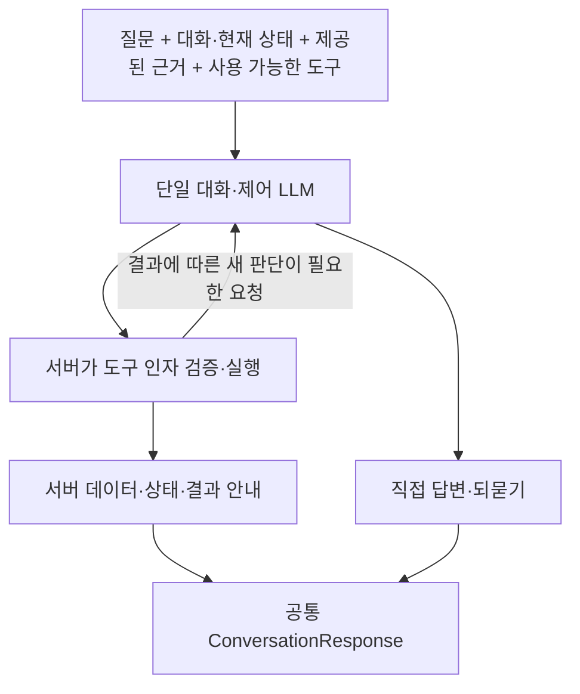

# 단일 대화·제어 LLM과 공통 도구 응답

질문·대화 이력·현재 요청 상태·제공된 근거·등록된 도구 정의를 같은 LLM에 전달한다. 이 모델이 직접 답변, 되묻기, 도구 호출을 선택한다. 별도 라우팅 호출이나 도구별 응답 모델은 추가하지 않는다. 모델·공급자 설정, 예산과 토큰 가드는 기존 설정을 사용한다. 비교 기준은 기존 두 문항에 성공한 `gpt-5.4-mini-2026-03-17`이며, GPT-4o-mini는 정확성 실패로 채택 보류 상태다.

## 후속 호출은 선택

`ConversationService`는 도구 호출이 완료됐다는 이유만으로 LLM을 다시 호출하지 않는다. 일반적인 도구 실행은 실제 서버 결과와 상태 안내를 `ConversationResponse`로 반환한다. 예를 들어 장소 검색은 실제 목록과 개수, 비동기 일정 생성은 접수 상태를 반환한다. `messageSource=SERVER_RECEIPT`, 인용은 빈 배열이며 원문·근거는 서버의 실제 결과에 보존한다. 접수 상태를 일정 완성으로 바꾸지 않는다.

결과를 보고 비교·설명하거나 결과에 의존하는 다음 작업을 판단해야 하면, 같은 모델이 도구 호출과 함께 assistant content에 `{"afterTool":"REASSESS"}`를 선택한다. 서버는 도구 결과와 전체 근거를 기존 대화에 추가하고 같은 LLM으로 후속 판단을 이어간다. 이후에도 직접 답변·되묻기·다음 도구 호출을 선택할 수 있다. 설명용 모델을 별도로 호출하지 않는다.

추가 판단이 없으면 content를 비우거나 `{"afterTool":"RETURN_RESULT"}`를 사용한다. 생략은 RETURN_RESULT다. 이 제어 JSON은 도구 인자와 분리돼 있다. 기존 도구 스키마·category enum·서버 인자 검증·허용 도구 목록을 바꾸지 않았다. 제어 값은 프롬프트 지시와 서버 파싱으로 처리하며 공급자 Structured Outputs로 강제했다고 주장하지 않는다.

서버가 결과를 반환하기 전에는 모델이 그 결과를 알 수 없다. 도구 호출과 함께 미래의 결과를 확정하는 사용자용 message를 쓰지 않도록 지시하고, 제어 JSON에 message 등 다른 필드나 잘못된 enum·형식이 섞이면 도구 실행 전에 거부한다. 모델의 해당 텍스트를 실행 결과 설명으로 재사용하지 않는다. 직접 답변이나 결과를 받은 후의 설명은 기존 JSON·인용 검증을 거친다. 모든 자연어 주장의 의미 정확성을 이 형식 검증만으로 보장하는 것은 아니다.

도구 실패 상태와 사유는 보존한다. 즉시 반환 경로의 실패는 TOOL_FAILED로 종료하고 설명을 위한 추가 호출은 하지 않는다. 기존 STOP 정책은 후속 판단 요청보다 우선한다. CONTINUE 정책에서는 명시적인 REASSESS가 있을 때만 같은 모델이 실패 결과를 보고 판단할 수 있다. 반복 호출 캐시·호출 ID 검증·도구 수·모델 턴 수·토큰 및 예산 가드는 유지한다.

## 여러 도구에 공통 적용

현재 실제 등록 도구는 장소 검색, 일정 생성, 생성 작업 상태 조회다. 이 도구들은 같은 루프·실행기·서버 응답 계약을 사용한다. 일정 수정과 기억 조회는 아직 실제 등록 도구가 아니다. 새 기능을 구현하거나 등록된 것처럼 표시하지 않는다. 공통 루프의 확장성은 해당 이름을 가진 오프라인 테스트 대역으로만 확인했다. 실제 기능 검증으로 집계하지 않는다.

일정 생성 도구가 요청을 접수한 뒤 비동기 작업에서 사용하는 추론까지 없앴다는 뜻은 아니다. 결과에 의존하는 연속 작업이나 근거 설명도 필요하면 같은 대화에서 여러 번 판단할 수 있다. ‘한 번에 판단’은 대화와 제어의 판단 통합이며 모든 작업의 추론 횟수가 항상 1이라는 보장이 아니다.

## 적용 상태와 확인 범위

기존 성공 기준인 develop 커밋 `e7cadc2025edf75432f0c9819a60f160ad16d7d5`에서 분리한 `feat/conversation-control`의 변경이다. 스트리밍 실험 브랜치의 UI·출력 축소·검색어/limit 변경을 이 변경에 합치지 않았다. 이 브랜치의 공급자 클라이언트와 전송 설정은 기준 그대로이며, 별도로 보존한 스트리밍 구현을 통합하거나 배포하지 않았다. 기존 평가 원본과 성공 기록도 수정하지 않았다.

관련 오프라인 검사는 직접 답변·되묻기, 단일 호출 후 서버 결과 반환, 명시적인 후속 판단과 연속 작업, 실행 전 주장 차단, 실패 영수증 보존, 기존 인용·원문·category·예산 가드를 확인한다. 기본 반환에서는 설명만을 위한 두 번째 추론과 그 앞의 토큰 계산 요청이 발생하지 않는 코드 경로를 확인한다. 실제 모델이 새 제어 지시를 선택하는 정확성, 실제 지연과 비용은 아직 측정하지 않았다. 실제 API·모델·검색·DB·유료 호출과 배포는 수행하지 않는다.

관련 검사 148개가 실패·오류·건너뜀 없이 통과했다. 마지막 검사 이후에는 인자 줄바꿈과 문서만 정리했으며 전체 검사를 반복하지 않았다. 검사 클래스별 결과와 파일 해시는 로컬 검증 기록 `.local-backups/conversation-control-verification-20261103-01.json`에 남긴다.

후속 검토는 별도 토큰 계산 API 왕복과 최종 설명 대기를 줄이는 데 둔다. 토큰 가드 우회, 별도 라우팅 모델, 도구별 응답 모델은 추가하지 않는다.

프로토콜 참고: [공식 OpenAI function calling 문서](https://developers.openai.com/api/docs/guides/function-calling). 도구 실행과 결과에 따른 모델 후속 처리는 애플리케이션이 관리하며, 이번 RETURN_RESULT/REASSESS는 이 프로젝트의 공통 제어 계약이다.
