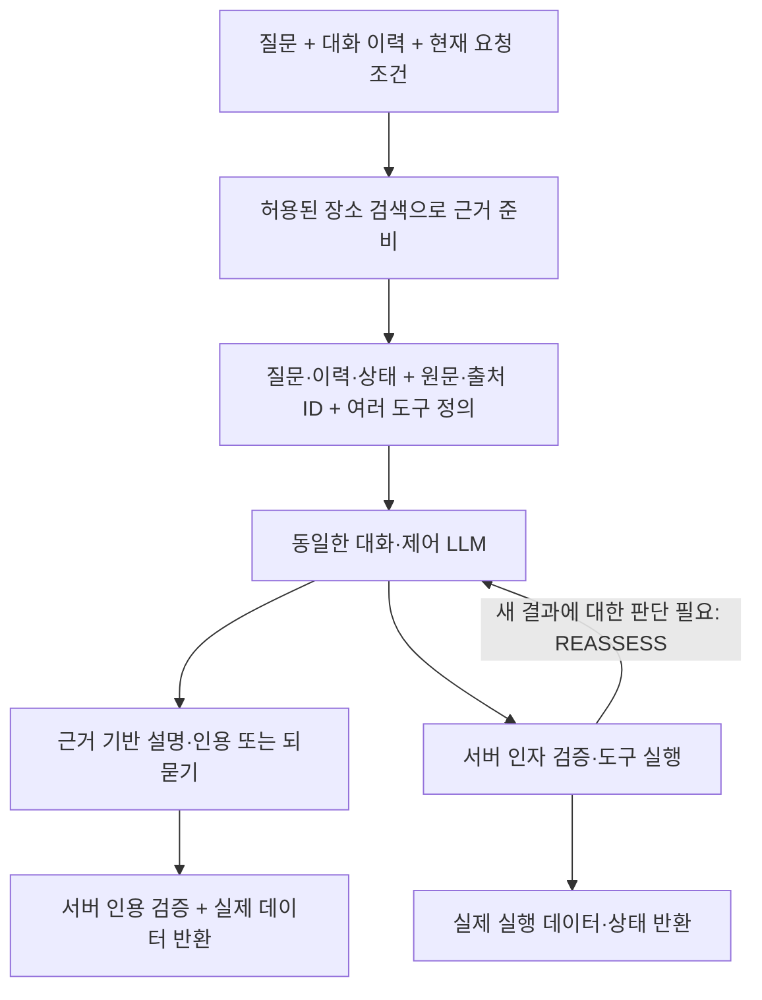

# 첫 LLM 호출 전 장소 근거 준비

질문을 받은 뒤 첫 LLM을 호출하기 전에 장소 근거를 준비하도록 실행 순서를 변경했다. 이전 `6421d8f6`의 후속 설명 호출 선택화와 구분되는 구현이다.

`ConversationEvidencePreparation`이 등록된 준비 전략을 선택하고, `PlaceConversationEvidence`가 기존 `SearchPlacesTool`의 검색·근거 조립을 재사용한다. 실제 Spring 조립에서는 이 준비 단계를 `ConversationService` 생성자에 주입한다. 준비 단계를 전달하지 않는 서비스 생성자는 남기지 않았다.

검색 도구가 허용된 턴에서는 첫 판단 전에 읽기 전용 장소 조회를 한 번 수행한다. 검색어는 `request.message()` 그대로이며, 기존 resolver가 명시된 `searchContext` 또는 기존 일정 영역 조건을 상속한다. 기본 검색 한도 10과 기존 검색 설정을 유지한다. ‘궁’을 분류로 바꾸거나 city를 추측하지 않는다. 별도 라우팅 LLM이나 단어별 의도 분기표는 없다. 이 정책은 일반 대화에도 사전 조회 비용을 추가할 수 있으며, 이번에는 실제 지연·비용을 측정하지 않았다. 검색 도구가 허용되지 않으면 해당 준비 전략은 적용하지 않는다.

이 사전 조회는 서버가 명시적으로 수행하는 입력 준비다. 모델의 누락된 query를 보정하거나 모델이 도구를 호출한 것처럼 기록하지 않는다. 실제 모델의 도구 호출에는 기존 인자 검증이 그대로 적용된다.

## 첫 입력과 서버 결과

첫 LLM 입력은 시스템 지시문, 대화 이력, 사용자 메시지의 `message·planningRequest·searchContext`와 새 `serverEvidence`, 등록 도구 정의다. `serverEvidence.data`에는 검색 조건·필터 출처·장소 후보와 `selectedEvidence`가 들어간다. 원문 `original`, 주석 `annotations`, 생성 보충 문맥 `generatedSupplement`, 검색 정보 `retrieval`와 출처 ID를 구분해 보존한다. 잘린 description으로 원문을 대체하지 않는다.

`planningRequest`와 `searchContext`는 제공된 현재 요청 조건이다. 최신 일정 작업 상태나 수정 성공을 첫 검색 자료만으로 확정하지 않는다. 새로 준비한 자료는 장소 조회 결과이며 일정 생성·수정·기억 도구를 실행한 영수증이 아니다. 사용 가능한 여러 도구 정의는 같은 LLM에 계속 전달한다.

단순 장소 안내는 첫 LLM이 이 근거로 `{message,citations}`를 반환할 수 있다. 서버는 준비 단계의 출처 맵으로 기존 인용 검증을 수행하고, 실제 장소 데이터와 LLM 설명·인용을 공통 응답으로 반환한다. 이 경로의 `messageSource`는 LLM이며 고정 안내문이 아니다. 모델이 근거 없는 일반 대화나 되묻기를 선택하면 사전 조회된 무관한 장소 목록을 자동으로 붙이지 않는다.

추가 도구를 선택하면 서버가 인자를 검증하고 실행한다. 실제 결과를 보고 새로 판단해야 하는 경우에만 같은 LLM으로 REASSESS를 이어간다. 실행 상태 안내는 실제 영수증으로 유지하며 이를 근거 기반 자연어 설명의 대체로 판정하지 않는다. 실행하지 않은 결과를 미리 확정하는 모델 텍스트는 기존 제어 검증으로 거부한다.

근거 준비는 별도 `EVIDENCE_PREPARATION` 관측으로 기록하며 모델 toolResults를 꾸며내지 않는다. 사전 조회 1회도 기존 도구 호출 한도에 포함한다. 모델·서비스 등급·재시도·예산·토큰 가드 설정은 바꾸지 않았다. 첫 토큰 계산 요청부터 준비된 원문 전체가 포함되고, 초과하면 추론 요청 전에 중단한다. 준비 단계 실패는 FAILED로 남기고 모델 호출 전에 중단한다. 정상적인 빈 결과 EMPTY와 구분한다.

## 기존 두 문항의 오프라인 확인

자료는 `Evaluation/runs/contextual/openai-strict-search-two-case-v1/20261103-01/raw/`의 보존된 두 요청·검색 결과·답변이다. 원본 파일을 수정하지 않았다.

| 문항 | 첫 입력의 근거 | LLM 응답 경로 | 검증 결과 |
|---|---|---|---|
| PLR-TM-palaces-01 | 보존 검색 결과의 원문·주석·보충·검색 정보 및 현재 출처 ID | 보존 답변을 모의 모델이 1회 반환 | 실제 서버 데이터 + LLM 설명 + 인용 검증 통과 |
| PLR-TM-palaces-03 | 동일하게 보존된 검색 근거 전체 | 보존 답변을 모의 모델이 1회 반환 | 실제 서버 데이터 + LLM 설명 + 인용 검증 통과 |

`ConversationGroundingTest`는 실제 Spring 생성자와 전략 주입 경로에서 검색이 첫 LLM보다 먼저 실행되는지 확인한다. 첫 LLM에는 검색·일정 생성·작업 상태 조회 정의가 함께 제공된다. 모의 OpenAI 전송 검사에서는 STRICT_SEARCH_V1과 기존 승인 정책의 임시 복사본을 사용해 첫 토큰 계산 및 추론 요청에 원문과 세 도구의 strict 정의가 있는지 확인한다. 저장소의 승인 정책·과거 ledger는 바꾸지 않는다.

모델 응답은 **과거 답변을 재사용하고 이번 준비 단계의 evidenceId로 연결한 모의 응답**이다. placeId·sourceId·quote는 보존한다. 실제 모델이 새 입력에서 답을 생성하거나 도구 선택에 성공했다고 집계하지 않는다. 이전 검색어 확장과 낙선재·운현궁의 일부 정식 인용 부족도 해결됐다고 표시하지 않는다.

사전 조회의 검색어는 원래 사용자 질문이다. 보존 검색 결과는 과거 모델이 선택한 검색어로 얻었던 결과를 오프라인 주입한 것이다. 따라서 이 검사는 새 검색어의 실제 검색 품질·순위·필터 선택 성능을 검증한 것이 아니다. 첫 입력의 근거 전달과 1회 응답이 가능한 코드 경로를 확인한다.

검사 산출물은 `Server/TravelMate/build/conversation-grounding-offline/`에 있다.

- `PLR-TM-palaces-01.first-input.json`, `PLR-TM-palaces-03.first-input.json`: 첫 메시지·도구 정의.
- 각 문항의 `.native-first-request.json`: 실제 모의 전송 요청에서 읽은 JSON을 보기 좋게 저장한 자료. 전송 바이트 원본이나 그 바이트 해시라고 표시하지 않는다.
- 각 문항의 `.response.json`, `.verification.json`: 응답·인용·호출 경로와 MOCK 범위.

관련 Java 검사 161개가 통과했다. 이 중 새 준비 경로 검사는 11개다. 빈 검색·준비 실패·잘못된 인용·되묻기·다른 상태 도구 선택·새 도구 결과 후 재판단·토큰 초과 차단을 포함한다. 기존 제어·예산 단위 검사는 준비 전략을 빈 목록으로 명시해 해당 단계만 분리 검사하고, 새 검사는 실제 준비 전략을 주입해 첫 입력을 확인한다.

실제 API·모델·임베딩·검색 서버·DB 호출은 0회다. 모의 토큰 계산값은 실제 사용량이나 청구 증거가 아니다. 실제 모델의 새 입력 준수·설명 품질, 실제 검색 품질, 토큰 수·비용·지연과 전체 호출 신뢰성은 미검증이다. 새 도구·모델 교체·UI 변경·백업 정리·배포는 하지 않았다. 일정 수정과 기억 조회 도구는 여전히 미등록이다.
