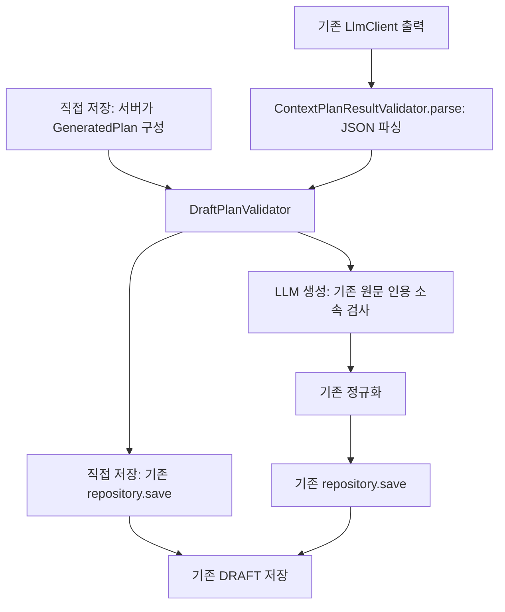

# 직접 저장·LLM 생성의 DRAFT 검증 공통화

2026-11-01. 검색 근거 전달 다음 단계로, 현재 `/api/v1/plans`와 `/api/v1/plans/generations`가 저장하는 **DRAFT**의 조건을 공통화했다.
확정·수정 도구·단일 LLM 도구 루프를 구현한 변경은 아니다.

## 기존 차이와 변경

| 조건 | 직접 초안 저장: 변경 전 | LLM 생성: 변경 전 | 변경 후 |
|---|---|---|---|
| 체류시간 합 ≤ 요청 시간창 | 검사 누락 | 결과 검증기에서 검사 | `DraftPlanValidator`에서 동일 검사 |
| 명시한 카페 최소 개수 | 검사 누락 | 생성 서비스에서 검사 | 공통 검증기에서 선택 장소의 category/sourceCategory로 검사 |
| 필수 장소 존재·중복·필수 장소 범위 | 공통 서비스에서 검사 | 공통 서비스에서 검사 | 유지. 운영시간 정책 → 필수 장소 조회 순서도 일치 |
| 결과의 필수 장소 포함·후보 소속·중복·방문 순서 | 서버가 직접 구성 | 결과 검증기와 생성 서비스에서 중복 검사 | 공통 검증기에서 검사 |
| 선택한 일반 후보의 범위 | 일반 후보를 추가하지 않음 | 검색 필터에 의존 | 공통 검증기로 선택된 모든 장소를 저장 직전에 검사 |
| 제목·방문 수 | 서버가 제목과 필수 장소로 구성 | 제목과 1~6개 방문 검사 | 공통 검증기로 동일 검사 |

예를 들어 60분씩 두 장소를 방문하는데 시간창이 119분이면, 기존 직접 저장은 허용하고 LLM 생성은 거부했다.
이제 둘 다 거부한다. 시간창이 120분이면 체류시간 조건 자체는 통과하지만, **실제 이동시간까지 충족했다는 뜻은 아니다.**
카페 최소 1개를 요청하고 공원만 선택한 직접 저장도 이제 거부한다. 명시적 조건을 만족시킨 뒤 저장해야 한다.

공통 검증은 저장할 계획과 실제 후보 metadata, 원래 요청을 입력받는다. 출처 인용 검증은 생성 경로에 그대로 남는다.
직접 저장은 모델 출처 인용을 입력받는 API가 아니므로 인용을 만들어 붙이지 않는다.
직접 저장에서 공통 검증에 실패하면 HTTP 400과 검증 사유를 반환하고, 생성 작업은 기존 비동기 계약대로 FAILED와 사유를 기록한다.
응답 형태는 다르지만 계획 승인·거부 조건은 같다. 이미 처리한 idempotency key의 결과 재조회는 기존 동작을 유지한다.

## 현재 DRAFT에서 허용하는 불완전성

- 계획 설명·활동·추천 이유가 비어 있어도 초안으로 허용한다. 목적지는 기존 계약대로 선택 사항이다.
- 실제 도착/출발 시각·구간 이동시간·최적 동선이 없어도 초안으로 허용한다. 이 정보를 계산하거나 검증하지 않는다.
- 운영시간을 확인하지 못한 장소는 기존 `ALLOW_WITH_WARNING` 정책에서만 허용한다. 기존 응답의 미검증 초안 경고를 유지한다.
- 명시한 필수 장소·카페 개수·체류시간·중복·범위 조건 위반은 초안에서도 허용하지 않는다.
- 기존 요청의 중심/반경·출발 위치·시작/종료 시간 등 필수 필드를 완화하지 않는다. 빈 작업 메모/장소 0개의 저장 API를 새로 만들지 않았다.

현재는 CIRCLE·WALK만 지원한다. 고정 방문 시각·예산 제한·운영시간 미확인 장소 EXCLUDE는 기존처럼 지원 불가를 명시해 거부한다.
초안 승인을 조건의 실제 충족이나 예약·운영 확정으로 해석하지 않는다.

## 확정 상태와 경계

계획 저장 SQL의 상태는 여전히 `DRAFT`다. 확정 API·확정 전용 검증·버전 증가·롤백 경로는 없다.
향후 확정 경로에서는 실제 이동을 포함한 시간 성립, 운영시간과 방문 조건, 미확인 정보의 처리 정책부터 정해야 한다.
이 기준을 이번에 구현하거나 통과했다고 표시하지 않는다. 기존 체류시간 합 검사는 그 검증을 대신할 수 없다.

`PlanAreaValidator`는 기존 Haversine 계산과 좌표 유효성 검사를 이동해 재사용한다. 검색의 PostGIS/거리 필터·순위·후보 상한은 바꾸지 않았다.
이는 선택 원 안의 좌표 검사이며 보행 경로 거리나 실제 이동 가능성 검사가 아니다.
기존 `ContextPlanRepository`의 체류시간 저장 방식도 유지한다. 필수 장소는 요청값, 일반 후보는 RELAXED 60분/NORMAL 40분을 사용한다.

현재 REST에 연결된 두 경로를 대상으로 한다. 미연결 구형 `PlanGenerationService`/`PlanValidator`를 새 도구로 연결하지 않았다.
기존 원문·출처·귀속·관계·조건 전달과 인용 검사, 검색 설정을 변경하지 않는다. 근거 적합성이나 자연어 설명의 의미 정확성은 별도 평가다.

## 검증·남은 항목

[모의 회귀 기록](../../Evaluation/runs/contextual/draft-plan-validation-v1/20261101-01/REPORT.md)에 실제 실행 명령·JUnit 결과·검증 범위를 남겼다.
공통 조건의 회귀와 기존 원문 전달 회귀만 실행했으며, 기존 검색·계획 평가 데이터셋의 범위나 문항을 새로 정하지 않았다.
실제 검색/리랭킹 품질·계획 품질·LLM 도구 선택의 품질 평가를 완료한 것은 아니다.

**토큰 예산은 미해결이다.** 전체 원문 전달 후의 실제 모델 토큰 수와 기존 context 한도를 검증하지 않았다.
다음 실제 LLM 실행 전에 사용 모델·입력/출력 예약 토큰·context 한도·초과 시 원문 보존 정책을 확인하고,
실행할 기존 평가 범위·case ID·호출 횟수·비용을 먼저 알려야 한다. 이번에는 실제 모델 호출·운영 DB 반영·배포를 하지 않았다.
