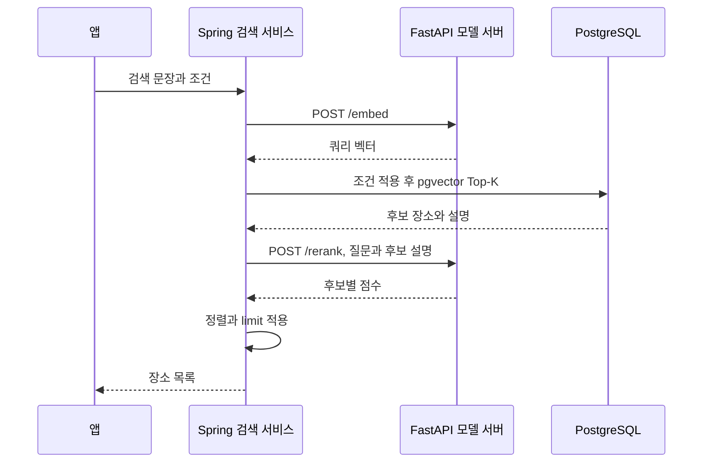
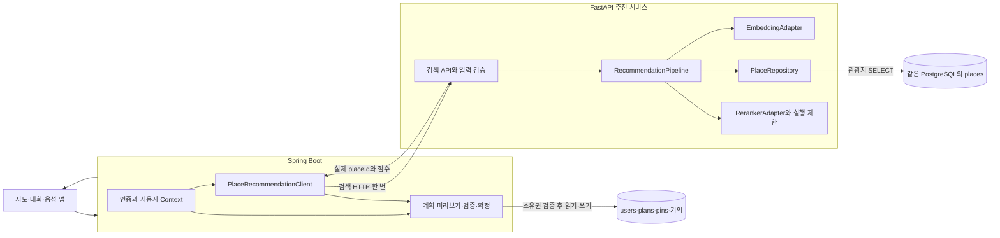
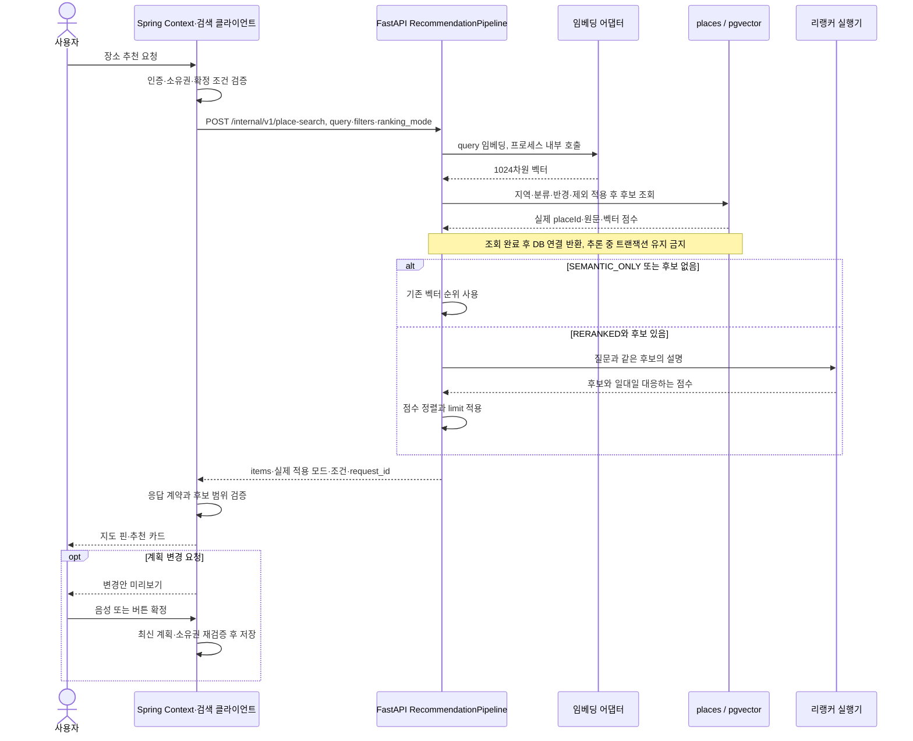
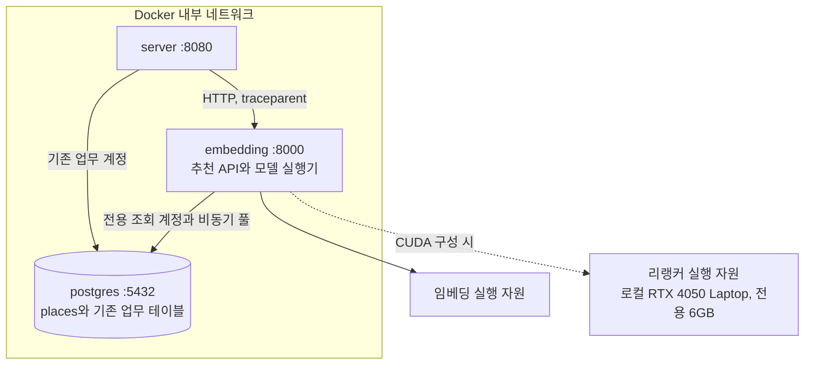

# FastAPI DB 직접 조회 기반 장소 추천 구조

[문서 목록](../README.md) · [검색 API·DB 명세](../specifications/fastapi-place-recommendation.md) · [투어 가이드 전체 구조](personal-tour-guide.md)

작성일: 2026-10-25, 한국 시간. 코드 확인 기준: `f9f09db`. **검색 책임을 옮기기 위한 구현 설계이며, 아직 서버·Docker·DB에 적용한 상태는 아닙니다.**

## 1. 이번에 정한 방향

사용자 요청에 따라 **FastAPI가 쿼리 임베딩 → PostgreSQL 후보 조회 → 리랭킹 → 최종 추천 목록을 한 요청 안에서 처리**합니다. Spring은 사용자 인증, 여행 Context 구성, 도구 호출, 계획 검증·저장을 관리합니다.

- Spring → FastAPI의 검색 호출은 한 번입니다. FastAPI가 자기 `/embed`, `/rerank` 엔드포인트를 HTTP로 호출하지 않고 내부 모델 어댑터를 호출합니다.
- 기존 PostgreSQL의 `places.embedding vector(1024)`와 장소 ID를 사용합니다. 관광지 데이터를 다른 DB에 복제하거나 벡터를 다시 만들 필요는 없습니다.
- FastAPI에는 관광지 조회 권한을 부여합니다. 개인 기억·사용자·계획 변경은 Spring의 책임으로 유지합니다.
- 구조 이전과 추론 속도 개선을 나눠 검증합니다. DB 조회를 옮기는 것만으로 리랭커의 9.95초 추론이 0.5초가 되지는 않습니다.
- 이름 조회·하이브리드 검색은 확장 지점입니다. 첫 이전에서는 기존 검색 순위·후보 수·점수 계산을 유지해 전후 비교가 가능하게 합니다.

## 2. 현재 구조와 변경 구조

### 현재 코드

Spring의 [PlaceSemanticSearchService](../../Server/TravelMate/src/main/java/com/yollo/TravelMate/domain/place/service/PlaceSemanticSearchService.java)가 파이프라인을 조율하고, [PlaceSemanticSearchRepository](../../Server/TravelMate/src/main/java/com/yollo/TravelMate/domain/place/repository/PlaceSemanticSearchRepository.java)가 SQL을 실행합니다. FastAPI는 현재 모델 추론만 담당합니다. `SEMANTIC_ONLY`는 리랭킹 호출을 생략합니다.

### 목표 구조

`Places`와 `Business`는 접근 책임을 구분해 그린 것입니다. 현재는 같은 PostgreSQL 인스턴스입니다. FastAPI가 계획 테이블까지 접근한다는 뜻은 아닙니다.

## 3. 추천 한 번의 처리 순서

일반 검색 API는 계획을 저장하지 않습니다. 기존 계획 생성 API와 새 대화 미리보기의 차이는 [기존 명세](../specifications/personal-tour-guide.md#6-검색자동-생성자동-배정-계약-초안)를 따릅니다.

## 4. FastAPI 내부 책임 분리

| 모듈 제안 | 역할 | 자원 수명 |
|---|---|---|
| `PlaceSearchRouter` | 내부 서비스 인증, DTO 검증, 응답 매핑 | 요청 단위 |
| `RecommendationPipeline` | 임베딩·조회·순위 결정 조율 | 상태 없는 서비스 |
| `EmbeddingAdapter` | 현재 BGE-M3 쿼리 임베딩 | lifespan에서 모델 로드 |
| `PlaceRepository` | 고정 SQL·바인딩으로 조건과 pgvector 조회 | lifespan의 비동기 DB 풀 사용 |
| `RankingStrategyRegistry` | 요청 모드에 맞는 전략 선택 | 전략 목록 주입 |
| `SemanticRankingStrategy` | 현재 벡터 순위 유지 | `SEMANTIC_ONLY` 지원 |
| `CrossEncoderRankingStrategy` | 같은 후보의 리랭킹·정렬 | `RERANKED` 지원 |
| `InferenceExecutor` | 모델별 동시 실행 제한·대기·취소 상태 | 애플리케이션 단위 |
| `SearchTelemetry` | trace 연결, 단계 시간과 후보 수 기록 | 요청 Context |

전략은 `is_applicable(mode)`를 제공하고 레지스트리가 선택합니다. Router에 검색 SQL이나 모드별 모델 처리를 몰아넣지 않습니다. 비동기 DB I/O와 모델 연산을 분리하고, 동기 추론으로 FastAPI 이벤트 루프를 막지 않도록 실행기를 둡니다. 추론용 스레드만 추가해도 CPU/GPU 연산량은 줄지 않습니다.

## 5. 실행 자원과 배포

- 로컬 GPU는 RTX 4050 Laptop 전용 VRAM 6GB입니다. 운영 GPU는 미정입니다. 공유 GPU 메모리를 전용 VRAM 용량에 더하지 않습니다.
- CPU/GPU 프로필 모두 동일 추천 API를 사용합니다. GPU 프로필은 CUDA 지원 PyTorch·Docker GPU 연결·실제 CUDA 장치 확인이 필요합니다. 현재 GitHub Dockerfile은 CPU 전용입니다.
- 임베딩 CPU·리랭커 GPU 배치는 실행 자원 제안입니다. Ollama 동시 실행, 실제 피크 VRAM·대기시간을 확인한 뒤 확정합니다.
- 처음에는 기존 FastAPI 서비스 안의 모듈로 구현합니다. 자원 경쟁이 확인되면 같은 어댑터 뒤의 리랭커 실행기를 별도 프로세스·GPU 서비스로 분리할 수 있습니다. 처음부터 서비스 수를 늘리는 요구는 아닙니다.
- 모델·DB 풀은 lifespan에서 준비·종료합니다. 모델을 요청마다 로드하거나 Uvicorn worker를 무작정 늘려 VRAM을 중복 점유하지 않습니다.
- DB 풀 연결은 SQL 조회 동안만 사용하고 모델 대기·추론 전에 반환합니다.

## 6. 속도 목표와 장애 처리

사용자가 제시한 목표는 **리랭커 추론 약 9.95초 → 약 0.5초 이하**입니다. 검색 API 전체 시간 목표, 평균·백분위 기준, 후보 수·토큰 수·배치 크기·정밀도는 아직 확정하지 않았습니다. 사용자 전달 CPU 측정에서 검색 API 전체는 108.723초, 리랭커 추론은 108.564초였습니다. GPU 반복 실행 약 9.95초를 포함해 이번 문서 작업에서 재실행하지 않았으며, 비교 시 단계와 입력 조건을 맞춰 확인해야 합니다.

| 상황 | 설계 |
|---|---|
| 모델 정상 | 요청한 모드와 실제 사용 모드를 기록하고 결과 반환 |
| DB 정상, 조건 내 후보 0개 | 빈 성공 결과. 조건을 자동으로 넓히지 않음 |
| DB 연결·SQL 실패 | 검색 실패로 반환. 후보 0개와 구분 |
| `RERANKED` 모델 사용 불가·대기 초과 | 장애 상태를 명시. 기본 순위 대체 허용 여부는 운영 정책으로 확정 |
| 기본 순위 대체가 허용된 요청 | `ranking_mode_applied=SEMANTIC_ONLY`와 이유를 명시. 리랭킹 성공으로 기록하지 않음 |
| 요청 취소·기한 만료 | 대기 작업 제거. 이미 시작한 연산의 실제 종료까지 실행 슬롯 점유 추적 |

시간 제한·동시 실행 수의 숫자는 여기서 임의로 정하지 않습니다. 평가의 `RERANKED` 비교에서는 실제 리랭킹이 완료된 결과를 사용하고, 대체 결과·실패·취소를 따로 집계합니다. HTTP 타임아웃만으로 이미 실행 중인 GPU 연산이 중단된다고 가정하지 않습니다.

## 7. 이전 순서

1. FastAPI의 조회 계정·비동기 DB 풀·모델 수명 관리와 내부 검색 계약을 준비합니다.
2. 기존 SQL의 필터·거리식·벡터 점수를 보존해 후보 조회를 옮깁니다. 현행 Top-K=30·모드·리랭킹 입력도 우선 보존합니다.
3. 같은 DB·질문·조건으로 기존 Spring 경로와 FastAPI 경로의 후보·점수·모드별 결과를 비교합니다.
4. Spring의 일반 검색, Context 검색, 계획 생성 후보 조회, `search_places`가 같은 추천 클라이언트를 사용하도록 연결합니다.
5. 기존 공개 응답 DTO와 평가 입력 형식을 유지합니다. 기존 `/embed`는 재임베딩 배치와의 호환을 위해 유지합니다.
6. 경로 동등성이 확인되면 모델 정밀도·입력 길이·배치·후보 수·검색 전략을 각각 독립적으로 비교합니다. 평가 문항과 합의한 6개 지표를 유지합니다.

이 문서와 [상세 명세](../specifications/fastapi-place-recommendation.md)가 변경 목표입니다. 코드·DB 계정·컨테이너 재빌드·GPU 속도 달성은 후속 구현·검증 대상입니다.
