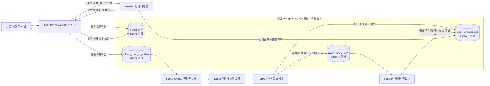
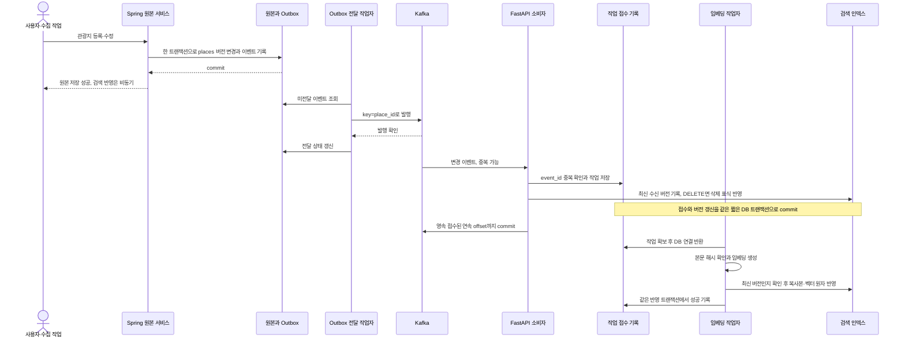
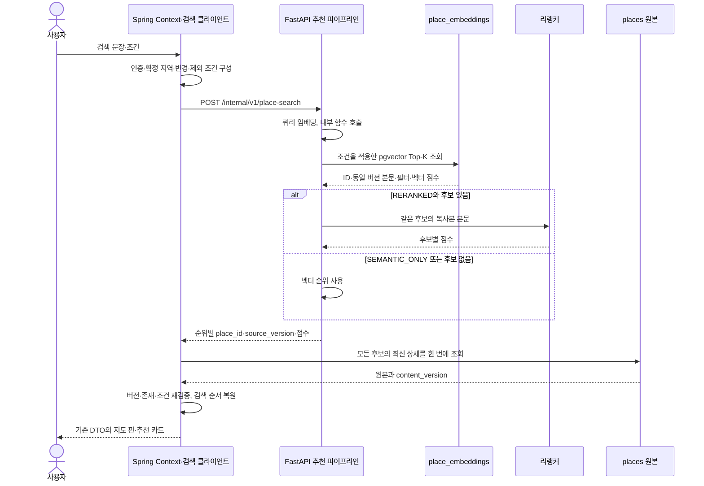

# Kafka·CQRS 기반 FastAPI 장소 추천 구조

[문서 목록](../README.md) · [API·이벤트·DB 명세](../specifications/fastapi-place-recommendation.md) · [투어 가이드 전체 구조](personal-tour-guide.md)

갱신일: 2026-10-25, 한국 시간. 코드 확인 기준: `f9f09db`, 이전 문서: `6e18c16`. **사용자가 확정한 Kafka와 검색용 복사본 저장을 반영한 구현 설계입니다. 서버·DB·Kafka에 아직 적용한 상태는 아닙니다.** 기존 FastAPI의 `places` 조회 전용 설계를 이 문서의 CQRS 구조로 대체합니다.

## 1. 확정한 역할

- **Spring:** 관광지 원본 `places`의 등록·수정·삭제와 사용자·기억·계획을 관리합니다.
- **FastAPI:** 관광지 임베딩을 생성하고 자신이 소유한 `place_embeddings`에 벡터·본문·필터용 복사본을 저장합니다. 온라인 요청에서는 쿼리 임베딩·후보 검색·리랭킹을 수행합니다.
- **Kafka:** Spring의 관광지 변경 이벤트를 FastAPI로 전달합니다. 검색 요청 자체는 Spring → FastAPI HTTP 한 번으로 처리합니다.
- **Spring 최종 응답:** FastAPI가 반환한 순위별 ID로 원본 상세를 일괄 조회하고, 버전·조건을 검증해 앱에 반환합니다.
- 같은 PostgreSQL 인스턴스를 사용할 수 있습니다. 원본과 검색 테이블의 수정 계정·책임을 분리하며 FastAPI는 원본을 JOIN하지 않습니다.

두 테이블의 소유권을 분리해도 동기화 책임은 남습니다. 원본과 검색 인덱스는 **최종적 일관성**으로 연결되며, 원본 저장 성공과 검색 반영 완료를 구분합니다.

## 2. 전체 구조도

`places`와 `place_embeddings`가 두 도메인 테이블입니다. Outbox와 작업 접수 기록은 전달 유실·중복·재시도 제어를 위한 보조 저장소입니다. 기존 계획 테이블은 Spring이 계속 관리합니다.

## 3. 등록·수정·삭제 흐름

- Kafka 전송은 원본 저장 트랜잭션 밖에서 수행합니다. 전송 실패 시 Outbox를 재시도합니다.
- Kafka 발행 성공 직후 프로세스가 종료되면 같은 이벤트가 다시 발행될 수 있습니다. `event_id`로 중복 처리하고, exactly-once 처리를 달성했다고 가정하지 않습니다.
- 소비자는 임베딩이 끝날 때까지 Kafka poll을 막지 않고 DB에 작업을 영속 접수한 뒤 offset을 commit합니다. 이것은 **접수 완료**이며 **검색 반영 완료**는 아닙니다.
- offset을 먼저 commit하지 않습니다. 파티션에서 앞선 미접수 메시지를 건너뛰어 뒤의 offset을 commit하지도 않습니다.
- 작업자는 재시도·재시작 후에도 버전 검사와 원자적 갱신을 지킵니다. 모델 추론 중 DB 트랜잭션을 열어 두지 않습니다.
- DELETE는 임베딩 없이 처리합니다. 버전 표식을 남겨 늦게 도착한 과거 UPSERT가 삭제된 관광지를 되살리지 못하게 합니다.

## 4. 온라인 추천과 상세 조회

- FastAPI는 리랭킹 본문을 얻으려고 원본 DB를 JOIN하거나 Spring에 후보별 HTTP 요청을 하지 않습니다.
- 지역·분류·반경·제외 필터는 FastAPI 복사본에서 Top-K 전에 적용합니다. 필터용 복사본도 벡터·본문과 같은 원본 버전이어야 합니다.
- Spring 상세 조회는 `WHERE id IN (...)` 등 일괄 조회입니다. 그 결과의 DB 순서를 신뢰하지 않고 FastAPI 반환 순서대로 재구성합니다.
- 삭제·버전 불일치·필수 조건 변경 후보를 정상 추천에 조용히 섞지 않습니다. 부분 반환·후보 보충·재시도 등 사용자 응답 정책은 별도 확정하며, 내부 결과는 `INDEX_LAG`로 구분할 수 있게 합니다.
- 추천은 계획 저장과 분리합니다. 기존 대화 변경은 미리보기 → 음성/버튼 확정 → 최신 계획과 소유권 재검증 후 반영합니다.

## 5. 데이터 소유권과 정합성

| 저장소 | 쓰기 책임 | 핵심 규칙 |
|---|---|---|
| `places` | Spring | 원본과 `content_version` 관리 |
| `place_change_outbox` | Spring과 전달 작업자 | 원본 변경과 이벤트 기록을 같은 트랜잭션에 포함 |
| `place_embeddings` | FastAPI | 벡터·복사본·원본 버전을 함께 반영 |
| `place_index_jobs` | FastAPI | 영속 접수·중복·재시도·실패·완료 기록 |
| 사용자·계획·기억 | Spring | FastAPI 검색 계정에 접근 권한 부여하지 않음 |

검색용 복사본은 원본을 대신하는 편집 저장소가 아닙니다. FastAPI가 관광지 설명을 임의로 수정하거나 모델이 만든 설명을 원본처럼 저장하지 않습니다. 복사본은 Spring 이벤트로 재구성 가능한 읽기 모델입니다.

| 위험 | 처리 |
|---|---|
| 원본 저장 후 Kafka 장애 | Outbox에 남겨 재전송 |
| Kafka 발행 확인 후 Outbox 표시 실패 | 같은 event_id 재발행을 허용하고 소비자가 중복 제거 |
| v5 작업보다 v6 작업이 먼저 완료 | 최신 수신 버전과 조건부 갱신으로 v5 완료 반영 차단 |
| v6 삭제 후 v5 UPSERT 도착 | 삭제 버전 표식으로 재생성 차단 |
| 설명은 v6, 벡터는 v5 | 복사본·벡터·해시·source_version을 한 번에 교체해 혼합 차단 |
| 원본 v6, 아직 검색 복사본 v5 | 인덱스 지연으로 추적하고 Spring 최종 조회에서 식별 |
| 임베딩 생성 실패 | 작업 실패·재시도 상태 보존. 성공으로 offset/상태를 꾸미지 않음 |
| 모델 revision 변경 | 별도 인덱스 세대·재색인 작업으로 관리. 원본 버전만으로 중복 판정하지 않음 |

동일 Kafka key는 장소별 같은 파티션으로 보내는 데 사용합니다. 재시도·여러 전달 작업자·비동기 임베딩 완료 순서는 여전히 달라질 수 있으므로 버전 검사를 생략하지 않습니다.

## 6. 실행 자원과 운영 범위

Kafka는 오프라인 관광지 인덱싱을 비동기화합니다. 사용자의 온라인 쿼리 임베딩·리랭킹 추론 자체를 빠르게 만드는 장치는 아닙니다. 리랭커 약 9.95초 → 약 0.5초 이하 목표는 별도 최적화·측정 대상으로 유지합니다.

- 로컬 GPU: RTX 4050 Laptop 전용 VRAM 6GB. 운영 GPU는 미정입니다.
- 검색 API와 Kafka 소비자·인덱싱 작업자는 내부 모듈을 공유하되 실행 책임을 분리합니다. 무거운 관광지 배치 임베딩이 온라인 리랭킹을 무제한 밀어내지 않도록 작업량·동시 실행을 제어합니다.
- 모델·비동기 DB 풀·Kafka 클라이언트 수명을 관리합니다. 여러 프로세스에서 모델을 각각 로드해 VRAM을 중복 점유하지 않도록 배포 단위를 설계합니다.
- Kafka 브로커·토픽·소비자 운영은 선택 범위에 포함됩니다. 파티션 수·복제 수·보관 기간·재시도 횟수·모델 실행 한도는 운영 요구를 확인한 뒤 확정합니다.
- 로컬 브로커·토픽 초기화·Kafka UI는 [Docker 실행 안내](../../Docker/KAFKA_README.md)를 따릅니다. 기반 시설 준비와 Spring Outbox·FastAPI consumer 구현 완료를 구분합니다.
- 검색 API readiness와 인덱싱 readiness를 구분합니다. Kafka 장애 때 기존 인덱스 조회 가능 여부와 새 데이터 반영 실패를 각각 관측합니다.
- 온라인 요청의 fallback·응답시간 예산과 인덱스 최신성 사용자 응답 정책은 아직 확정하지 않았습니다.

## 7. 현재 코드에서 이전하는 순서

1. 기존 `places` 원본과 공개 placeId를 보존하고 `content_version`·Outbox·검색 인덱스·작업 상태의 마이그레이션을 준비합니다.
2. Spring의 원본 변경 경로를 모두 같은 이벤트 규약으로 연결합니다. 관리자·수집 배치의 직접 UPDATE가 이벤트를 빠뜨리지 않게 합니다.
3. Kafka 전달·접수·작업·버전·삭제 처리를 구현하고, 새 테이블에 FastAPI만 쓰도록 권한을 나눕니다.
4. 기존 벡터의 모델·전처리·원문 대응이 확인되면 초기 이관에 재사용합니다. 확인되지 않는 행은 재색인 대상으로 구분합니다.
5. 초기 복사와 실시간 이벤트를 버전으로 병합하고 인덱스 준비를 확인합니다. 오래된 초기 복사가 최신 이벤트를 덮어쓰지 않게 합니다.
6. 같은 데이터 버전으로 기존 경로와 새 경로의 모드별 후보·점수·조건을 비교합니다. Spring의 최신 상세 일괄 조회와 순위 복원도 검증합니다.
7. 일반 검색·Context 검색·계획 생성 후보·`search_places`를 새 추천 클라이언트로 연결합니다.
8. 전환이 검증된 뒤 기존 `places.embedding`과 Spring 벡터 UPDATE 경로의 폐기를 진행합니다. 문서 작성 단계에서 기존 컬럼·볼륨·데이터를 삭제하지 않습니다.

공개 검색 DTO·기존 평가 문항과 6개 순위 지표는 유지합니다. 상세 계약은 [API·이벤트·DB 명세](../specifications/fastapi-place-recommendation.md)에 있습니다.
