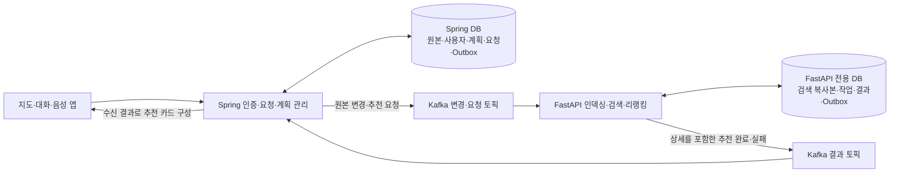
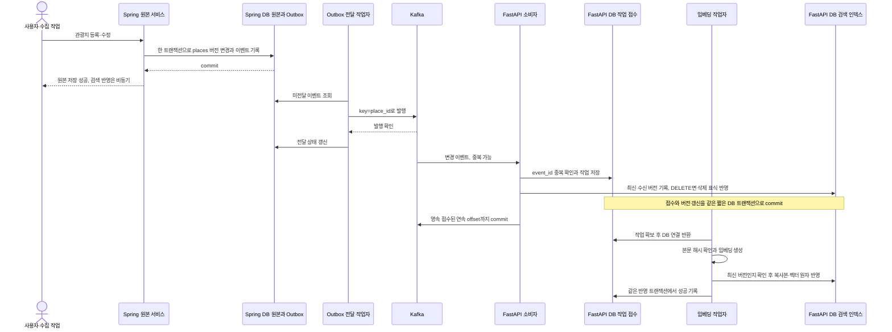
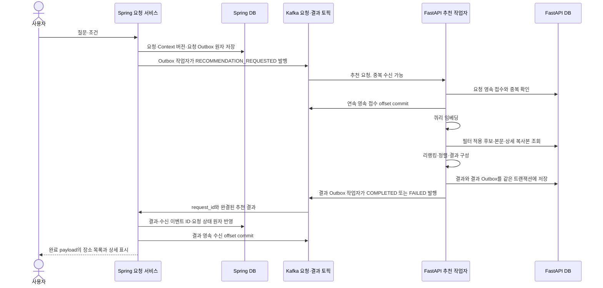

# 별도 DB·Kafka 요청/완료 기반 FastAPI 추천 구조

> 청크 검색 확장: [청크 구조도](contextual-retrieval.md)의 원문·문맥·장소별 최대 20개 활성 청크를 추가한다.
> DB 소유권과 Kafka 경계는 유지하며, 후보 장소의 최고 근거 청크 하나를 기존 리랭커에 전달한다.
> 청크 수에 따른 점수 합산은 하지 않는다. 무청크 기존 행은 점진 이행 동안 기존 벡터를 사용한다.

[문서 목록](../README.md) · [이벤트·DB 명세](../specifications/fastapi-place-recommendation.md) · [투어 가이드 전체 구조](personal-tour-guide.md)

갱신일: 2026-10-25, 한국 시간. 코드 확인 기준: `f9f09db`, 이전 설계: `7921ecb`. **사용자 지시에 따라 FastAPI 전용 DB와 Kafka 추천 요청·완료 흐름으로 갱신한 구현 계약입니다. 로컬 Codex의 진행 중인 구현을 확인한 결과나 서버 적용 완료 기록은 아닙니다.**

## 1. 확정한 역할

- **Spring과 Spring DB:** 관광지 원본·사용자·기억·계획을 관리하고, 요청을 인증해 Kafka로 전달합니다. 추천 결과를 영속 수신하고 앱 응답·계획 미리보기에 사용합니다.
- **FastAPI와 별도 FastAPI DB:** 임베딩·본문·지역·좌표·이미지 등 검색에 필요한 복사본을 저장합니다. 요청을 받아 쿼리 임베딩 → 후보 검색 → 리랭킹 → 순위가 정해진 추천 장소 목록을 만듭니다.
- **Kafka:** 관광지 원본 변경, 추천 요청, 추천 완료·실패를 각 계약으로 전달합니다. 추천 요청도 Kafka를 거칩니다.
- **추천 완료 payload:** ID뿐 아니라 이름·설명·좌표·지역·분류·이미지·출처·점수·순위·버전을 포함합니다. Spring은 완료 payload만으로 추천 카드를 구성하며 상세 보충을 위해 원본 DB를 재조회하지 않습니다.
- **임베딩 벡터:** FastAPI DB의 검색 인덱스에 보관합니다. 여기서 사용자가 말한 ‘임베딩 결과’는 원시 벡터가 아니라 검색·리랭킹을 마친 추천 장소 목록입니다.

이전의 같은 DB 내 테이블 분리와 Spring 상세 재조회 설계는 이 구조로 대체합니다. 두 DB 사이에 JOIN·공유 트랜잭션·물리 FK를 사용하지 않습니다. 관광지 원본과 검색용 복사본은 최종적 일관성으로 연결합니다.

## 2. 전체 구조도

두 DB는 별도 서비스·접속 정보·자격 증명·마이그레이션을 갖습니다. FastAPI는 Spring DB를, Spring은 FastAPI DB를 직접 조회하지 않습니다. 관광지 데이터는 원본 이벤트로 검색용 복사본을 재구축할 수 있게 합니다.

## 3. 등록·수정·삭제 흐름

- Kafka 전송은 원본 저장 트랜잭션 밖에서 수행합니다. 전송 실패 시 Outbox를 재시도합니다.
- Kafka 발행 성공 직후 프로세스가 종료되면 같은 이벤트가 다시 발행될 수 있습니다. `event_id`로 중복 처리하고, exactly-once 처리를 달성했다고 가정하지 않습니다.
- 소비자는 임베딩이 끝날 때까지 Kafka poll을 막지 않고 DB에 작업을 영속 접수한 뒤 offset을 commit합니다. 이것은 **접수 완료**이며 **검색 반영 완료**는 아닙니다.
- offset을 먼저 commit하지 않습니다. 파티션에서 앞선 미접수 메시지를 건너뛰어 뒤의 offset을 commit하지도 않습니다.
- 작업자는 재시도·재시작 후에도 버전 검사와 원자적 갱신을 지킵니다. 모델 추론 중 DB 트랜잭션을 열어 두지 않습니다.
- DELETE는 임베딩 없이 처리합니다. 버전 표식을 남겨 늦게 도착한 과거 UPSERT가 삭제된 관광지를 되살리지 못하게 합니다.

## 4. 추천 요청과 완결된 결과 전달

- 등록·수정 시 관광지 임베딩을 만드는 작업과 사용자 추천 작업은 구분합니다. 추천 완료 이벤트에 관광지 전체 벡터를 넣는 계약이 아닙니다.
- FastAPI 결과는 `items`의 순서·rank와 동일한 설명·점수·좌표·원본 버전을 포함합니다. Spring이 이름이나 이미지를 보충하기 위해 별도 DB 조회를 하지 않습니다.
- FastAPI는 조회를 끝낸 뒤 DB 연결을 반환하고 리랭킹합니다. 결과는 조회 시점의 일관된 인덱스 스냅샷으로 표시합니다. 최신 원본을 실시간 재조회한 결과라고 주장하지 않습니다.
- 같은 request_id에 다른 질문·필터가 오면 충돌입니다. 새 사용자 요청과 바뀐 Context에는 새 요청 ID 또는 명시된 세대를 사용합니다.
- 늦거나 중복된 완료 이벤트가 현재 화면의 새 요청·새 계획을 덮어쓰지 않도록 요청 ID·Context 버전·처리 상태를 확인합니다.
- 결과 전달은 비동기입니다. 앱의 접수 응답·진행 알림·최종 수신 방식과 대기 기한은 별도 확정합니다. 기존 동기 GET API와 자동 호환된다고 표시하지 않습니다.
- 추천 표시와 계획 변경은 별도입니다. 사용자가 계획 반영을 확정할 때 Spring이 소유권·현재 계획 버전·필수 장소 조건을 검증합니다. 이는 추천 결과의 상세 보충 조회와 구분합니다.

## 5. 데이터 소유권과 정합성

| 위치 | 저장 내용 | 수정 책임 |
|---|---|---|
| Spring DB | 관광지 원본·content_version, 변경 Outbox | Spring |
| Spring DB | 추천 요청·Context 버전·수신 결과·요청 Outbox | Spring |
| FastAPI DB | place_embeddings의 벡터·본문·모든 응답용 상세 복사본 | FastAPI |
| FastAPI DB | 인덱싱·추천 작업, 추천 결과·결과 Outbox | FastAPI |
| Kafka | 변경·요청·완료 이벤트 전달과 재처리 | 각 producer·consumer의 계약 |

각 서비스는 자신의 DB 트랜잭션과 Outbox를 사용합니다. Spring 원본 commit과 FastAPI 인덱스 반영을 하나의 DB 트랜잭션으로 묶지 않습니다. 두 DB 사이의 placeId는 논리 참조입니다.

| 위험 | 처리 |
|---|---|
| 원본 저장·추천 접수 후 Kafka 장애 | Spring Outbox에서 재전송 |
| Kafka 발행 확인 직후 Outbox 표시 실패 | 같은 이벤트 ID 재발행과 소비자 중복 제거 |
| v6 완료 후 v5 인덱싱 작업 완료 | 최신 수신 버전으로 조건부 갱신, v5 반영 차단 |
| 삭제 이후 오래된 UPSERT 도착 | 삭제 버전 표식으로 재생성 차단 |
| 복사본 본문·필터·이미지와 벡터의 버전 혼합 | 같은 source_version의 스냅샷으로 원자 반영 |
| 추천 계산 완료 후 Kafka 결과 발행 실패 | FastAPI DB의 결과 Outbox에서 재전송 |
| Spring 결과 수신 후 offset commit 전 장애 | 결과와 수신 ID를 함께 보존해 재수신 중복 제거 |
| 이전 화면 요청의 결과가 늦게 도착 | request_id·Context 버전으로 현재 요청과 분리 |
| 검색 복사본이 원본보다 늦음 | 스냅샷 버전·색인 지연으로 관측. 원본 최신성 보장 정책은 별도 확정 |

추천 응답에서 원본을 재조회하지 않으므로 실시간 원본과의 버전 일치를 동기 확인했다고 표시할 수는 없습니다. 원본 변경 전파 지연·삭제 반영 지연의 허용 기준은 확인 후 정합니다. 사용자 확정 시 계획의 유효성 검사는 Spring의 책임으로 유지합니다.

## 6. 실행 자원과 운영 범위

Kafka는 관광지 인덱싱뿐 아니라 추천 요청·완료 결과도 비동기로 전달합니다. 큐 대기·전달 시간이 추가되며 모델 추론 자체를 빠르게 만드는 장치는 아닙니다. 리랭커 약 9.95초 → 약 0.5초 이하 목표는 별도 최적화·측정 대상으로 유지합니다.

- 로컬 GPU: RTX 4050 Laptop 전용 VRAM 6GB. 운영 GPU는 미정입니다.
- 추천 요청 소비자·검색 파이프라인·결과 발행 작업자·관광지 인덱싱 작업자는 내부 모듈을 공유하되 실행 책임을 분리합니다. 무거운 관광지 배치 임베딩이 온라인 리랭킹을 무제한 밀어내지 않도록 작업량·동시 실행을 제어합니다.
- 모델·비동기 DB 풀·Kafka 클라이언트 수명을 관리합니다. 여러 프로세스에서 모델을 각각 로드해 VRAM을 중복 점유하지 않도록 배포 단위를 설계합니다.
- Kafka 브로커·토픽·소비자 운영은 선택 범위에 포함됩니다. 파티션 수·복제 수·보관 기간·재시도 횟수·모델 실행 한도는 운영 요구를 확인한 뒤 확정합니다.
- 로컬 브로커·토픽 초기화·Kafka UI는 [Docker 실행 안내](../../Docker/KAFKA_README.md)를 따릅니다. 기반 시설 준비와 Spring Outbox·FastAPI consumer 구현 완료를 구분합니다.
- 추천 요청 소비·결과 발행·인덱싱 readiness를 구분합니다. Kafka 장애 때 로컬 인덱스 조회 가능 여부와 요청·완료 전달 불가 상태를 별도로 관측합니다.
- 온라인 요청의 fallback·응답시간 예산과 인덱스 최신성 사용자 응답 정책은 아직 확정하지 않았습니다.

## 7. 현재 코드에서 이전하는 순서

1. Spring DB와 독립된 FastAPI PostgreSQL·pgvector DB, 접속 계정·마이그레이션·백업 경계를 준비합니다.
2. Spring 원본의 content_version과 변경 Outbox를 준비하고 수집·관리 경로의 이벤트 누락을 점검합니다.
3. FastAPI 전용 DB에 검색 복사본·작업·결과·Outbox를 만들고 본문·필터뿐 아니라 최종 응답에 필요한 이미지·출처 필드까지 반영합니다.
4. 변경·추천 요청·추천 결과 토픽과 producer·consumer를 연결합니다. 접수·완료·중복·실패·재전송을 각각 검증합니다.
5. 검증된 기존 벡터를 초기 이관하고 불일치·미확인 행은 재색인합니다. 초기 복사가 최신 이벤트를 덮어쓰지 않게 버전으로 병합합니다.
6. 원본 재조회 없이 결과 이벤트로 기존 지도 카드에 필요한 필드를 구성하는지 확인합니다.
7. 같은 인덱스·모델·조건에서 두 검색 모드의 후보·점수·순위와 기존 6개 지표를 비교합니다. 큐 왕복 시간과 모델 추론은 따로 측정합니다.
8. 일반 검색·Context·계획 생성·툴 호출의 접수·진행·결과 계약을 연결합니다. 공개 API의 동기/비동기 호환 방식은 별도 확정합니다.
9. 전환 검증 후 기존 places.embedding과 Spring의 벡터 UPDATE 경로를 정리합니다. 문서 작성 단계에서 기존 컬럼·볼륨·데이터를 삭제하지 않습니다.

현재 Docker에는 Kafka·UI 기반 시설이 준비되어 있습니다. 별도 FastAPI DB·추가 요청/결과 토픽 초기화·애플리케이션 연결은 로컬 Codex의 구현과 대조할 대상이며 이번 문서 갱신으로 배포하지 않습니다.
