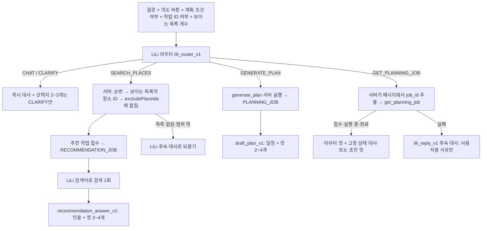

# LiLi 라우터

대화 턴의 첫 LLM 호출은 페르소나 LiLi 자신이다. LiLi는 장소 근거 없이 즉시 대사·감정을 내고 분기와 검색어를 정한다.
검색과 계획은 그 뒤 서버가 실행하는 작업이며, 결과에는 LiLi의 별도 컷 대사가 붙는다.

## 규칙

- 라우터 Strict JSON 필드 순서: `branch → intent → search_query → exclude_positions → emotion → message → choices`. 결정을 먼저 쓰고 대사를 쓴다.
- 라우터 대사는 반응과 예고만 한다. 장소 사실을 말하지 않는다. 평가는 `router_line_no_place_facts` 의미 기준으로 따로 본다.
- 대화 턴에서는 사전 검색을 하지 않는다. 장소 근거는 추천 작업(`RECOMMENDATION_GENERATION` 단계)에서만 준비된다.
- `job_id`는 LLM 출력에 없다. 서버가 사용자 메시지에서 UUID를 정확히 하나 찾을 때만 조회하고, 0개·여러 개면 LiLi 후속 대사로 다시 묻는다.
  라우터 입력의 `jobIdProvided`가 같은 규칙(`PlanningJobReference`)으로 계산된다. false면 LiLi는 CLARIFY로 되물어야 한다.
- 제외 검색은 순번으로 처리한다.
  - 앱이 지금 보여 주는 추천 결과를 `displayedResult {resultId, placeIds}`로 화면 순서대로 보낸다.
  - LiLi는 1부터 시작하는 순번(`exclude_positions`)만 낸다.
  - 서버(`DisplayedPositions`)가 순번을 장소 ID로 바꾸고, 기존 `excludePlaceIds`에 합친다.
  - 목록이 없거나 순번이 범위를 벗어나면 검색하지 않고 되묻는다.
  - 새 검색 결과로 "첫 번째"를 추정하지 않는다. 변환 결과는 `EXCLUSION` 이벤트로 남는다.
- 후속 대사(`lili_reply_v1`)는 서버 코드 이름이나 원본 도구 데이터를 받지 않는다.
  - 받는 것은 `LiliServerCode`의 한국어 상황 설명과 사용자용 사유, 되물어야 하는지 여부(`askUser`)뿐이다.
  - 실패 안내에는 선택지를 붙이지 않는다.
- 작업 조회 결과가 접수·실행 중·완료면 후속 모델 호출 없이 응답한다. 라우터 컷 뒤에 고정 상태 대사(`lili-job-status-v1.json`)나 초안의 컷을 붙인다.
  실패일 때만 LiLi 후속 대사를 쓴다.
- 계획 작업의 실패 사유는 사용자에게 보이는 문구다. 토큰 예산 같은 내부 실패는 일반 안내 문구로 바꿔 저장한다.
  내부 원인은 생성 응답 본문, 후보 ID와 함께 `PLAN_DRAFT` 이벤트로 작업에 연결해 기록한다.
- 도구는 LiLi의 분기에 따라 서버가 실행한다(`TOOL_RESULT.initiator = LILI`). 모델이 도구 호출을 직접 내지 않는다.
- 페르소나는 `conversation/persona/lili-v1.txt` 한 곳에 있고 라우터·후속·추천·계획 프롬프트가 같은 파일을 쓴다.
- 결과 대사는 `dialogue: [{text, emotion}]` 컷 2~4개, 컷당 1~2문장이다. 장소·일정 정보는 카드(`items`/`data`)에 두고 대사에 나열하지 않는다.
- 계획 초안은 `plans.character_dialogue`(JSONB)에 컷을 저장한다. 응답의 `message`/`emotion`은 첫 컷이다.

## 선택과 실행 경로

- 라우팅 구현은 `ConversationRoutingModule.Version`(`SINGLE_LLM_V1`, `LILI_ROUTER_V1`)으로 고르고 `supports()`로 하나만 선택한다.
  설정 키: `travelmate.conversation.modules.routing` (`CONVERSATION_ROUTING_MODULE`, 평가 `EVAL_CONVERSATION_ROUTING_MODULE`).
- 분기 처리는 `LiliBranchHandler` 구현(`LiliReplyHandler`, `LiliSearchHandler`, `LiliPlanHandler`, `LiliJobHandler`) 중 `supports(branch)`가 맞는 하나다.
- 추천 작업은 `POST` 대화 턴 안에서 접수되고 `GET /api/v1/recommendation-jobs/{jobId}`로 결과를 받는다. 같은 사용자·멱등 키는 한 작업으로 합쳐진다.
- 예산 원장은 대화 턴과 같은 case·input hash·request를 이어받고, 배경 작업은 단계별 상한(`maxPlanGenerationCalls`, `maxRecommendationGenerationCalls`)을 따로 둔다.

## 평가

- 평가셋은 `conversation-smoke-v2`(10문항)다. 판정 범위는 [v2 설명](../../Evaluation/datasets/conversation-smoke-v2/README.md)에 있다. 채점은 `Evaluation/tracks/conversation/lili_score.py`.
- 제외 문항은 네 가지를 대조한다: 순번, 서버 변환 ID, 작업의 `searchCriteria.excludePlaceIds`, 작업 결과에 그 장소가 없는지.
- 계획 문항은 접수(`plan_job_accepted`)와 초안 완성(`plan_job_succeeded`, `plan_draft_retrieved`)을 따로 판정한다.
- 모든 LiLi 대사에서 내부 코드·용어를 찾는다. 추천 대사에서는 근거 원문이 없는 후보의 이름을 찾는다.
- 자동 검사: 라우터 관측·스키마, 분기, 검색어, 대화 턴 사전 검색 없음, 분기별 도구, 서버 실행, 도구 인자, 선택지는 CLARIFY만,
  추천 작업 완료·검색 1회·검색어 일치·컷 수·인용 원문 포함.
- 러너(`job_follow.py`)는 추천 작업을 2초 간격으로 최대 180초, 계획 생성 작업을 3초 간격으로 최대 240초 폴링한다. 모두 `runtime_read` 상한 안에서만 읽는다.
  계획이 성공하면 초안을 한 번 더 조회한다. 실패나 시간 초과는 완성으로 보지 않는다.
- 라우팅 경계 50문항 세트는 별도로 추가한다(미작성).
