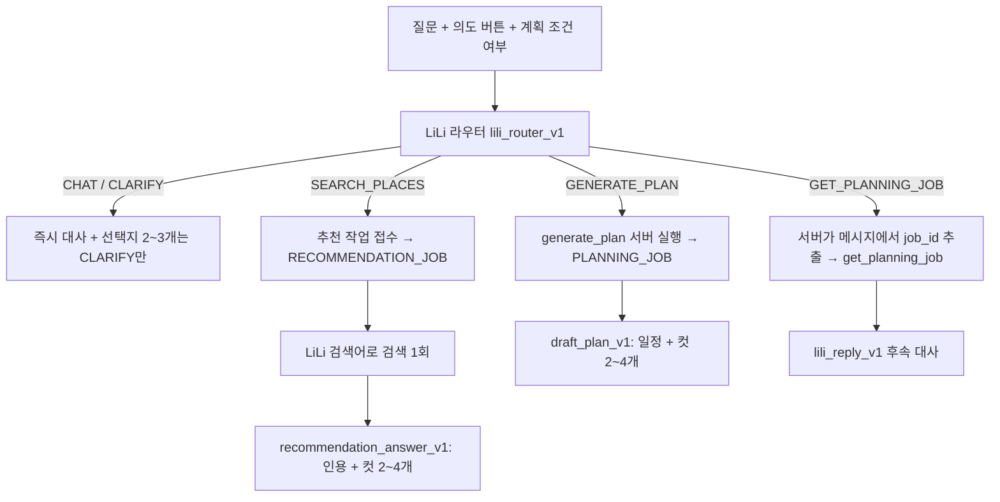

# LiLi 라우터

대화 턴의 첫 LLM 호출은 페르소나 LiLi 자신이다. LiLi는 장소 근거 없이 즉시 대사·감정을 내고 분기와 검색어를 정한다.
검색과 계획은 그 뒤 서버가 실행하는 작업이며, 결과에는 LiLi의 별도 컷 대사가 붙는다.

## 규칙

- 라우터 Strict JSON 필드 순서: `branch → intent → search_query → emotion → message → choices`. 결정을 먼저 쓰고 대사를 쓴다.
- 라우터 대사는 반응과 예고만 한다. 장소 사실을 말하지 않는다. 평가는 `router_line_no_place_facts` 의미 기준으로 따로 본다.
- 대화 턴에서는 사전 검색을 하지 않는다. 장소 근거는 추천 작업(`RECOMMENDATION_GENERATION` 단계)에서만 준비된다.
- `job_id`는 LLM 출력에 없다. 서버가 사용자 메시지에서 UUID를 정확히 하나 찾을 때만 조회하고, 0개·여러 개면 LiLi 후속 대사로 다시 묻는다.
- 도구는 LiLi의 분기에 따라 서버가 실행한다(`TOOL_RESULT.initiator = LILI`). 모델이 도구 호출을 직접 내지 않는다.
- 페르소나는 `conversation/persona/lili-v1.txt` 한 곳에 있고 라우터·후속·추천·계획 프롬프트가 같은 파일을 쓴다.
- 결과 대사는 `dialogue: [{text, emotion}]` 컷 2~4개, 컷당 1~2문장이다. 장소·일정 정보는 카드(`items`/`data`)에 두고 대사에 나열하지 않는다.
- 계획 초안은 `plans.character_dialogue`(JSONB)에 컷을 저장한다. 응답의 `message`/`emotion`은 첫 컷이다.

## 선택과 실행 경로

- 라우팅 구현은 `ConversationRoutingModule.Version`(`SINGLE_LLM_V1`, `LILI_ROUTER_V1`)으로 고르고 `supports()`로 하나만 선택한다.
  설정 키: `travelmate.conversation.modules.routing` (`CONVERSATION_ROUTING_MODULE`, 평가 `EVAL_CONVERSATION_ROUTING_MODULE`).
- 분기 처리는 `LiliBranchHandler` 구현(`LiliReplyHandler`, `LiliSearchHandler`, `LiliPlanHandler`, `LiliJobHandler`) 중 `supports(branch)`가 맞는 하나다.
- 추천 작업은 `POST` 대화 턴 안에서 접수되고 `GET /api/v1/recommendation-jobs/{jobId}`로 결과를 받는다. 같은 사용자·멱등 키는 한 작업으로 합쳐진다.
- 예산 원장은 대화 턴과 같은 case·input hash·request를 이어받고, 배경 작업은 단계별 상한(`maxPlanGenerationCalls`, `maxRecommendationGenerationCalls`)을 따로 둔다.

## 평가

- 회귀 9문항은 `expected.lili_branch`를 가진다. 채점은 `Evaluation/tracks/conversation/lili_score.py`.
- 자동 검사: 라우터 관측·스키마, 분기, 검색어, 대화 턴 사전 검색 없음, 분기별 도구, 서버 실행, 도구 인자, 선택지는 CLARIFY만,
  추천 작업 완료·검색 1회·검색어 일치·컷 수·인용 원문 포함.
- 러너는 추천 작업을 2초 간격, 최대 180초 폴링하며 `runtime_read` 상한 안에서만 읽는다.
- 라우팅 경계 50문항 세트는 별도로 추가한다(미작성).
