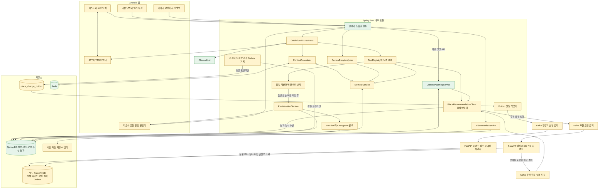
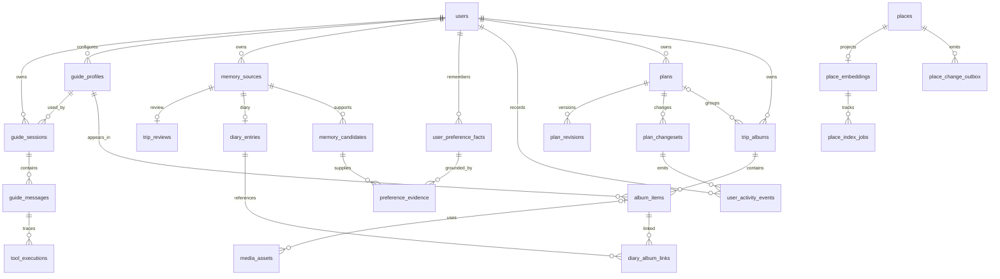
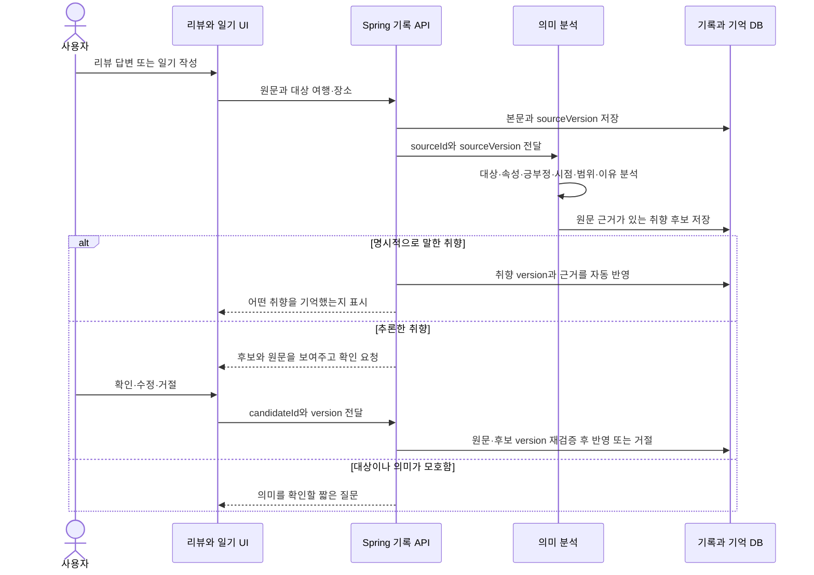
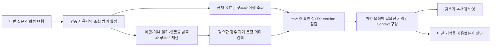
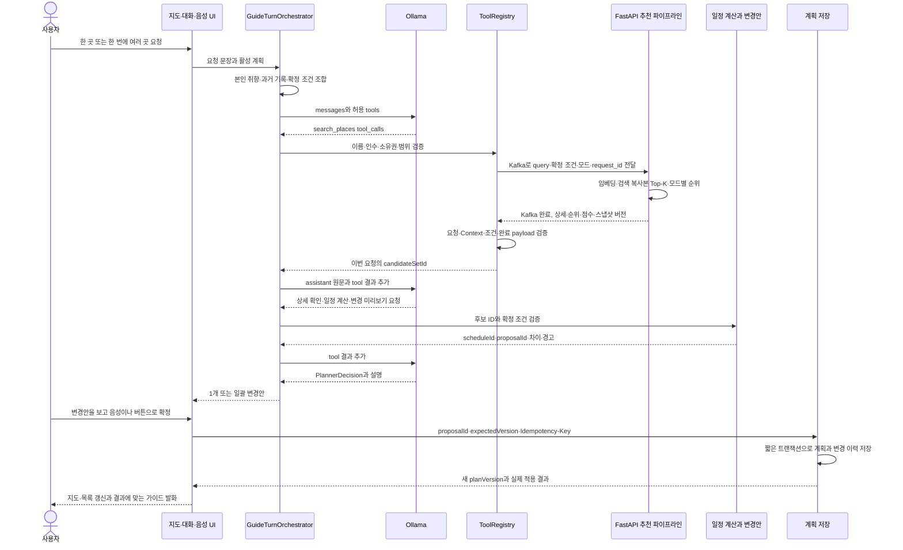
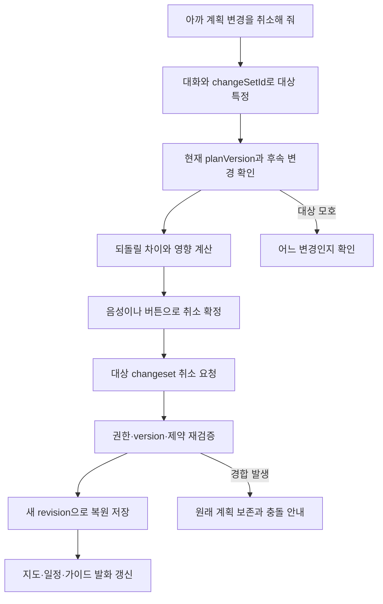
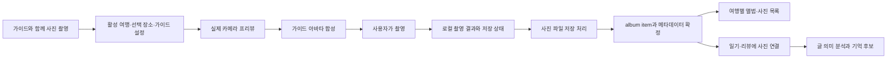

# 개인화 투어 가이드 구조도

[문서 목록](../README.md) · [상세 명세서](../specifications/personal-tour-guide.md) · [FastAPI 추천 구조도](fastapi-place-recommendation.md)

기존 TravelMate에 사용자 기억·대화·일정 변경·카메라 합성 사진 앨범을 연결하는 구조안입니다. 명시적 취향 자동 저장, 추론 취향 확인 후 저장, 계획 변경만 롤백, 실제 카메라에 가이드 아바타 합성은 사용자가 지정한 요구사항입니다. 신규 모듈·테이블·API는 구현 전 제안입니다.

2026-10-25 갱신: Spring DB와 FastAPI DB를 분리하고 추천 요청·완료도 Kafka로 전달하는 구조입니다. FastAPI는 자신의 복사본으로 검색·리랭킹하고 상세가 포함된 장소 목록을 완료 이벤트로 보냅니다. Spring은 응답 상세를 보충하려고 원본을 재조회하지 않습니다. [이벤트·DB 명세](../specifications/fastapi-place-recommendation.md)를 참고하며 현재 코드가 이미 이전됐다는 뜻은 아닙니다.

## 1. 전체 구성

초록은 현재 연결된 구성요소, 노랑은 추가·변경 설계입니다. 선은 목표 연결을 나타내며 전체 흐름이 현재 동작한다는 뜻은 아닙니다. Spring Boot의 업무 모듈, FastAPI의 추천 파이프라인, 기존 Ollama를 연결하는 구조입니다.

- 지도·조건 입력·계획 조회는 부분 구현입니다. 공통 편집기와 대화 동기화 전체를 완료한 상태는 아닙니다.
- Spring Boot가 사용자 권한·조건·검증·저장을 관리합니다. LLM은 사용자 UID를 선택하거나 직접 SQL을 실행하지 않습니다.
- 추천 툴은 Kafka로 요청하고 완료 이벤트의 상세 장소 목록을 받습니다. FastAPI 내부에서 쿼리 임베딩 → 전용 DB 복사본 Top-K → 모드별 리랭킹을 수행합니다. Spring은 완료 payload로 응답을 구성하며 상세 재조회를 하지 않습니다. 세 Kafka 노드는 같은 브로커의 서로 다른 토픽입니다.
- Spring은 원본과 Outbox를 같은 트랜잭션으로 기록하고 Kafka로 전달합니다. FastAPI는 이벤트로 자신의 검색 인덱스만 수정합니다. 원본 JOIN이나 직접 수정 권한은 부여하지 않습니다. 개인 기억·계획·일기·사진의 소유권 검증과 저장은 Spring이 관리합니다.
- 검색용 복사본은 비동기 반영됩니다. 이벤트 ID·원본 버전·삭제 표식·결과 payload 검증으로 정합성을 관리합니다. Kafka 적용과 리랭커 추론 속도 최적화는 별도 검증입니다.
- Spring DB와 FastAPI DB는 별도 서비스입니다. 결과 payload는 사용한 인덱스 버전을 표시하며 최신 원본을 동기 확인한 결과라고 표시하지 않습니다. 추천 표시와 계획 확정 시의 소유권·버전·필수 조건 검증은 구분합니다.
- PostgreSQL 활용은 기존 [대화 영속화 비교안](../../MDs/chat_persistence_options.md)을 계승하는 구조 제안입니다. 신규 테이블은 아직 적용하지 않습니다.
- Redis는 재구성 가능한 세션 Context·작업 캐시 후보입니다. 장기 취향·계획 이력·사진의 유일한 저장소로 사용하지 않는 구조안입니다.
- STT/TTS 제공자, 카메라 합성의 2D/3D 방식, 파일 저장소는 미정입니다. 촬영 범위를 별도 VR 공간이나 VR 기기로 확대하지 않습니다.
- 대화 미리보기에서 현재의 `generate()`·`create()`를 그대로 호출하면 확정 전 저장이 발생합니다. 신규 계산·미리보기 경로는 저장을 분리하고, 기존 서비스의 후보 조회·검증 로직을 재사용하는 방식으로 설계해야 합니다.

## 2. 데이터 관계

기존 `users`, `plans`, `places`와 연결하는 논리 모델입니다. 아래 나머지 테이블과 관계는 제안이며, `plans`에 version을 연결하는 마이그레이션도 아직 없습니다. 검색 복사본의 관계는 논리 참조이며 원본 hard delete 시 삭제 버전 표식을 잃는 물리 FK를 뜻하지 않습니다.

| 정보 | 보관 위치 제안 | 구분할 점 |
|---|---|---|
| 이번 여행의 조건 | 기존 `plans.context`와 세션 Context | 한 여행의 조건을 영구 취향으로 간주하지 않음 |
| 가이드 캐릭터 설정 | `guide_profiles` | 아바타·발화 스타일 설정과 사용자 취향 사실을 구분 |
| AI 대화 | `guide_sessions`, `guide_messages` | 기존 `chats`는 방의 사용자 대화용. AI role·tool 결과 계약은 별도 |
| 리뷰·일기·명시 취향 발언 | `memory_sources`와 본문/메시지 참조 | 원문과 분석 결과를 분리 |
| 취향 후보 | `memory_candidates` | 명시·추론·모호함을 구분하고 근거 구절 보존 |
| 장기 취향 | `user_preference_facts`, `preference_evidence` | 명시 발언은 자동 반영, 추론은 확인 후 반영 |
| 여행·행동 기록 | `user_activity_events`, 기존 plans/pins | 계획에 추가한 사실과 실제 방문을 구분 |
| 계획 변경·취소 | `plan_revisions`, `plan_changesets` | 과거 내용을 복원하더라도 version은 새로 증가 |
| 사진 앨범 | `trip_albums`, `album_items`, `media_assets` | 파일 본체와 목록·여행·가이드 메타데이터를 구분 |

정확한 논리 필드와 연결 조건은 [상세 명세 4장](../specifications/personal-tour-guide.md#4-논리-데이터-모델-제안)에 있습니다.

## 3. 리뷰·일기·답변에서 취향을 저장하는 흐름

단순 감성 점수만 저장하지 않습니다. “전시는 좋았는데 오늘 사람이 많아서 힘들었어”는 전시·혼잡이라는 두 대상을 분리하고, 오늘의 경험과 평소의 취향을 구분합니다. “나는 북적이는 곳을 싫어해”는 명시 취향입니다. “여기가 피곤했어”에서 모든 혼잡한 곳을 싫어한다고 추론했다면 확인을 받습니다.

가이드가 “오늘 그 장소는 어땠어?”라고 물으면 질문 ID·대상 placeId·사용자 답변을 묶어 저장합니다. “아까 거기”의 대상이 확정되지 않으면 모델이 장소를 추측해 기억하지 않습니다. 명시 취향 자동 저장과 추론 확인의 구체적인 경계 예시는 명세서의 검토안으로 구분합니다.

## 4. 다음 대화에서 기억을 찾아 사용하는 흐름

- 확인된 “조용한 곳 선호”는 구조화된 값으로 먼저 조회합니다. 모든 프로필을 매번 벡터 검색할 필요는 없습니다.
- “지난번 사람이 많아서 싫었던 곳”은 본인 리뷰·일기를 날짜·여행·장소로 좁힌 뒤 의미 검색하는 구조안입니다. 소유자·가시성·기억 상태 필터를 Top-K 이전에 적용합니다.
- 기억 임베딩은 검색 인덱스 제안입니다. 원문·출처·version·사용자 확인 상태를 대체하지 않습니다. 개인 기억에 pgvector를 추가하는 구현 여부는 확정 전입니다.
- 장소를 클릭하거나 계획에 넣었다는 이유만으로 취향이나 방문 완료를 자동 확정하지 않습니다.
- 이번 요청과 장기 취향이 달라도 이번 여행의 예외와 장기 취향 수정을 구분합니다. 기존 명세의 확정 폼 조건과 충돌하면 확인 질문으로 해결합니다.

## 5. 의미검색 → Top-K → 1개 또는 일괄 생성·배정

현재 `ContextPlanningService.generate()`는 새 DRAFT를 생성 후 저장합니다. 위의 일반 툴 반복, 기존 계획 변경안, 시간표·실제 경로 계산은 아직 연결되지 않았습니다. 사용자는 대화·음성 변경안을 먼저 보고 음성이나 버튼으로 확정하는 방식을 지정했습니다. 미리보기와 확정 전용 draft를 어떻게 보관할지는 제안 계약이며, 현재 생성 API를 이번 문서 작업에서 변경하지 않습니다.

모델은 필요한 정보·계산을 요청하고, 실제 검색·경로 계산·저장은 서버가 실행합니다. 후보에 없는 placeId, 다른 요청의 scheduleId, 모델이 만든 좌표·운영시간·이동시간은 채택하지 않습니다. 1개와 일괄 방식은 같은 검증·변경 경로를 쓰는 제안입니다.

## 6. 마음에 들지 않는 계획 변경을 되돌리기

사용자가 지정한 롤백 범위는 **장소 추가·삭제·배정 등 계획 변경**입니다. 이 작업으로 장기 취향·리뷰·일기·사진을 되돌리거나 삭제하지 않습니다. 취향 수정·삭제는 별도의 기억 관리 기능입니다.

저장된 작업의 “되돌리기”는 SQL 실패의 `ROLLBACK`과 다릅니다. 저장해 둔 변경 전후 상태를 이용해 새로운 version을 만들며, LLM에게 과거 계획을 다시 상상해서 작성하게 하지 않습니다. 후속 편집을 조용히 덮어쓰지 않습니다.

## 7. 실제 카메라에 가이드를 합성하고 사진첩에 저장

사진에는 가이드 설정의 version을 연결하여 나중에도 어떤 가이드와 찍었는지 확인합니다. 카메라 합성형 촬영은 요구사항으로 확정됐지만 2D/3D 아바타, 공간 고정, 렌더링 엔진·파일 저장소는 미정입니다. 촬영 성공과 서버 앨범 저장 성공은 구분해 표시합니다.

사진만으로 사용자의 감정·장기 취향·실제 방문을 확정하지 않습니다. 기억은 연결된 일기·리뷰·명시 발언과 정해진 확인 정책에서 가져옵니다.

## 8. 현재 코드와 연결점

| 역할 | 현재 코드 | 추가 설계 |
|---|---|---|
| 이번 조건 | [PlanContext](../../Server/TravelMate/src/main/java/com/yollo/TravelMate/domain/plan/data/request/PlanContext.java) | 장기 취향과 이번 확정 조건을 구분하는 ContextAssembler |
| 장소 검색 | [PlaceSemanticSearchService](../../Server/TravelMate/src/main/java/com/yollo/TravelMate/domain/place/service/PlaceSemanticSearchService.java) | 별도 FastAPI DB·Kafka 요청/완료로 이전. 상세를 포함한 결과 payload 사용. [CQRS 구조](fastapi-place-recommendation.md) 참고 |
| 생성 | [ContextPlanningService](../../Server/TravelMate/src/main/java/com/yollo/TravelMate/domain/plan/service/ContextPlanningService.java) | 1개·일괄 제안, 배정·시간표 계산 |
| LLM 계약 | [LlmClient](../../Server/TravelMate/src/main/java/com/yollo/TravelMate/ai/llm/base/LlmClient.java) | messages·tool_calls·tool 결과를 보존하는 호출 |
| LLM 구현 | [OllamaLlmClient](../../Server/TravelMate/src/main/java/com/yollo/TravelMate/ai/llm/derived/OllamaLlmClient.java) | 도구 반복 호출과 최종 구조화 출력 |
| 저장 | [ContextPlanRepository](../../Server/TravelMate/src/main/java/com/yollo/TravelMate/domain/plan/repository/ContextPlanRepository.java) | version·revision·changeset 저장 |
| 비동기 작업 | [PlanningJobRepository](../../Server/TravelMate/src/main/java/com/yollo/TravelMate/domain/plan/repository/PlanningJobRepository.java) | turnId·proposalId·changeSetId 연결 |
| 방 채팅 | [chats 정의](../../Docker/init/01-schema.sql) | AI 전용 role·도구 결과 저장 모델 별도 추가 |

미정 정책은 [문서 목록](../README.md)의 결정표에서 확인합니다. 코드·DB 변경은 이 문서 작성에 포함하지 않습니다. 평가 범위는 유지하며, 사용자 지정 리랭커 추론 목표는 별도 추천 구조 문서에 기록했습니다.
