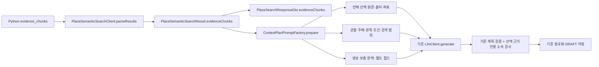

# 검색 원문 근거의 Spring·계획 LLM 전달

2026-11-01. [도구 구조 점검](single-llm-tool-integration-audit.md) 후속의 **1단계만** 구현한다.
계획 검증 공통화·단일 LLM 도구 루프·일정 수정·실제 이동시간/동선 최적화는 이번 변경에 포함하지 않는다.



## 전달 계약

`SearchEvidenceChunk`는 Kafka 문서를 복사해 보존하는 불변 값이다. 검색 응답 JSON에서는 별도 wrapper 없이 원래 문서 모양으로 직렬화한다.
`chunk_text`, source ID/version, chunk/context version, metadata, place_refs, 관계·핵심/보조·방향·conditions,
검색 범위와 기존 추가 필드는 그대로 유지한다. 외부 코드가 반환된 JsonNode를 수정해도 보존 값은 바뀌지 않는다.
기존 근거 없는 메시지는 빈 목록으로 호환하고 설명에서 새 출처를 만들어내지 않는다. 전달된 근거의 잘못된 형식은 조용히 버리지 않는다.

선택 근거의 source_span 길이, 관계 인용의 범위·내용, 조건 인용, matched_relations와 관계 순번을 검사한다.
Python 좌표는 Unicode code point 단위이므로 Java UTF-16 인덱스로 바로 자르지 않는다.
이 검사는 인용의 전달 무결성이다. Kafka 출처의 외부 진위나 장소 귀속의 의미 정확성을 새로 판정하는 기능은 아니다.

## 기존 계획 입력

`ContextPlanningService`는 검색 결과를 버리지 않고 `prepare(request, candidates, searchResults)`로 전달한다.
기존 후보 ID·순서·필수 장소 병합·검색 인자와 정규화·저장 호출을 유지한다.
기존 `description` 요약은 최대 400자를 유지하지만, `selectedEvidence`의 원문은 자르지 않는다.

| 필드 | 내용·역할 |
|---|---|
| `original` | 선택 원문 chunk_text, 출처·버전·좌표·metadata |
| `annotations` | content_kind·place_refs·관계와 조건. 원문에 대한 구조화 정보이며 의미적 진실 판정이 아님 |
| `generatedSupplement` | 생성된 context_text·가상 질문·추출 엔티티·생성 이력. 원문 인용으로 사용하지 않음 |
| `retrieval` | context version·검색 범위·선택 관계·관계 순번·점수 |
| `evidenceId` | 해당 요청·장소·선택 슬롯에 부여한 참조 ID. 외부 문서 ID가 아님 |

검색에서 근거를 받은 필수 장소도 그 선택 근거를 유지한다. 검색되지 않은 필수 장소나 구버전 호환 결과에는 `NONE_SELECTED`를 표시한다.
선택 근거가 있더라도 상태는 `SELECTED_UNASSESSED`이며 의미적 적합성이 확인됐다는 뜻이 아니다.

기존 LlmClient와 모델 설정을 사용한다. 계획 시스템 프롬프트에 원문/보충 문맥 구분, 장소 귀속·방향·조건 유지,
부족·부정·상충·과거 기록을 현재 사실로 바꾸지 말라는 지침과 구조화 인용 형식만 덧붙인다.
별도 판정 LLM이나 이동 의도 정규식은 없다. 구형의 미연결 PlanGenerationService에 새 검색을 붙이지 않는다.

## 출처·인용 소속 검증

기존 GeneratedPin에 선택형 `citations`를 추가한다.

```json
{"evidenceId":"E101-0","sourceId":"전달한 실제 source_id","quote":"정확한 원문 인용"}
```

`PreparedPrompt`는 실제 직렬화한 선택 근거의 참조 집합을 보관한다. `PlanEvidenceCitationValidator`는 다음을 검사한다.

- evidenceId가 해당 요청에서 전달됐는가.
- 그 ID가 인용을 단 장소의 선택 근거인가.
- sourceId가 그 근거의 실제 source_id와 같은가.
- quote가 허용된 실제 원문에 포함되는가. 생성 보충 문맥만의 문장은 허용하지 않는다.
- 관계 범위로 받은 근거는 선택 관계의 인용으로만 사용했는가. 다른 장소의 관찰 문장을 목적지의 근거로 인용하지 못하게 한다.

인용이 있으면 검사 실패 시 기존 실패 경로로 종료해 저장하지 않는다. 인용이 없는 기존 출력은 호환한다.
본문 문자열을 의미 분석하거나 자유문장 속 ID를 출처로 해석하지 않는다. **서버가 검증하는 출처 표시는 구조화된 citations뿐**이다.
올바른 출처 ID를 붙인 잘못된 설명, 부정 반전·상충 무시를 이 검사만으로 탐지했다고 주장하지 않는다.
정확한 독립 인용이 없는 구버전 관계 전용 근거는 해당 관계의 인용을 허용하지 않는다. 원문 전달 자체는 유지한다.

DB 스키마·저장 방식은 유지한다. 기존 계획 정규화 후 저장에서는 이 임시 검증용 인용을 별도로 영속화하지 않는다.
따라서 인용 카드·답변 출처 UI나 장기적인 주장별 인용 감사 저장까지 구현된 것은 아니다.

## 검증과 한계

[모의 Kafka → 실제 소비/DTO → 실제 계획 서비스 → 모의 LLM 검증 기록](../../Evaluation/runs/contextual/spring-evidence-delivery-v1/20261101-01/REPORT.md)

전체 원문이 LlmClient 요청 문자열에 들어가는 것까지 검사했다. 실제 모델은 호출하지 않았다.
전체 근거·metadata가 늘면 요청이 길어진다. 기존 Ollama의 context/token 설정을 바꾸지 않았으며 실제 토큰 예산·응답 품질·서비스 지연은 미검증이다.
기본 선택 근거 수·활성/후보 상한은 그대로이므로 필요한 모든 근거가 선택됐다는 보장도 없다.
실제 검색·계획 품질과 의미 판정, 공통 계획 검증, 도구 호출 루프는 별도 과제로 남긴다.
