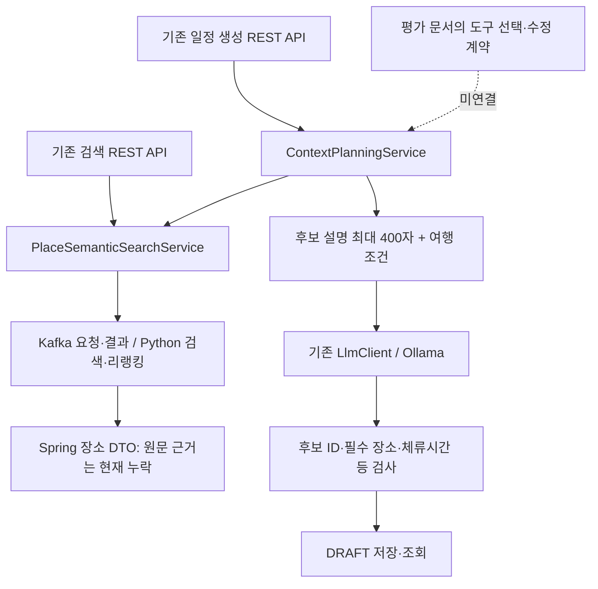

# 단일 LLM의 도구 구조와 평가 연결 점검

2026-11-01. 점검 기준 코드 `67f9f799`. 기존 원문 연결 요청보다 먼저 검색·일정 생성·수정의 실제 연결을 확인한 기록이다.
**현재 서버에 평가 문서와 같은 단일 LLM 도구 오케스트레이터가 완성돼 있지는 않다.**
검색 API와 일정 초안 생성 API는 있지만 도구 선택·실행·최종 응답을 묶는 루프, `modify_plan` 실행기, 평가 기록 어댑터가 빠져 있다.
설명 문장을 붙이는 변경만으로 검색·리랭킹·계획 도구가 완성됐다고 판단할 수 없다.

이 점검에서는 애플리케이션 코드를 수정하지 않았다. 모델·실제 검색·평가 실행·운영 DB 반영·배포도 하지 않았다.
파일 해시와 기존 데이터셋의 선언 수는 [inventory.json](../../Evaluation/runs/tool-architecture-audit/20261101-01/inventory.json)에 있다.

## 1. 실제 LLM 호출 경로

[LlmClient](../../Server/TravelMate/src/main/java/com/yollo/TravelMate/ai/llm/base/LlmClient.java)는
`generate(systemPrompt, userPrompt) -> String`만 제공한다.
[OllamaLlmClient](../../Server/TravelMate/src/main/java/com/yollo/TravelMate/ai/llm/derived/OllamaLlmClient.java)는
기존 설정의 모델(코드 기본값 `qwen3:8b`)에 `/api/chat`을 호출한다. 시스템·사용자 메시지 두 개와 JSON 출력 옵션을 보내며
native `tools` 입력, `tool_calls` 응답 파싱, tool-result 메시지 누적, 대화 이력 기반 반복 실행은 구현돼 있지 않다.
실제 실행 중인 모델 설정을 조회한 것은 아니므로 기본값을 운영 모델 확정값으로 읽으면 안 된다.

실제 API에서 확인되는 LLM 사용은 `ContextPlanningService.runGeneration -> LlmClient.generate`의 일정 초안 생성이다.
이 서비스가 검색을 먼저 실행한 뒤 LLM에 후보를 넣는다. LLM이 `search_places`를 선택해 호출하는 흐름은 아니다.
구형 `PlanGenerationService`와 핀 활동용 `PinActivityService`도 같은 LlmClient를 사용하지만,
이를 검색·생성·수정 전체의 대화 도구 루프로 볼 수 없다. 구형 생성 서비스는 일반 컨트롤러 호출 연결을 찾지 못했다.

## 2. 도구별 계약과 현재 입력·출력

평가의 [tool_contracts.json](../../Evaluation/datasets/v1.4.0/generated/schemas/tool_contracts.json)은
자체 상태를 `evaluation_design_contract; not a claim that production tools exist`로 명시한다.
아래의 평가 도구 이름과 REST API는 같은 구현이라고 가정할 수 없다.

| 도구 | 평가 계약 | 실제 입력·출력 | 연결 상태·공백 |
|---|---|---|---|
| `search_places` | query, region, city, exclude_place_ids, area → `PLACES` | `GET /api/places/search`: query·region·city·category·limit·rankingMode. `POST /api/v1/places/search`: context·query·limit와 rankingMode. 결과는 장소 DTO 목록 | 실제 검색·리랭커까지 연결. LLM 도구 등록/호출과 공통 응답 envelope는 없음. Spring에서 exclude_place_ids는 항상 빈 배열이며 공개 요청으로 받지 않음 |
| `create_plan` | place_ids·start_at·end_at·origin·transport → 서버 계산 미리보기 `PLAN` | `POST /api/v1/plans/generations`: GeneratePlanRequest + Idempotency-Key → Job(202), 이후 job·plan 조회. `POST /api/v1/plans`: 필수 장소로 직접 초안 저장 → Draft(201) | 기존 초안 생성 경로는 있음. 평가 계약의 선택 ID 전용 도구·신뢰 경로 비용으로 서버 순서/시간 계산·미리보기 후 확인 적용과는 다름 |
| `modify_plan` | plan_id·operation·target_place_id·new_place_id → `PLAN_DIFF`, 확인 전 preview | 대응하는 일정 수정 REST/service 실행 경로를 찾지 못함 | 평가 스키마·문항·채점기는 있지만 실제 변경/미리보기/확인/버전/롤백 연결 없음 |
| `ask_clarification` / `recall_memory` | missing / query → 확인 질문·소유자 범위 기억 조회 | 일반 대화 도구 실행 경로를 찾지 못함 | 일정 API의 검증 오류를 이 도구의 구현으로 세지 않음 |

### 검색 입력의 차이

기존 검색 흐름은 Controller → `PlaceSemanticSearchService` → `PlaceSemanticSearchClient` → Kafka → Python → 결과 수신이다.
최대 반환 20개, 서비스 내부 허용 최대 30개, 후보 상한 30개·활성 상한 20개는 서로 구분한다.
`SEMANTIC_ONLY`와 `RERANKED`를 요청할 수 있다. 현재 설정·데이터에 대한 새 검색은 하지 않았다.

지도 범위 POST는 `PlanContext`를 요구한다. area뿐 아니라 시작/종료 시각·출발점·선호 등 일정 context 형식이 필요하며,
서비스는 query에 themes와 additionalRequest를 덧붙인다. region 검색은 해당 POST 서비스에서 지원하지 않는다.
GET의 region/city/category와 POST의 area를 평가의 모든 조건과 자동으로 같다고 볼 수 없다.

### 일정 입력과 서버의 실제 검증 범위

`GeneratePlanRequest`는 context, inputMethod(TEXT/VOICE), requiredStops(placeId·stayMinutes·fixedStartAt)다.
context에는 area·origin/destination·startAt/endAt·transportMode·objective·preferences·categoryRequirements·additionalRequest·unknownHoursPolicy가 있다.
스키마에 필드가 있다는 사실과 서버가 그 의미를 계산·준수한다는 사실은 다르다.

| 조건 | 현재 코드의 처리 |
|---|---|
| 필수 장소 | ID 존재·중복·선택 범위 검사, 생성 결과에 모두 포함됐는지 검사 |
| 후보·방문 수·순번 | 후보 밖/중복 ID 거부, 1~6개와 순번 집합 검사. 이름·좌표는 서버 후보 값으로 저장 |
| 시간 | 같은 한국 날짜·최대 12시간 입력 검증. LLM 생성 경로는 체류시간 합을 검사하지만 직접 초안 저장 경로는 이 결과 검증기를 거치지 않음. 실제 이동시간을 포함한 일정은 아님 |
| 지도 범위 | 원형 범위만 지원. 필수 장소는 서버 거리 검사. REGION은 거부 |
| 차량·고정 시각·예산 | CAR, fixedStartAt 지정, budgetKrw 지정은 지원하지 않아 거부 |
| 운영시간 | EXCLUDE는 검증할 수 없어 거부. ALLOW_WITH_WARNING에서는 미확인 초안 경고 |
| 카테고리 | LLM 생성 경로에서 CAFE 최소 개수만 코드 검사. 직접 초안 저장에는 같은 검사가 없음. 모든 자연어 선호·회피 조건을 검증하는 것은 아님 |
| 순서·동선·objective | LLM이 sequence를 제안하고 서버가 형식을 검증·정규화. DISTANCE/DURATION에 따른 경로 최적화·도로 이동시간 계산은 없음 |
| 사용자 확인 | 생성 완료 시 DRAFT를 저장. 평가의 preview proposal → 확인 이벤트 → 버전 증가 commit과는 다른 흐름 |

`PlanningResponse.Draft`는 planId·context·title·pins·warnings를 반환한다.
pins에는 placeId·이름·좌표·체류시간·순서가 있고, 평가 PLAN의 arrivalAt/departureAt·proposalId/applied·확정 버전 계약은 없다.
따라서 일정 초안이 저장됐다는 사실로 일정 조건 준수나 수정 완료를 확정하면 안 된다.
특히 직접 저장과 LLM 생성의 검증 단계가 다르므로 두 경로의 조건 준수 결과도 합쳐서 평가하면 안 된다.

## 3. 원문 근거가 끊기는 위치

Python 완료 이벤트에는 `evidence_chunks`와 원문·문맥·출처·귀속·관계·조건이 있다.
하지만 [PlaceSemanticSearchClient.parseResults](../../Server/TravelMate/src/main/java/com/yollo/TravelMate/domain/place/client/PlaceSemanticSearchClient.java)는
`PlaceResult`와 rerankScore만 만들어 `PlaceSemanticSearchResult`로 반환한다. 완료 원본 JSON은 DB에 보존하지만 호출자 DTO로 근거를 넘기지 않는다.
`PlaceSearchResponseDto`에도 원문 근거·출처 ID가 없다.

일정 생성에서는 검색 결과에서 `.place()`만 추출하고, `ContextPlanPromptFactory`가 description을 최대 400자로 자른다.
별도 원문 인용·출처 목록·관찰 주체·관계 방향·제한 조건·생성 보충 문맥 구분은 LLM 입력에 연결돼 있지 않다.
현재 PlanValidator 계열은 장소 ID를 검증하지만 설명의 출처 ID가 실제 제공한 근거 안에 있는지 검증하지 않는다.
이 부분이 앞선 원문 기반 답변 요청에서 재사용 경로를 보완해야 할 지점이다. 이동 정규식을 추가할 지점이 아니다.

## 4. 기존 데이터셋·평가기 연결 상태

기본 데이터셋은 `Evaluation/common/paths.py`의 **v1.4.0**이다. 선언된 200문항이며 원본을 바꾸거나 새 문항을 만들지 않았다.
트랙 표식은 search 85, plan 50, state 70, tool_call 200, message 200이다. 중복 표식이므로 서로 더하는 수가 아니다.
PLAN 응답 문항은 29개, PLAN_DIFF는 19개이며, plan 트랙 문항 수와 응답 타입 수는 다르다.
여행 비용 행렬 fixture가 있는 문항은 20개다. 이 숫자들은 기존 파일의 재고 조사이며 새 실행 범위가 아니다.

| 평가 대상 | 기존 자산 | 무엇을 검사하는가 | 실제 코드와의 연결 |
|---|---|---|---|
| 검색·리랭킹 순위 | search 트랙, 질문별 place_judgments, ranking_metrics | 같은 qrels로 embedding/리랭킹 순위를 각각 평가 | 채점 함수는 있음. 커밋된 runner는 기록된 응답 envelope를 입력받으며 REST 응답을 자동 호출·변환하지 않음 |
| 도구 선택·인자 | tool_call 트랙·score_args | 실제 전처리 전 tool_calls와 기대 도구/고정 인자 비교 | 실제 LLM tool_calls 수집 경로가 없음. REST 호출을 LLM의 선택 성공으로 꾸미면 안 됨 |
| 계획의 장소 선택 | plan/score_rules | 후보 ID·필수/제외·개수·관련도·서버 ID 보존 | 실제 GeneratePlanRequest/GeneratedPlan과 평가 create_plan 인자 계약을 잇는 관측 어댑터가 없음 |
| 계획의 시간·동선 | plan/score_rules·score_route와 고정 비용 행렬 | 도착/출발 시각, 시간 범위, 최적 비용 대비 경로 비용 | 실제 Draft에는 해당 시각·신뢰 경로 비용 입력이 없음. 연결 없이 점수를 실제 계획 품질로 해석할 수 없음 |
| 수정·상태·확인 | state 트랙·observations | preview를 적용으로 표현했는지, before/after·확인·버전 증가 | 실제 modify_plan/확인/관측 수집 경로가 없어 문장만으로 평가할 수 없음 |
| 최종 설명 | message/persona 및 선택형 judge | 의도·근거·페르소나 | 유료 판정 경로는 선택 사항. 이번에는 호출하지 않았으며 새 별도 판정 LLM을 앱에 추가하지 않음 |

공통 runner는 `case_id`, `input_sha256`, 실제 `tool_calls`, response를 가진 저장 기록을 읽는다.
서버 data 보존은 `primary_result_id`와 `tool_results[].public_data`, 상태 검증은 `source=backend_observation`인 before/after가 있어야 한다.
없으면 해당 검사가 null이 될 수 있다. **null이나 미연결을 통과로 세면 안 된다.**
또한 이 runner의 일부 자체 테스트는 기대 호출·서버 출력을 구성한 모의 기록을 사용한다. 그 통과는 운영 도구 통합의 증거가 아니다.

### 로컬에만 있는 검색 평가 확장

사용자 작업공간에는 미커밋 `collect_live.py`, `collect_holdout.py`, API record 채점 확장, holdout 관련 파일이 존재한다.
이는 실제 검색 REST를 호출해 SEMANTIC_ONLY/RERANKED 기록을 수집할 수 있는 경로다. 단일 LLM의 도구 선택/계획 도구까지 수집하지는 않는다.
holdout 수집기는 질문 검수와 런타임/코퍼스 확인을 요구하며 실행 시 실제 검색·모델을 사용한다. 이번에는 읽기만 했다.
후보 자동 판정 관련 로컬 파일도 실행하지 않았다.

이 파일들은 현재 작업 브랜치에 없는 미커밋 작업이다. [inventory](../../Evaluation/runs/tool-architecture-audit/20261101-01/inventory.json)에
존재·로컬 수정 여부·해시만 기록했고 복사·수정·커밋하지 않았다. 공개 브랜치에 이미 연결된 기능으로 보고하지 않는다.
두 모드의 수집은 각각 새 검색을 실행하므로 동일 후보를 같은 리랭커로만 재정렬한 실험과 다를 수 있다.
평가 corpus의 ID/원문과 실제 서버 corpus가 맞는지 확인하고, qrels 밖 후보의 판정 범위도 따로 기록해야 한다.

기존 contextual pilot 26문항은 원문·귀속·부정·과거/상충·부족 근거의 진단에 재사용할 수 있다.
한 대상 장소에서 만든 감독 진단이므로 전체 여행 질문·계획 도구의 독립 검증셋으로 확장 해석하지 않는다.

## 5. 다음 연결과 평가를 분리하는 기준

1. 도구 실행 계약부터 맞춘다. 현재 REST를 `search_places/create_plan/modify_plan`의 구현이라고 일괄 선언하지 않는다.
2. 기존 검색 경로의 Spring DTO에서 원문 근거를 보존하고 기존 LlmClient에 전달한다. 출처/장소 ID 검증과 설명 품질은 별개로 기록한다.
3. 검색 평가는 질의·조건·후보·선택 근거·순위·모드·코퍼스 버전으로 남긴다. 대화 설명 점수를 검색 점수로 쓰지 않는다.
4. 계획 평가는 실제 선택 ID와 서버 계산/저장/미리보기/확인 관측을 남긴다. 시간·동선 구현이 없으면 그 지표를 성공으로 만들지 않는다.
5. 최종 답변은 서버 type/data를 유지하고 LLM이 설명을 작성하도록 연결한다. 새 판정 모델이나 이동 전용 의미 규칙은 추가하지 않는다.

이번 점검에서는 새 평가 범위·문항 수·스플릿·실제 모델을 선택하거나 실행하지 않았다.
후속 실행 전에는 **기존 데이터셋/트랙과 case ID 목록, 입력·코퍼스 버전, 모의/실제 구분, 대상 모델 호출 횟수·반복·비용 범위**를 먼저 알린다.
원문 연결의 모의 회귀, 검색/리랭킹 품질, 계획 조건 준수, 최종 설명의 의미 평가를 각각 별도 결과로 남긴다.

따라서 이 점검은 구조·연결 상태의 확인이며, 앞선 원문 기반 답변 구현이나 검색·계획 품질 평가의 완료 보고가 아니다.
