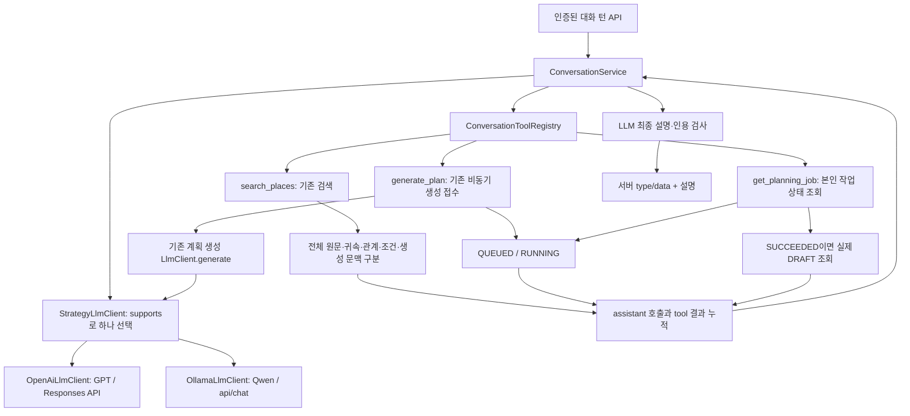

# 단일 LLM 도구 루프와 GPT·Qwen 전략

2026-11-01. 기준 커밋 `2756ff12`의 원문 전달·DRAFT 공통 검증 위에 대화 도구 실행 경로를 추가했다.
[기존 구조 조사](single-llm-tool-integration-audit.md)는 당시 기준의 기록으로 보존한다.

## 호출 구조

단일 LLM은 선택한 **같은 공급자/모델 전략을 재사용**한다는 뜻이다. API 호출 1회라는 뜻은 아니다.
대화는 `chat(messages, tools)`, 기존 계획 생성은 `generate(system, user)`를 사용한다.
계획 생성 작업의 검색·LLM·공통 초안 검증·인용 검사·저장 순서는 유지한다.
별도 판정 LLM, 이동 의도 정규식, 미구현 수정 실행기를 추가하지 않았다.

## 공급자 전략과 설정

`LlmStrategy.supports(LlmProvider)`와 주입받은 전략 목록으로 정확히 한 구현을 고른다.
`StrategyLlmClient`가 @Primary이므로 기존 LlmClient 소비자도 동일한 선택을 사용한다.
맞는 전략이 없거나 둘 이상이면 실패한다. 공급자 if/switch 분기와 자동 유료 fallback은 없다.

| 설정 | 개발 기본값·역할 |
|---|---|
| `LLM_PROVIDER` | `QWEN`. `OPENAI`로 명시하면 GPT 전략 선택 |
| 기존 `ollama.base-url`, `ollama.model` | 기존 주소/모델 설정 유지. 코드 모델 기본값은 `qwen3:8b` |
| `OPENAI_BASE_URL` | `https://api.openai.com/v1` |
| `OPENAI_MODEL` | 기본 모델 없음. 실행 전에 사용할 GPT 모델을 명시해야 함 |
| `OPENAI_API_KEY` | 기본 키 없음. 비밀 값은 커밋하지 않음 |
| `OPENAI_MAX_OUTPUT_TOKENS` | 1536. 검증된 전체 토큰 예산이라는 뜻은 아님 |
| `CONVERSATION_MAX_MODEL_TURNS` | 6. 턴 안의 대화 모델 호출 한도 |
| `CONVERSATION_MAX_TOOL_CALLS` | 8. 실패·캐시 응답을 포함한 도구 호출 처리 한도 |

Qwen은 기존 nonstream/think=false와 8192 context·1536 출력·temperature 0.3 설정을 유지한다.
계획 텍스트 생성은 기존 JSON 모드, 도구 대화는 native tools와 assistant/tool 이력을 사용한다.
Ollama의 함수 arguments 객체와 tool_name을 변환하며 내부 상관 ID는 서버에서 부여한다.

GPT는 Responses API의 function_call, call_id, function_call_output을 변환한다.
출력의 reasoning 항목을 포함한 continuation을 다음 호출에 재전달하고 `store=false`, `truncation=disabled`를 사용한다.
이 상태는 현재 턴 내부에만 있으며 비밀 추론 continuation을 공개 응답이나 평가 로그로 내보내지 않는다.
계획 generate의 JSON 출력 계약도 유지한다. 공급자별 오류·미완료·거부를 실패로 처리하고 자동 재시도하지 않는다.
인증/공급자 오류의 원문이나 키를 실패 영수증에 넣지 않는다.

프로토콜 근거: [OpenAI 함수 호출](https://developers.openai.com/api/docs/guides/function-calling),
[stateless reasoning](https://developers.openai.com/api/docs/guides/reasoning),
[Ollama 도구 호출](https://docs.ollama.com/capabilities/tool-calling),
[Ollama chat](https://docs.ollama.com/api/chat).
실제 설치 버전·모델의 호환성까지 확인한 기록은 아니며 HTTP 경계는 모의 검사했다.

## 실제 등록 도구

| 이름 | 모델 입력 | 서버 실행·출력 |
|---|---|---|
| `search_places` | query(1~2000자), limit(1~20) | 요청의 PlanContext와 기존 검색 서비스 재사용 → PLACES |
| `generate_plan` | 빈 객체 `{}` | 요청의 GeneratePlanRequest 그대로 기존 생성 API 서비스 접수 → PLANNING_JOB 또는 이미 완성된 DRAFT |
| `get_planning_job` | job_id | 로그인 사용자 소유 작업 조회. SUCCEEDED+planId이면 실제 초안 조회 → DRAFT |

userUid·작업 생성 키·장소 metadata를 모델 인자로 받지 않는다. 원문 근거의 참조 ID도 서버가 만든다.
도구 인자는 JSON 객체·정확한 필드·타입·범위를 서버에서 확인한다. 추가 필드나 JSON 뒤의 잔여 토큰은 거부한다.
여행 조건의 기존 Bean Validation과 ContextPlanningService의 지원 제한·공통 DRAFT 검증은 그대로 적용한다.

`generate_plan`은 평가 설계의 미리보기 `create_plan`과 다르다. 현재 구현은 비동기 생성 후 DRAFT 저장이다.
미리보기·확정·변경 버전·롤백을 수행하는 `create_plan/modify_plan`처럼 등록하지 않았다.
LLM이 검색 결과의 장소 ID로 새 확정 계획을 직접 저장하는 경로도 아니다.

현재 생성 조건은 사용자가 전송한 구조화 `planningRequest`에서 온다.
자연어 발언의 모든 조건을 PlanContext로 자동 추출·변경하는 기능은 완성하지 않았다.
최신 발언과 조건이 다르면 보완을 요청하도록 지시하지만 의미 준수 품질은 실제 모델로 평가해야 한다.
기존 여행 조건이 없으면 도구는 조건 부족을 반환하고 LLM이 설명으로 필요한 정보를 요청한다.

## API와 권한

`POST /api/v1/conversation/turns`에 기존 인증 사용자와 UUID `Idempotency-Key` 헤더를 사용한다.
요청은 `message`, 선택형 `planningRequest`, 선택형 `history`다.
planningRequest는 기존 GeneratePlanRequest 전체 계약을 사용한다. 검색에 필요한 context 역시 기존 계약 그대로다.
history는 USER/ASSISTANT 텍스트만 허용하며 SYSTEM/TOOL이나 서버 실행 영수증을 입력받지 않는다.
텍스트 이력은 사용자가 전송한 참고 대화이며 서버 권한이나 과거 작업의 증명이 아니다.
기존 보안 설정의 인증 필요 경로를 사용하며 익명 허용 경로를 추가하지 않았다.

서버가 `type`, `data`, 작업/장소/계획 ID와 관측 결과를 만든다.
LLM 최종 출력은 message와 citations만 받으며 type/data를 붙이면 최종 설명을 거부한다.
최종 JSON이 틀리거나 모델이 실패해도 이미 얻은 서버 데이터와 Job 영수증은 보존한다.
응답의 termination은 COMPLETED/MODEL_FAILED/INVALID_RESPONSE/MODEL_LIMIT/TOOL_LIMIT으로 구분한다.
COMPLETED는 도구 대화가 종료됐다는 뜻이며 계획 완성·확정을 의미하지 않는다.

턴 내부 이력·도구 캐시는 요청 범위에만 있다. 대화 세션/턴 결과의 DB 영속화는 이번 구현에 없다.
Idempotency-Key는 생성 작업 키를 서버에서 결정하는 데 사용하고 기존 작업 저장소가 요청 일치를 검증한다.
같은 키를 재전송해도 대화 모델 호출이나 검색 전체를 정확히 한 번만 실행하는 보장은 없다.

## 반복·실패·주 결과

- 도구 호출을 담은 assistant 메시지를 먼저 쌓고, 각 tool 결과를 같은 호출 ID로 추가해 다음 모델 호출에 보낸다.
- 도구 이름은 전략 레지스트리에서 찾는다. 등록되지 않은 도구는 오류 결과만 반환한다.
- 같은 도구·같은 정규화 인자는 턴 내 캐시로 처리한다. 인자 키 순서가 달라도 재실행하지 않는다.
- 생성 작업 키는 로그인 사용자·턴 키에서 결정한다. 같은 턴의 반복 생성은 1회 실행하고 요청 재전송은 기존 idempotency 검증을 재사용한다.
- 상태 조회도 턴 내 같은 인자는 캐시한다. 진행 중 작업을 기다리며 반복 polling하거나 sleep하지 않는다.
- 모델/도구 한도를 넘거나 호출 ID가 비었거나 중복이면 종료한다. 모델/도구 오류로 다른 공급자에 자동 전환하지 않는다.
- 여러 도구 결과가 있으면 DRAFT > PLANNING_JOB > PLACES > ERROR 우선순위로 서버가 주 결과를 고른다. 나중 검색이 생성 영수증을 덮지 않는다.

QUEUED/RUNNING/FAILED 작업 응답은 서버가 상태 문장을 작성하여 모델의 완료·확정 표현으로 바뀌지 않게 한다.
SUCCEEDED라도 planId와 실제 본인 초안을 확인해야 DRAFT를 반환한다.
DRAFT는 여전히 미확정이며 실제 이동시간·최적 동선·운영시간 검증을 의미하지 않는다.

## 원문·인용·관측의 범위

검색 공개 데이터는 기존 PlaceSearchResponseDto를 그대로 반환한다.
모델 입력은 기존 ContextPlanPromptFactory의 구조화 근거를 재사용하여 original·annotations·generatedSupplement·retrieval을 분리한다.
전체 원문·출처·장소 귀속·방향·관계·조건을 전달하며 description의 400자 요약에 의존하지 않는다.
여러 검색에서 같은 장소가 나와도 원문 버전이 혼동되지 않도록 검색 실행마다 evidenceId에 서버 범위를 붙인다.
그 결과의 실제 sourceId·placeId·허용 quote만 기존 PlanEvidenceCitationValidator의 공통 검사로 허용한다.

정확한 원문을 인용하면서 잘못 설명하는 경우, 인용 없이 지어낸 문장, 부정 반전·상충 무시 등
**설명 문장의 의미 정확성을 코드 검사만으로 보장하지 않는다.** 별도 판정 모델이나 정규식 판정을 추가하지 않았다.

toolResults에는 실제 모델의 호출 이름/인자/ID와 서버 결과·캐시/실패 상태를 기록한다.
이는 현재 API 응답의 관측 필드이며 운영 수집기·case_id/input_sha256·기존 평가기 어댑터까지 연결한 것은 아니다.
검색 순위, 도구 선택, 계획 조건·상태 변경의 실제 평가 연결은 별도 작업으로 남는다.
기존 미커밋 수집기를 수정하거나 없는 기능으로 취급하지 않는다.

## 검증과 다음 실제 실행 전 확인

[모의 회귀·프로토콜 검증 기록](../../Evaluation/runs/contextual/single-llm-tool-loop-v1/20261101-01/REPORT.md).
OpenAI/Qwen HTTP는 MockRestServiceServer, 계획·검색·LLM은 Mockito로 검사했다.
실제 모델 호출·검색·운영 DB 반영·배포·프런트엔드 연결은 실행하지 않았다.

**토큰 예산은 미해결이다.** 실제 실행 전에 선택한 GPT/Qwen 모델, native 도구 지원 버전, 입력/출력 한도,
전체 원문+도구 정의+누적 이력+reasoning continuation+출력 예약량, 초과 시 원문 보존 정책을 확인해야 한다.
대화 루프 한도는 토큰 예산 검증을 대신하지 않는다. 한 턴에는 대화 호출 외에 기존 비동기 계획 생성 호출도 생길 수 있다.
실제 평가의 기존 데이터셋/트랙·case ID·모델 호출 수·반복·비용은 실행 전에 따로 확정해야 한다.
