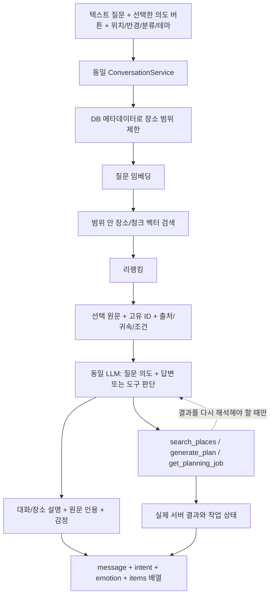

# 공통 대화 서버와 네 단계 평가

운영용 소스와 평가용 소스는 각각 루트 `Server/TravelMate`와 `embedding-server` 하나씩이다.
실행 프로세스와 DB·Redis·Kafka·비밀값·로그는 분리한다. 과거 B안 worktree/JAR은 현재 품질의 근거로 사용하지 않는다.
`evaluation`은 Spring 프로필이며 별도 도구 루프 구현이 아니다.



질문 임베딩은 검색어를 벡터로 만드는 연산이다. 장소 청크의 저장 임베딩은 수집·색인 시 만든다.
매 검색 때 모든 장소의 원문을 다시 임베딩하지 않는다. 이번 변경은 요청 시 메타데이터 적격 장소를 먼저 읽고,
적격 장소가 없으면 질문 임베딩·벡터 검색·리랭킹을 건너뛴다. 벡터 SQL도 MATERIALIZED CTE에서 필터를 다시 적용한다.
현재 반경 SQL은 구면 거리식이다. PostGIS로 구현돼 있다고 표시하지 않는다.

지역·도시·분류·제외 ID·반경은 실제 필터다. **테마는 현재 의미 검색 선호 조건**이다.
DB의 검증된 테마 태그 컬럼이 없으므로 테마를 만족하는 장소만 강제 통과시킨다고 주장하지 않는다.
질문 원문은 보존하고 테마는 별도 검색어 보강과 LLM 입력으로 제공한다.

## 실행의 동일성과 격리

- 일반·평가 모두 기본 공급자는 OPENAI. Qwen 구현은 호환을 위해 남지만 기본 경로에서 선택하거나 모델을 적재하지 않는다.
- 모두 `STRICT_TOOLS_V1`, 최종 답변 JSON Schema, 같은 v2 프롬프트를 기본으로 사용한다.
- 추론 가능 모델은 `reasoning.effort=none`. 해당 파라미터가 없는 모델은 `UNSUPPORTED`를 명시해 파라미터를 보내지 않는다. 모델 이름으로 기능을 추측하지 않는다.
- 프로필 간 다른 것은 연결 대상·로깅 경로·예산이다. 대화 호출 상한(`max-model-turns`·`max-tool-calls`)은 평가 프로필에서 덮어쓰지 않고 `application.properties` 값을 함께 쓴다.
  실험 설정에 적은 상한과 실제 서버가 보고한 상한이 다르면 대화 요청 전에 중단한다. 실제 서버가 설정을 반영했는지는 실행 계약에서 확인한다.
- Spring은 빌드 때 main 소스의 SHA-256을 내장한다. 검색 서버도 실행 시점 소스 해시를 내보낸다.
- 실제 수집기는 인증한 평가 계정과 두 서버의 소스 해시를 현재 작업 폴더와 비교한다. 구형 서버면 대화 요청 전에 실패한다.
- 코드가 같다는 검사는 corpus·모델 가중치·GPU·검색 품질이 같다는 검사를 대신하지 않는다. 상태와 장치를 별도 기록한다.

```text
정상 작업 폴더/
  Server/TravelMate/                     공통 서버 소스
  embedding-server/                      공통 검색 소스
  Evaluation/evaluation_server.py        격리 연결로 공통 Spring 실행
  Evaluation/evaluation_search_server.py 격리 연결로 공통 검색 실행
  Evaluation/experiments/                버전·설정·실행 범위
  Evaluation/runs/<run-id>/              요청·응답·원장·관측·채점만 보존
  Resouces/Images/LiLi/                  원본 10개 + 감정 매핑 catalog.json
```

기동 명령은 정상 작업 폴더에서 실행한다. 과거 런타임·백업 경로를 재사용하지 않는다.
`.env.evaluation.json`에는 `server-environment.example.json`의 EVAL_* 연결값과 키·공식 모델 한도를 채운다.
이 비밀 설정은 Git에 추가하지 않는다. 시작 전 검사만 하려면 `--start`를 생략한다.

```sh
python Evaluation/evaluation_search_server.py --environment-file .env.evaluation.json --start
python Evaluation/evaluation_server.py --environment-file .env.evaluation.json --start
```

서로 다른 터미널에서 실행한다. 검색 쪽은 해당 Python 환경에 검색 서버 의존성과 모델이 설치돼 있어야 한다.
기존 운영 프로세스는 종료하거나 변경하지 않는다. 이 작업에서 실제 로컬 PC의 구형 B안 프로세스를 교체했다고 주장하지 않는다.

## 응답 계약

`ConversationRequest.intentHint`는 AUTO/CONVERSATION/RECOMMENDATION/PLAN이다. 버튼은 선택 사항이다.
같은 LLM에 힌트·질문·이력·검색 원문을 전달하고 판단한다. 별도 라우팅 모델은 없다.
`ConversationResponse`의 공통 필드는 `message`, `intent`, `emotion`, `items`, `citations`, 실행 상태다.

- TEXT: `items=[]`; 질문에 대한 반응·되묻기를 `message`로 전달한다.
- PLACES: 후보 1개도 `items=[...]`; 근거 기반 설명과 인용은 별도 필드다.
- DRAFT: `items=[초안]`; 초안 안의 `pins`도 배열이다. 서버에 실제 저장된 초안을 보존한다.
- PLANNING_JOB: `items=[]`, 기존 `data`에 작업 상태를 제공한다. 접수·실행 중은 완성된 계획이 아니다.

기존 클라이언트 호환을 위해 `type/data`도 보존한다. 이미지 경로는 모델이 만들지 않는다.
프롬프트에 나오는 Enum 값(의도·답변 종류·감정·도구 이름·작업 상태·필수 필드)은 `PromptVocabulary`가 Enum에서 채운다. 손으로 적은 목록은 없다.
DRAFT의 감정은 계획 생성 모델이 `draft_plan_v1`의 필수 `emotion`으로 고른 값이며 `plans.character_emotion`에 저장된다. 이전 초안처럼 값이 없을 때만 서버 기본값(EXCITED)을 쓴다.
서버의 감정 Enum을 클라이언트가 catalog.json과 매핑한다. 도구 영수증·실패 응답도 알려진 감정 태그를 가진다.
일반 답변은 한 번의 대화 모델 호출로 종료할 수 있다. 추가 도구의 결과를 다시 해석할 때만 같은 모델을 다시 호출한다.
비동기 계획 생성은 내부 생성 호출이 별도로 발생할 수 있다. 전체 계획을 무조건 추론 1회라고 세지 않는다.

## 네 평가 단위와 로그 레지스트리

순서는 **tool_call → recommendation → plan → conversation**이다. 각 단위는 설정만 선택하며 같은 수집기를 실행한다.
`Evaluation/experiments/conversation-smoke/stage-order.json`에서 순서와 네 설정 경로를 관리한다.

`log_types.py`는 평가 단위 Enum과 `TestLogPath` 문자열 상수를 정의한다.
`test_logs.py`의 정적 `TestLogs.ENTRIES`는 `(Enum, lambda)` 쌍 배열이다.
대주제 주석 아래 요청·실행·관측·판정의 소주제를 묶고, 들여쓰기는 8칸으로 구분한다.
모든 Enum에 정확히 하나의 함수가 있어야 하며 중복·누락은 검사에서 실패한다.
호출 원장도 같은 배열에서 공통 RunControl을 생성한다. 쓰기·호출 제한을 각 구현체가 우회하지 않는다.

기계적 검사는 이름·인자·결과 배열·응답·감정·원문 인용 소속을 검사한다.
추천 이유가 원문으로 지지되는지, 여행 외 질문에 맞게 반응했는지는 별도 의미 검수다.
계획은 Job 접수와 초안 내용을 나눠 본다. 초안의 필수 장소·중복·순서·체류시간·반경을 검사하되,
실제 도로 이동시간·운영시간·검증 자료가 없는 카페 분류를 통과로 만들지 않는다.

## RAG의 확인된 범위

출처 ID는 출처 종류·URL/content ID·필드에서, 청크 ID는 출처 ID·원문 버전·문자 구간·분할 버전에서 결정된다.
원문 소속과 위치를 서버가 검증한다. **고유 ID가 있다는 사실이 의미 귀속의 정확성을 보증하지는 않는다.**
장소별 활성 청크 상한은 20개다. 15~20개를 목표로 다양한 출처의 실제 근거를 확보하며,
원문이 부족하면 개수를 맞추려고 복제·창작하지 않는다. 검색 결과 장소 수와 구분한다.
저장한 20개 전체를 모든 요청의 LLM 입력에 보내는 구조도 아니다. 질문에 맞는 선택 근거를 전달한다.

`ReviewedExcerptModule.execute()`는 주차/후기·감상/장소 설명/체험의 검수된 원문 구간을 별도 청크로 받는 모듈이다.
`python -m app.contextual.cli excerpts --input <검수 파일> --output <결과>`로 청크와 보류 목록을 만들고, `--apply`를 붙이면 `retrieval_excerpt_bundles`에 저장해 재색인을 요청한다.
검수 인용은 생성 청크 묶음을 대체하지 않고 더해진다. 같은 장소·같은 출처를 다시 검수하면 그 출처의 인용만 바뀐다.
인용은 약 2~3줄(기본 200자) 이하만 받고, 더 길면 `held_excerpts`로 돌려보내 검수자가 나누게 한다. 관점 이름(`[주차]` 등)은 임베딩 문장에 들어간다.
활성 청크 선택은 기본 `source-round-robin-v1`이다. `CONTEXTUAL_ACTIVE_SELECTION=aspect-source-round-robin-v2`를 지정하면 관점별로 돌아가며 고른다. 품질 비교 전에는 기본값을 바꾸지 않는다.
`python -m app.contextual.cli coverage --output <보고서>`는 활성 청크가 15개 미만인 장소를 나열한다. 부족분은 원문 수집·검수 대상이다.
새 생성 호출 없이 정확하고 유일한 인용 위치를 서버에서 찾는다. 관계는 명확하다고 검수되고 검수자가 기록된 것만 받는다.
모호하거나 미검수된 관계는 `held_relations`로 보류하고 해당 인용도 `held_excerpts`로 격리해 검색 청크를 만들지 않는다. 보존 원문은 훼손하지 않으며, 혼합 인용은 검수자가 확실한 관찰 부분을 별도 인용으로 나눈 뒤 다시 제출해야 한다.
실제 검수 파일로 적용하거나 재색인한 기록은 아직 없다. 기존 자동 생성 결과의 장소 귀속·관계 의미 오류는 해결 완료가 아니다.
기존 관계 스키마는 이동 관계에 특화돼 있다. 임의의 일반 관계 그래프가 이미 완성돼 있다고 설명하지 않는다.

## 화면과 후속 확장

부산 앱 콜라주를 참고해 위치·반경·테마 입력, 투명 반경/기준 핀, 의도 버튼, 텍스트 대화,
후보 카드·초안 배열·원문 인용·LiLi 감정 이미지를 연결했다. 분류 선택은 서버 enum endpoint에서 받는다.
`VITE_KAKAO_MAP_APP_KEY`(Git 제외 `.env.local`)가 있으면 카카오 지도 위에 투명 반경 원·끌어서 옮기는 기준 핀·후보 마커를 그린다.
키가 없거나 SDK를 불러오지 못하면 실제 좌표만 표시하는 평면 뷰로 바뀌고 그 이유를 화면에 적는다. 도로 경로·이동시간은 어느 쪽도 표시하지 않는다.
반경 슬라이더의 최소·최대는 서버 `SearchRadius`가 options 응답으로 내려준다.

ONDEVICE 한국어 WASM/BIN TTS는 사용자 지시에 따라 **확장 항목으로 보류**한다.
엔진·음성 모델이 선택되기 전에는 실제 on-device 음성 동작을 완료했다고 기록하지 않는다.
현재 API는 완성 JSON 응답 방식이다. 글자 스트리밍이나 1초 내 응답을 실측·보장하지 않았다.

초안 조회에는 기존 `plans.description`과 `pins.memo`에 저장된 설명·활동/선택 이유를 그대로 노출한다.
감정 태그를 위해 `plans.character_emotion` 열을 추가했다(`Docker/migrations/20261104_add_plan_character_emotion.sql`). 이미 만든 DB에는 직접 적용해야 한다.
**계획 생성 시 검사한 구조화 인용을 DB에서 다시 돌려주는 저장 경로는 아직 없다.**
계획 설명을 검색 결과의 완전한 출처 인용과 동등하다고 판정하지 않는다. 계획 내용과 근거의 의미 검수는 실제 생성·조회 후 별도로 필요하다.

Strict 형식과 평가 비용 승인은 별도 설정이다. 평가 프로필은 `evaluation-budget-requirement=REQUIRED`로 승인된 배치 원장을 요구한다.
일반 서버에 평가 case ID가 없다는 이유로 Strict 응답 전체가 막히게 하지 않는다. 입력 전체·출력 예약량을 검사하는 토큰 가드는 두 프로필 모두 사용한다.
입력 토큰 계산 HTTP 요청은 추론 1회와 별개이며, 이를 두 번째 라우팅 LLM이라고 세지 않는다. 계산 API 비용 미확인 상태도 그대로 보존한다.
