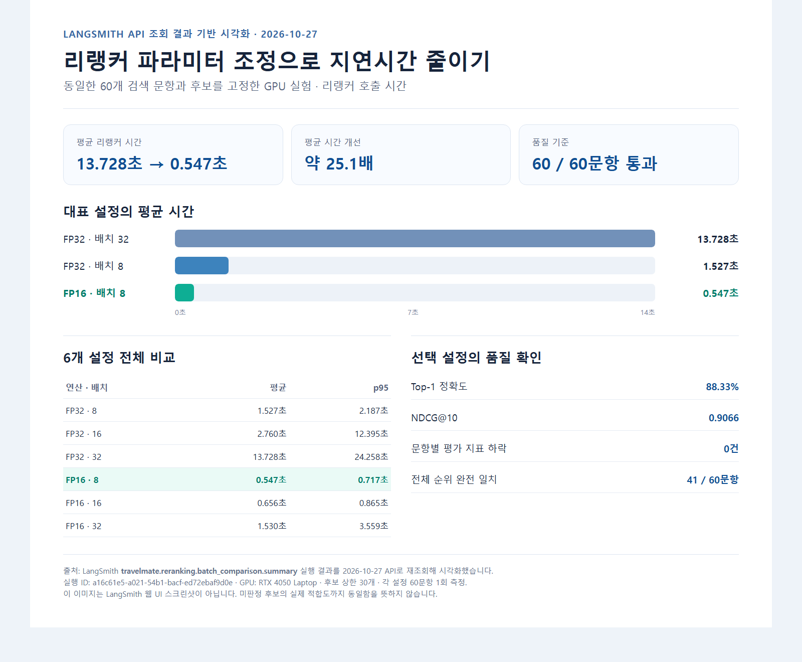
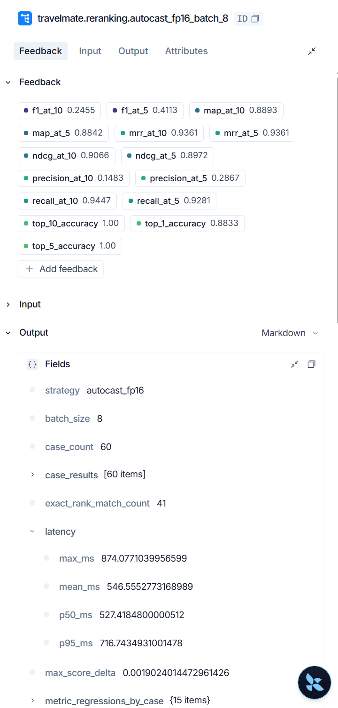
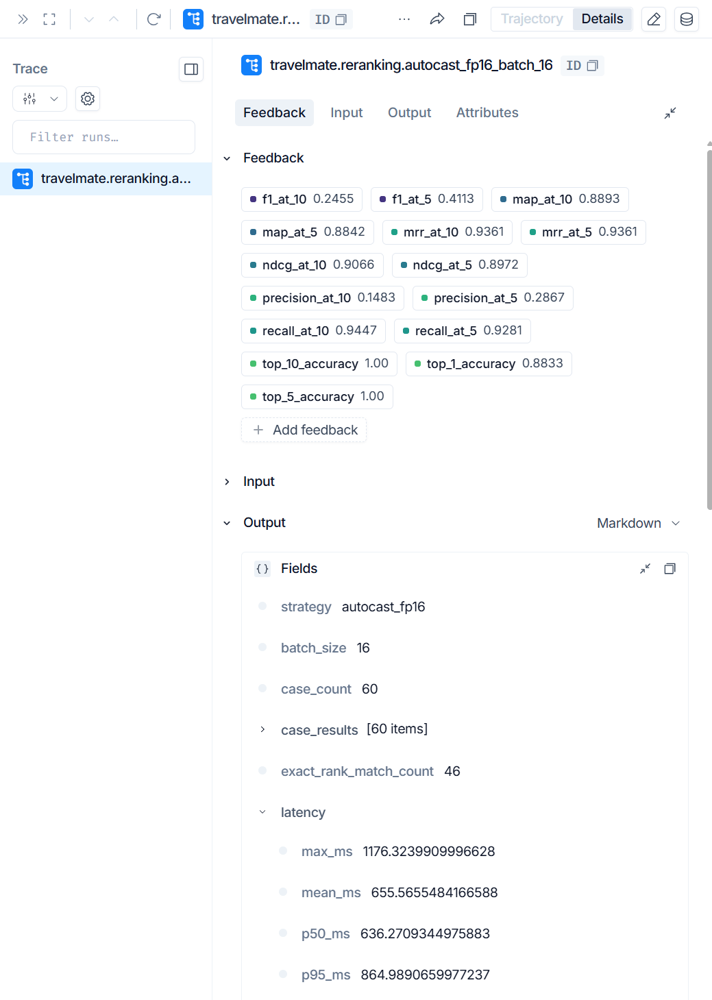
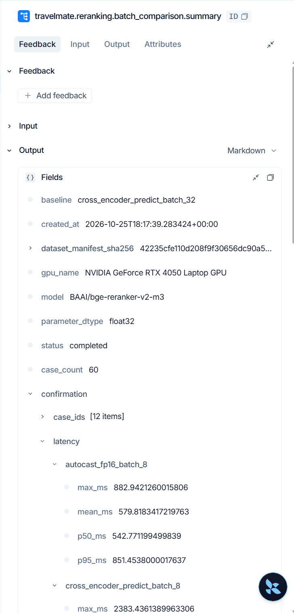

# LangSmith로 확인한 검색 리랭커 지연: 배치 크기와 FP16을 조정한 기록

장소 검색에서 임베딩 모델은 후보를 찾고, 리랭커는 후보의 순서를 다시 정한다. 결과의 관련도를 높이기 위해 리랭킹을 추가했지만, 응답이 느려지면 사용자가 결과를 기다리는 시간이 길어진다.

이번에는 LangSmith trace로 느린 구간을 찾고, **후보 30개와 모델은 유지한 채 리랭커의 배치 크기와 연산 정밀도**를 비교했다. 핵심 결과는 고정 입력 60문항에서 리랭커 호출 평균이 **FP32·배치 32의 13.728초에서 FP16 autocast·배치 8의 0.547초로 줄었다**는 것이다. 이는 리랭커 구간의 측정값이며 검색 API 전체 응답 시간은 별도로 측정했다.



> 이 그림은 2026년 10월 27일 LangSmith API에서 [배치 비교 실행](https://smith.langchain.com/o/eb9e01f0-f51b-44d0-a2d2-bc6f3f239c15/projects/p/be665de5-ef04-44e3-92f1-362740f035a9/r/a16c61e5-a021-54b1-bacf-ed72ebaf9d0e?poll=true)을 직접 재조회해 만든 시각화다. LangSmith 웹 UI 화면을 캡처한 이미지는 아니다. 프로젝트 링크는 접근 권한이 필요할 수 있으며, 재조회한 값은 [근거 JSON](assets/langsmith-api-evidence.json)에 보관했다.

## 어디가 느렸나

먼저 LangSmith의 `reranking.model_inference` span을 확인했다. 기존 80문항 측정에서 리랭커 모델 연산의 p95는 27.576초였다. 이 실행은 내부 구간을 자세히 보려고 CUDA 동기화를 수행하는 **진단 모드**였다. 따라서 그 시간을 일반 실행의 기준 성능으로 취급하지 않았다.

trace는 시간을 줄일 후보 구간을 찾는 데 사용했다. 최적화 효과를 비교할 때는 리랭커에 들어가는 입력을 고정해 다른 검색 단계의 변동을 분리했다.

## 바꾼 파라미터와 고정한 조건

검색 결과 상한은 20개지만, 리랭커는 pgvector에서 가져온 최대 30개 후보의 질문·본문 쌍에 점수를 매긴다. 이번 실험에서는 평가 가능한 60문항의 질문, 후보 ID, 후보 순서, 전체 본문을 한 번 수집해 고정했다. 모델은 `BAAI/bge-reranker-v2-m3`, GPU는 RTX 4050 Laptop GPU다. 후보 수 상한과 토큰 제한은 바꾸지 않았다.

조정한 값은 두 가지였다.

1. **배치 크기 32·16·8:** 30개 후보를 한 번에 처리할지, 더 작은 묶음으로 나눌지 결정한다. 배치 8에서는 최대 30개가 `[8, 8, 8, 6]`으로 처리된다.
2. **FP32와 FP16 autocast:** 모델 파라미터는 FP32로 두고, 지원되는 GPU 연산에 FP16 autocast를 적용했다.

두 실행 전략을 세 배치 크기로 조합해 총 여섯 설정을 비교했다. 각 설정은 첫 문항으로 두 번 예열하고 60문항을 한 번씩 측정했다. 문항마다 설정 실행 순서를 순환했다. 아래 표는 **리랭커 호출 시간만** 비교한다.

| 설정 | 평균 | p95 |
|---|---:|---:|
| FP32 · 배치 8 | 1.527초 | 2.187초 |
| FP32 · 배치 16 | 2.760초 | 12.395초 |
| FP32 · 배치 32 | 13.728초 | 24.258초 |
| **FP16 autocast · 배치 8** | **0.547초** | **0.717초** |
| FP16 autocast · 배치 16 | 0.656초 | 0.865초 |
| FP16 autocast · 배치 32 | 1.530초 | 3.559초 |

### 실제 LangSmith 화면으로 대조

아래는 로그인된 LangSmith 웹 UI에서 캡처한 **FP16·배치 8** 실행이다. `batch_size=8`, `case_count=60`, 평균 `546.555 ms`, p95 `716.743 ms`가 보인다. Feedback에는 Top-1 `0.8833`, NDCG@10 `0.9066`도 함께 표시된다.



#### FP16 · 배치 16

평균 `655.566 ms`, p95 `864.989 ms`다.



#### FP16 · 배치 32

평균 `1,530.273 ms`, p95 `3,559.439 ms`다.


네 장의 웹 UI 캡처는 2026년 10월 27일 프로젝트 계정에서 제공받은 원본이다.

비교 요약 화면에는 기준 설정, RTX 4050 Laptop GPU, `BAAI/bge-reranker-v2-m3` 모델, 60문항, 그리고 12문항 반복 확인 결과가 기록돼 있다.



같은 FP32 안에서 배치를 32에서 8로 줄이자 평균이 13.728초에서 1.527초로 줄었다. 배치 8을 유지하고 FP16 autocast를 적용하자 0.547초가 됐다. 이 고정 입력 비교에서 최종 설정은 FP32·배치 32보다 평균 약 **25.1배** 빨랐다. 입력 길이별로 고른 12문항을 설정별 세 번씩 다시 측정했을 때도 FP16·배치 8의 평균은 0.580초였다.

## 빨라진 만큼 순위가 달라졌을까

속도만으로 설정을 선택하지 않았다. 60문항에서 각 설정의 패딩 제외 토큰 ID가 일치하는지 확인하고, 사람이 판정한 장소를 기준으로 Top-1, Hit@5/10, Recall, Precision, F1, MAP, MRR, NDCG 등 15개 순위 지표를 문항별로 비교했다.

선택한 FP16·배치 8은 FP32·배치 32 대비 **평가 지표가 하락한 문항이 없었다.** 평균 Top-1 정확도는 88.33%, NDCG@10은 0.9066으로 같았다. 다만 전체 후보 순서가 완전히 같았던 문항은 **41/60개**다. 나머지 19개에서는 일부 순서가 달랐으므로, 모든 후보의 관련도가 동일하게 보존됐다고 말할 수는 없다. 사람 판정도 일부 장소에만 존재한다.

## 실제 API에 적용한 뒤

선택한 설정은 다음과 같다.

```dotenv
RERANK_EXECUTION_STRATEGY=autocast_fp16
RERANK_BATCH_SIZE=8
RERANK_DIAGNOSTICS_ENABLED=false
```

이 설정으로 실제 검색 API의 리랭킹 요청을 80문항에서 재실행했다. 요청 80개 모두 HTTP 200이었고, LangSmith의 리랭커 span 80개 모두 `autocast_fp16`, 배치 8, CUDA, FP16 autocast 설정을 기록했다.

| 리랭킹 포함 전체 HTTP 응답 | 이전 진단 모드·배치 32 | 적용 후 FP16·배치 8 |
|---|---:|---:|
| 평균 | 8.398초 | **1.607초** |
| p50 | 5.532초 | **1.512초** |
| p95 | 28.682초 | **2.015초** |

적용 후 LangSmith가 측정한 리랭커 span의 평균은 0.524초, p95는 0.756초였다. 전체 API 결과에서 조건을 완전히 적용할 수 있었던 60문항의 품질 지표도 이전과 같았다. 나머지 20문항은 현재 검색 API가 제외 장소 ID나 대화 이력을 전달하지 못해 품질 평균에서 제외했다.

**전체 API의 전후 표는 서로 다른 시점의 실측값이다.** 이전 실행에는 진단용 CUDA 동기화가 포함돼 있다. 따라서 전체 API 평균의 차이를 배치·FP16 변경만의 순수 효과라고 주장하지 않는다. 파라미터 효과를 분리한 근거는 위의 고정 입력 여섯 설정 비교다. 이 결과 역시 특정 GPU, 데이터와 측정 조건에서 얻은 값이다.

## 정리

LangSmith trace는 병목이 리랭커 구간에 있음을 보여줬다. 같은 입력을 고정한 실험에서는 배치 8과 FP16 autocast가 가장 낮은 평균·p95를 보였고, 현재 사람이 판정한 60문항의 순위 지표를 유지했다. 실제 API에 적용한 뒤에는 전체 검색 응답과 실행 설정을 다시 측정해 확인했다. 이번 기록에서 가장 유용했던 점은 **지연 구간 발견, 파라미터 비교, 품질 검사, 적용 후 확인을 각각 별도의 근거로 남긴 것**이다.

### 측정 근거

- [LangSmith 여섯 설정 비교 실행](https://smith.langchain.com/o/eb9e01f0-f51b-44d0-a2d2-bc6f3f239c15/projects/p/be665de5-ef04-44e3-92f1-362740f035a9/r/a16c61e5-a021-54b1-bacf-ed72ebaf9d0e?poll=true)
- [LangSmith FP16·배치 8 상세 실행](https://smith.langchain.com/o/eb9e01f0-f51b-44d0-a2d2-bc6f3f239c15/projects/p/be665de5-ef04-44e3-92f1-362740f035a9/r/3de0ef72-6bde-5256-8992-f686907854c3?poll=true)
- [LangSmith 실제 API 품질·지연 요약](https://smith.langchain.com/o/eb9e01f0-f51b-44d0-a2d2-bc6f3f239c15/projects/p/be665de5-ef04-44e3-92f1-362740f035a9/r/0ab65d90-12f7-564a-b148-605e1fe4e334?poll=true)
- [원본 측정 보고서](../../Evaluation/runs/search/v1.4.0/batch-fp16-20261026/report.md)와 [API 재조회 JSON](assets/langsmith-api-evidence.json)
