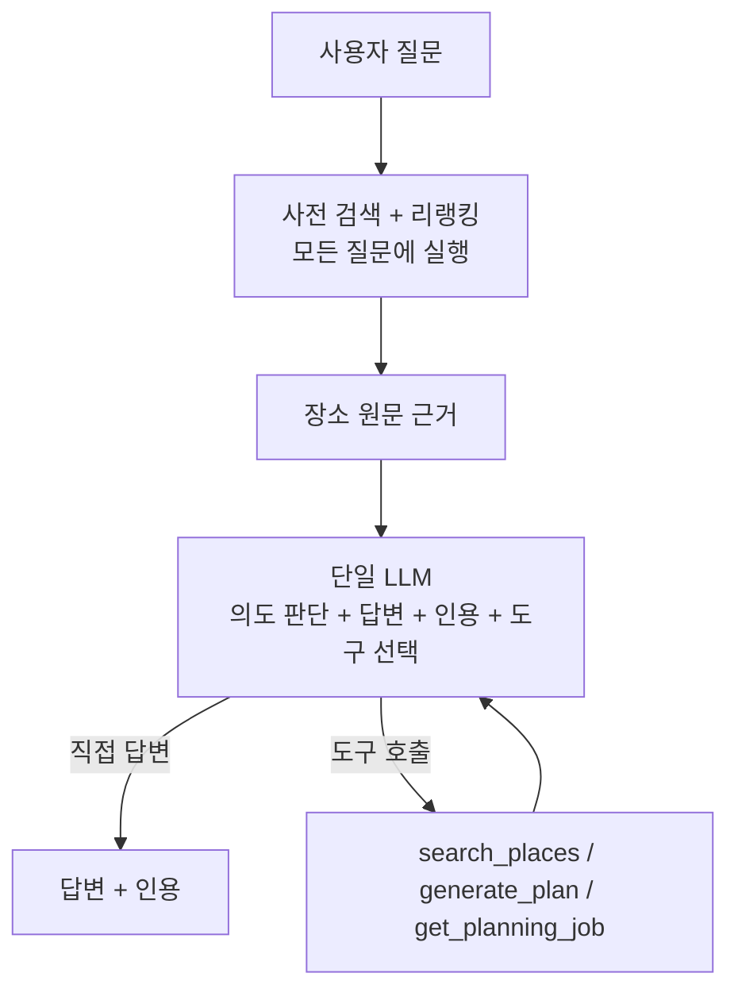
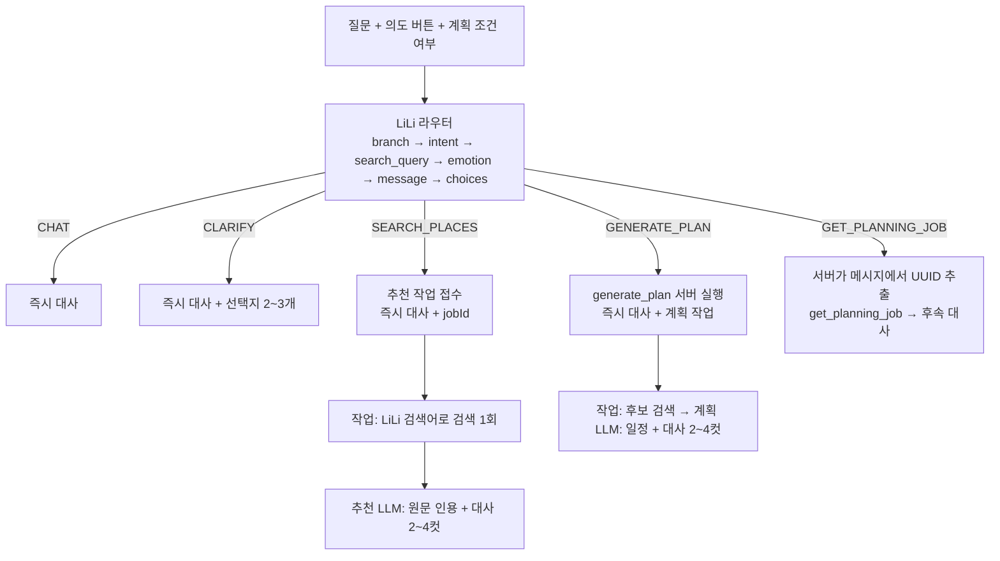
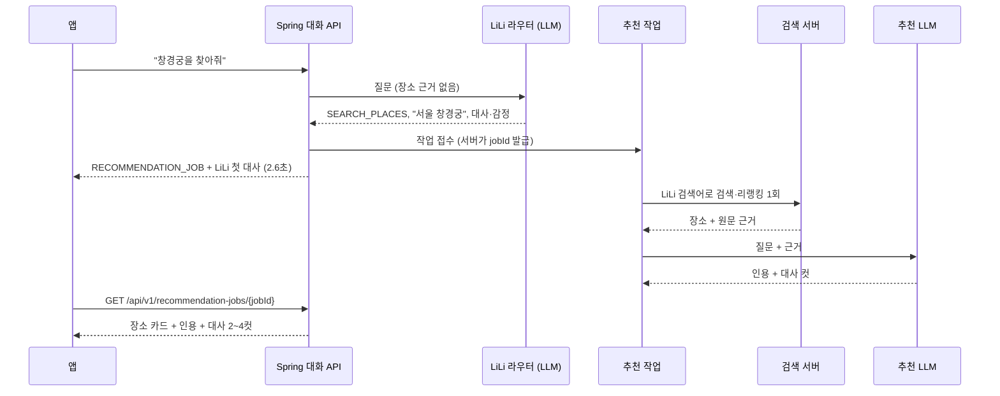

# 검색보다 먼저 LiLi가 답한다: 라우터 분리로 대화 응답 시간 17.4초 → 2.1초

> 블로그 초안. 같은 9문항·같은 모델·같은 평가 인프라에서 구조를 바꾸기 전과 후를 비교한 기록이다.
> 자동 검사 기준의 결과이며, 답변 문장의 의미 검수는 아직 하지 않았다.
> **정정 (2026-11-05):** 자동 통과 8/9 중 2건은 판정 범위가 좁아 성공으로 볼 수 없다(첫 후보 제외 미검증, 계획은 접수만 성공). 성공으로 볼 수 있는 것은 6/9다. 글 끝의 "정정"을 본다.

TravelMate의 대화 서버는 모든 질문에 같은 경로를 썼다. 질문이 들어오면 먼저 장소를 검색하고 리랭킹한 뒤, 그 근거와 도구 목록을 LLM 하나에 넘겼다.
그 LLM이 의도를 판단하고, 직접 답하거나 도구를 호출했다.

"고마워, 오늘은 여기까지 할게" 같은 인사에도 검색이 먼저 실행됐다. 실측에서 이 문항은 응답까지 35.9초가 걸렸고, 그중 32.7초가 사전 검색이었다.

## 바꾸기 전: 검색 → 단일 LLM

9문항 실측(`gpt-5.4-mini-2026-03-17`)에서 확인한 문제는 세 가지였다.

1. **모든 턴이 검색 지연을 떠안았다.**
   - 사전 검색은 2.6~32.7초였다.
   - 검색이 필요 없는 인사·되묻기·예약 거절 문항도 이 시간을 기다렸다.
2. **입력이 무거웠다.**
   - 턴마다 입력이 4,875~6,490 토큰이었다.
   - 질문과 관계없는 장소 근거가 매번 들어갔다.
3. **도구 선택이 흔들렸다.**
   - 근거가 이미 들어와 있으니, 모델은 검색·일정 생성·작업 조회가 필요한 3문항에서도 도구를 부르지 않고 직접 답했다.
   - 조건이 없어 되물어야 하는 일정 요청에는 `generate_plan`을 잘못 호출했다.
   - 자동 검사 통과는 **2/9**였다.

## 바꾼 뒤: LiLi 라우터 → 서버 실행 → 작업 결과

첫 LLM 호출을 페르소나 LiLi 자신으로 바꿨다. LiLi는 장소 근거를 받지 않는다.
사용자의 말에 바로 반응하는 대사와 감정을 내고, 다음에 할 일(branch)과 검색어만 정한다.
검색과 계획은 그 결정을 받은 서버가 실행한다. 결과에는 LiLi의 대사 컷이 따로 붙는다.

장소 검색 요청은 이렇게 흐른다. 사용자는 LiLi의 첫 대사를 먼저 받고, 근거가 필요한 설명은 작업이 끝난 뒤 받는다.

### 지킨 규칙

- **결정을 먼저 쓴다.** Strict JSON의 필드 순서를 `branch → search_query → emotion → message`로 두었다. 모델이 무엇을 할지 정한 뒤에 그에 맞는 대사를 쓴다.
- **라우터 대사에는 장소 사실이 없다.** LiLi는 원문을 받지 않았으므로 "찾아볼게", "짜 볼게" 같은 반응과 예고만 한다. 평가에 이 항목을 따로 두었다(`router_line_no_place_facts`).
- **도구는 서버가 실행한다.** 모델이 도구를 직접 부르지 않는다. branch가 맞으면 필요한 도구가 빠지는 일이 없다.
- **작업 ID는 LLM이 만들지 않는다.** 서버가 사용자 메시지에서 UUID를 정확히 하나 찾을 때만 조회한다.
- **페르소나는 한 파일에 있다.** 라우터·후속·추천·계획 프롬프트가 같은 `lili-v1.txt`를 쓴다.
- **대사와 카드를 나눈다.**
  - 결과 대사는 `dialogue: [{text, emotion}]` 컷 2~4개다.
  - 장소 목록과 일정은 카드로 보여 준다.
  - 계획 초안의 컷은 `plans.character_dialogue`에 저장한다.
- **구현은 설정 Enum으로 고른다.** `SINGLE_LLM_V1`과 `LILI_ROUTER_V1`이 같은 `supports()` 레지스트리에 있어, 이전 구조와 다시 비교할 수 있다.

## 결과: 같은 9문항

| 문항 | 이전 응답(초) | 이전 사전 검색(초) | 이전 입력 토큰 | LiLi 응답(초) | LiLi 라우터 입력 토큰 | LiLi 분기 |
|---|---|---|---|---|---|---|
| 창경궁을 찾아줘 | 17.4 | 11.5 | 6,087 | 2.60 | 1,134 | SEARCH_PLACES |
| 종로 왕실 가족의 궁·거처 | 29.8 | 25.7 | 5,933 | 3.50 | 1,150 | SEARCH_PLACES |
| 고마워, 여기까지 할게 | 35.9 | 32.7 | 5,144 | 2.06 | 1,141 | CHAT |
| 서울 여행 일정 만들어줘 (조건 없음) | 6.1 | 3.9 | 4,930 | 2.06 | 1,137 | CLARIFY |
| 내 일정 작업 어디까지 됐어? (ID 없음) | 6.0 | 2.6 | 5,112 | 4.35 | 1,142 + 후속 621 | GET_PLANNING_JOB ✗ |
| 일정 확정·예약까지 해줘 | 6.7 | 4.0 | 4,875 | 2.01 | 1,145 | CHAT |
| 첫 후보 빼고 다시 검색 | 6.0 | 3.7 | 4,882 | 1.80 | 1,164 | SEARCH_PLACES |
| 조건 그대로 일정 초안 요청 | 28.5 | 24.8 | 6,490 | 1.85 | 1,153 | GENERATE_PLAN |
| 작업 `6f1fe6ee…` 상태 확인 | 36.1 | 31.9 | 5,159 | 4.02 | 1,170 + 후속 741 | GET_PLANNING_JOB |

- **대화 응답 시간:** 중앙값이 17.4초에서 2.06초로, 최대가 36.1초에서 4.35초로 줄었다. 4초대 두 건은 작업 조회 뒤 LiLi 후속 대사를 한 번 더 부른 경우다.
- **입력 토큰:** 라우터 호출 입력은 1,134~1,170 토큰이다. 이전에 매 턴 들어가던 장소 근거가 빠졌다.
- **도구 선택:** 이전에 도구를 부르지 않던 3문항(제외 재검색·일정 생성·작업 조회)이 모두 맞는 branch로 갔고, 서버가 해당 도구를 실행했다. 조건 없는 일정 요청은 CLARIFY로 되물었다.
  - 다만 branch와 도구 실행이 맞았다는 뜻일 뿐, 제외 재검색은 실제로 아무것도 제외하지 않았다. 일정 생성도 접수만 됐고 초안은 실패했다(아래 정정).
- **자동 검사:** 8/9 통과로 기록됐다. 이 중 2건은 판정 범위가 좁았으므로, 성공으로 볼 수 있는 것은 **6/9**다.
- **비용:** 9문항에 15회 호출(라우터·후속·추천·계획 포함), 사용량 기준 약 $0.035였다.

## 그대로 남은 것과 새로 드러난 것

검색이 빨라진 것은 아니다. 검색은 대화 턴에서 빠져 작업으로 옮겨 갔다.

- 장소 추천 결과까지는 8.1~26.4초가 걸렸다(작업 안의 검색 3.5~22.1초 + 추천 추론 3.1~4.6초).
- 계획 작업의 후보 검색은 26초였다.
- 사용자가 첫 대사를 기다리는 시간은 줄었지만, 검색 지연 자체는 따로 풀어야 한다.

비교 조건도 완전히 같지는 않다.

- 이전 실행은 단일 LLM 기준의 검사(턴 안의 인용, 모델의 도구 호출)로 채점했다.
- 이번 실행은 라우터 기준의 검사(branch, 서버 실행 도구, 작업 결과의 인용과 컷)로 채점했다.
- 그래서 2/9와 이번 결과는 같은 채점표의 점수 차이가 아니다. 두 결과는 직접 비교하지 않는다.
- 시간과 토큰은 같은 방식으로 쟀다.

이번 실행에서 새로 발견한 문제도 있다.

1. **ID 없는 작업 질문을 되묻지 않았다.**
   - 작업 ID가 없는 질문인데 LiLi가 CLARIFY 대신 작업 조회를 골랐다.
   - 라우터 입력에는 계획 조건 유무만 있고 작업 ID 유무는 없다. 서버가 판정한 값을 입력에 넣을 예정이다.
2. **후속 대사가 내부 사유를 노출했다.** "JOB_ID_NOT_FOUND", "토큰 예산 검사 실패: COUNT_UNAVAILABLE"을 그대로 말했다.
3. **추천 대사가 근거 밖으로 나갔다.** 근거 없는 장소를 묘사했고, 장소 이름을 대사에 나열했다. 의미 검수 대상이다.
4. **계획 작업이 검증에서 실패했다.**
   - 실패 사유는 "체류시간이 여행 가능 시간을 초과"였다.
   - 계획 생성 모델의 출력 본문이 관측 로그에 남지 않아 원인을 아직 확인하지 못했다.

다음 단계는 위 문제를 고친 뒤, 라우팅 경계 50문항 세트로 30~50개 표본을 다시 재는 것이다.

## 정정 (2026-11-05)

자동 통과 8건 중 2건은 당시 채점기가 확인한 범위가 좁아서 성공을 입증하지 못한다.

- **첫 후보 제외**
  - 입력에 이전 후보 목록이 없었다(`history=[]`, `excludePlaceIds=[]`).
  - 서버는 새 검색어로 다시 찾았을 뿐 아무 장소도 제외하지 않았다.
  - 채점기는 검색어만 비교했다.
- **일정 생성**
  - 작업 접수만 확인했다.
  - 실제 작업은 체류시간 초과로 실패했다.

후속으로 평가셋을 `conversation-smoke-v2`로 올렸다. 바뀐 점은 세 가지다.
- 앱이 보여 준 목록의 순번을 서버가 장소 ID로 바꾼다. 그 ID가 검색 필터와 결과에 반영됐는지 대조한다.
- 계획은 접수와 초안 완성을 따로 판정한다.
- 목록 없이 "첫 번째를 빼 줘"라고 하면 되묻는 것이 정답이다.

v2 결과는 이 글의 수치와 직접 비교하지 않는다. 지연 시간 비교(대화 응답 17.4초 → 2.06초)는 측정 방식이 같아 그대로 유효하다.

## 참고 문서

| 내용 | 위치 |
|---|---|
| 라우터 구조·규칙·평가 항목 | [docs/architecture/lili-router.md](../architecture/lili-router.md) |
| 이번 실측 결과와 발견 사항 | [docs/evaluation/lili-router-live-20261104.md](../evaluation/lili-router-live-20261104.md) |
| 이전 단일 LLM 실측 (비교 기준) | [docs/evaluation/tool-calling-live-20261104.md](../evaluation/tool-calling-live-20261104.md) |
| 공통 대화 서버·평가 구조 | [docs/architecture/unified-conversation-evaluation.md](../architecture/unified-conversation-evaluation.md) |
| 이번 실행 기록 | `Evaluation/runs/conversation-smoke/20261104-lili-r2`, `20261104-lili-r2-rest` |
| 이전 실행 기록 | `Evaluation/runs/conversation-smoke/20261104-live-a-04` ~ `live-a-09`, `live-b-01`, `live-b-02` |
| 실행 설정 | `Evaluation/experiments/conversation-smoke/live.lili-regression.json`, `live.lili-regression-r2-rest.json` |
| 회귀 문항 (기대 branch 포함) | `Evaluation/datasets/conversation-smoke-v1/cases.json` (이 글의 실행), `conversation-smoke-v2/cases.json` (정정 후 판정) |
| LiLi 채점기 | `Evaluation/tracks/conversation/lili_score.py` |
| 페르소나·프롬프트 | `Server/TravelMate/src/main/resources/conversation/persona/lili-v1.txt`, `conversation/prompts/v1-lili-router-system.txt`, `v1-lili-followup-system.txt`, `v1-recommendation-system.txt` |
| 라우터·분기 구현 | `Server/TravelMate/src/main/java/com/yollo/TravelMate/domain/conversation/service/LiliRouterV1.java`, `Lili*Handler.java`, `RecommendationJobService.java` |
| DB 변경 | `Docker/migrations/20261105_lili_dialogue_and_recommendation_jobs.sql` |
