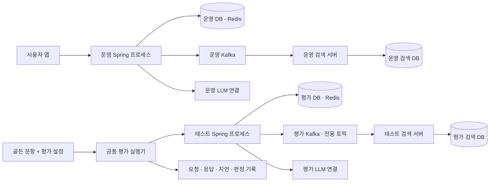
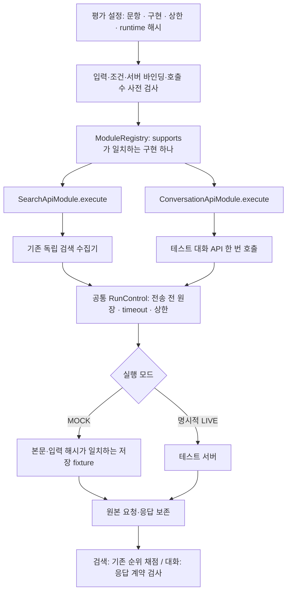
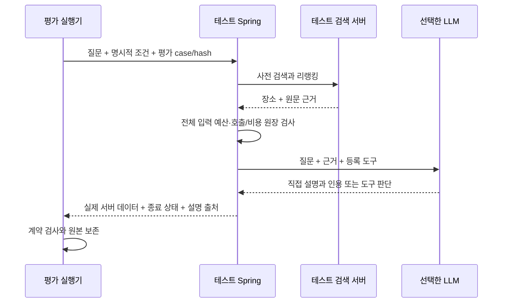

# 백업 복제 대신 모듈을 교체하는 평가 서버

TravelMate 평가에서는 코드 수정과 실제 실행 환경 준비가 섞였다. 버전마다 런타임을 복사하면서 새 서버가 이전 정책 파일을 읽는 문제가 발생했다. 이전 원장이 이미 존재해 `CREATE_NEW`가 호출을 차단했고, 모델 평가 전에 실행이 끝났다.

해결 방향은 코드 이력은 Git에 남기고, 테스트 서버 하나에서 구현과 설정을 선택하는 것이다. 운영 서버와 테스트 서버는 분리하되, 테스트 버전마다 프로젝트 전체를 복제하지 않는다.

## 운영과 평가를 나누는 경계

양쪽 Spring은 같은 소스에서 실행한다. 테스트는 `evaluation` 프로필을 사용하고, 별도 포트·인증 키·DB·Redis·Kafka broker/topics·검색 endpoint를 지정한다. 테스트 실행기는 운영 설정을 기본값으로 물려받지 않는다.

평가 LLM 연결이 별도의 모델 사본을 뜻하지는 않는다. OpenAI는 평가용 키와 기존 비용 정책을 사용하고, Qwen은 평가용 endpoint와 정확한 토큰 계산기 설정을 사용한다. 모델을 버전별로 다운로드하거나 실행기가 새 LLM을 자동 호스팅하지 않는다.

## 모듈을 선택하는 공통 실행 경로

검색을 임베딩 순위와 리랭킹 순위로 비교할 때는 같은 `SearchApiModule`에 `ranking_mode`만 다르게 전달한다. 두 동작을 위한 서버 폴더나 실행기 사본은 필요 없다. 새로운 평가 경로가 필요하면 `EvaluationModule`의 `supports`, `request`, `execute`를 구현하고 레지스트리에 등록한다.

모델·프롬프트·근거 준비는 서버의 기존 LLM 및 근거 전략이 담당한다. 실행기의 `backend_profile`은 선택한 서버 설정을 기록·대조하는 값이며 서버를 재설정하는 명령이 아니다. 모델 설정을 바꾸면 같은 테스트 서버를 재기동하고 해당 runtime record를 확인한 뒤 다음 비교를 실행한다. 이번 구현은 무중단 클래스 교체 기능이 아니다.

## 단일 LLM 경로를 평가할 때

평가 실행기는 대화 API를 호출하기 전에 또 검색하거나 별도의 라우팅 LLM을 호출하지 않는다. 검색과 근거 준비는 테스트 Spring이 처리한다. 현재 테스트 프로필은 모델 턴·도구 실행 상한을 각각 1로 두며 단순 장소 안내 두 문항을 확인하는 범위에 맞춘다. 여러 단계 도구 실행이나 비동기 계획 평가는 별도의 범위와 가드 설정이 필요하다.

## 결과를 과장하지 않는 기준

HTTP 200이어도 `COUNT_UNAVAILABLE`와 `SERVER_FALLBACK`이면 LLM 답변 성공이 아니다. 대화 모듈은 종료 상태, 설명 출처, 모델 턴, 추가 도구 실행 여부, 기대 응답 타입과 인용 존재를 검사한다. 이 검사는 인용의 의미 정확성을 판정하지 않는다.

검색 모듈은 기존 순위 채점기를 그대로 사용한다. MOCK·실패·코퍼스/설정 미확인은 실제 품질 지표와 지연 분모에서 제외한다. 대화의 내부 검색·추론 횟수는 서버 이벤트를 수집하지 않은 상태에서 추정하지 않는다.

결과 폴더에는 커밋·설정 해시·입력과 요청·응답·원장·측정값만 남긴다. 코드·가상환경·JAR은 넣지 않는다. 이전 원장은 삭제하거나 재사용하지 않는다. 재생성할 수 없는 원본과 단순 중복 사본도 구분한다.

## 구현과 검증 범위

이번 변경은 Python 공통 평가 실행기, 검색/대화 구현 클래스, 오프라인 fixture 예시, 별도 Spring 평가 프로필과 기동 전 검사다. 기존 검색 수집·채점 및 서버 예산 가드는 유지한다.

오프라인 검증은 모듈 선택, 요청·입력 해시, 한국어 원문 보존, 실패 시 후속 문항 중단, 호출 상한, 기존 원장 재사용 거부와 설정 분리를 대상으로 한다. 실제 서버 기동·DB 연결·모델 호출·검색 품질/지연 실측은 이번 구현 검증에 포함하지 않는다.

2026-11-04 확인한 관련 Python 회귀는 **75개 통과**다. 새 모듈/테스트 서버 검사 23개와 기존 필터·수집·Qwen 계약·judge/게시 가드 회귀를 포함한다. CLI 예시도 두 문항×두 검색 모드의 MOCK 실행을 완료했고 외부 전송은 0회였다. 이 수치를 실제 모델의 정답률이나 테스트 서버의 통합 기동 성공률로 해석하지 않는다.

실행 명령과 설정 계약은 [모듈 평가 안내](../../Evaluation/experiments/README.md)에 정리했다.
