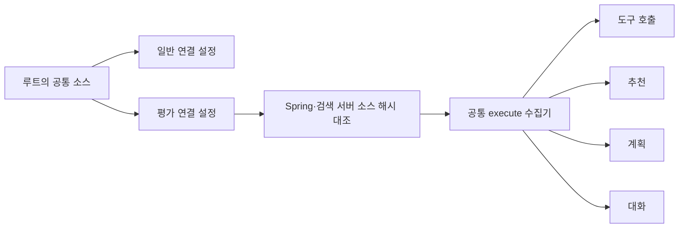

# 서버는 하나의 파이프라인, 평가는 네 단위로

과거 B안은 LLM이 검색을 골랐고, 최신 서버는 먼저 검색해 원문을 LLM에 주었다.
같은 평가 이름을 사용해도 이 둘의 결과는 같은 구조를 검증한 결과가 아니었다.
공통 소스를 실행하고 실행 중인 서버의 소스 해시를 확인하는 절차가 필요했다.

모듈은 검색·근거 구성·프롬프트·모델 호출의 실제 동작을 나눈다. 설정만 다른 경우 구현 클래스를 복제하지 않는다.
과거 버전은 Git에 남기고 새 실행 폴더에는 입력·출력·측정값만 저장한다.
`TestLogPath`와 정적 `(Enum, lambda)` 배열은 파일 종류와 기록 함수를 한 쌍으로 관리한다.

요청은 위치·반경 등 확정 메타데이터로 장소를 거른 뒤 질문 임베딩·벡터 검색·리랭킹을 수행한다.
그 결과의 원문과 질문을 같은 LLM에 주고 대화·추천·계획 도구 선택을 판단한다.
분류 값은 서버 enum을 UI·검증·도구 계약이 공유하며, 원문 인용의 ID와 실제 문자열 소속을 확인한다.
Strict JSON은 형식의 일치를 강화한다. 추천 이유가 사실인지, 여행 조건에 맞는지는 별도 평가다.

응답에는 질문에 대한 `message`, 의도, 감정, 배열 결과가 있다.
추천 하나도 배열이고, 완성된 계획은 초안 배열 안의 방문지 배열로 전달한다.
작업 접수는 완성된 계획으로 바꾸지 않는다. 캐릭터의 감정 태그는 원본 이미지 10개와 매핑한다.

검사 수가 늘었다고 실제 모델 품질을 통과시킨 것은 아니다. 이번 자동 검사는 공통 코드와 평가기·UI 계약을 검증한다.
MOCK는 실제 품질 성공으로 집계하지 않으며, 인용문이 원문에 있다는 이유만으로 잘못된 주장을 통과시키지 않는다.
실제 모델 실행은 동일 소스·전용 DB·모델·예산·관측이 준비된 환경에서 도구 호출부터 시작해야 한다.

[구현 계약·실행법·아직 검증하지 않은 범위](../architecture/unified-conversation-evaluation.md)에 한계까지 기록했다.
